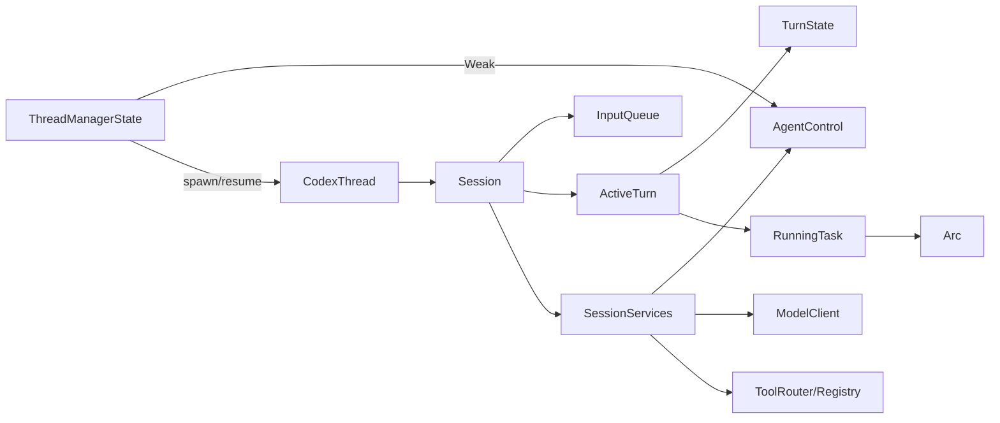
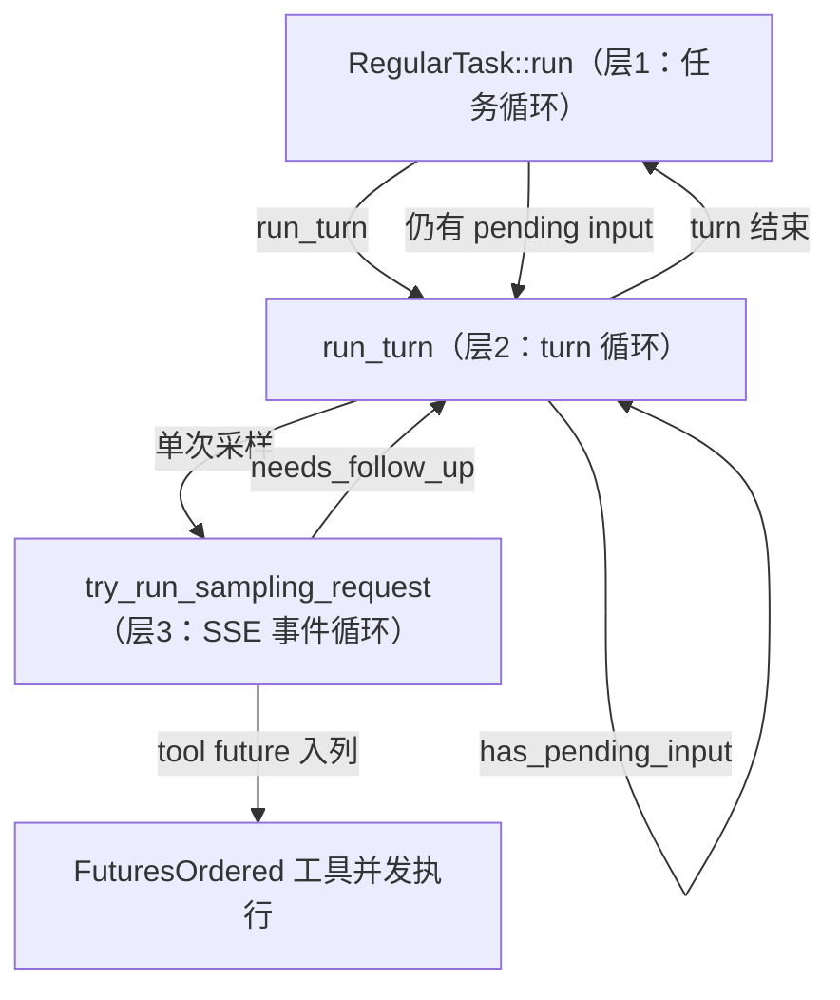
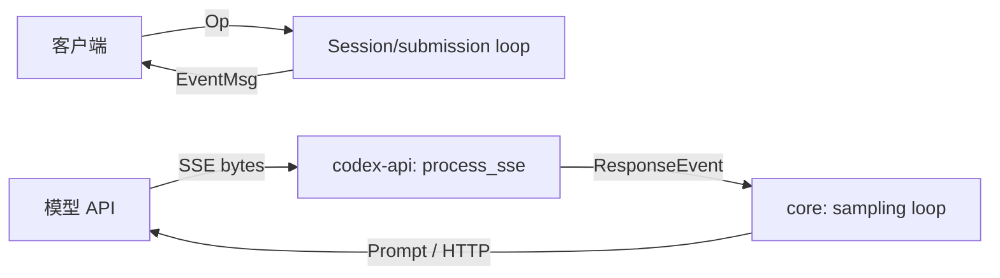
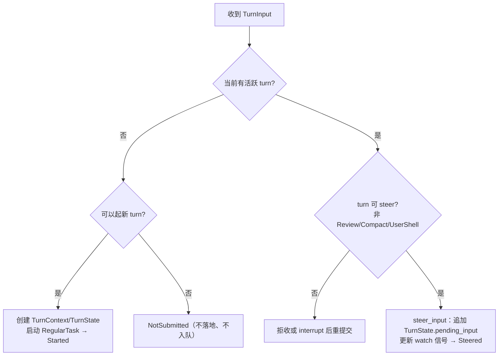
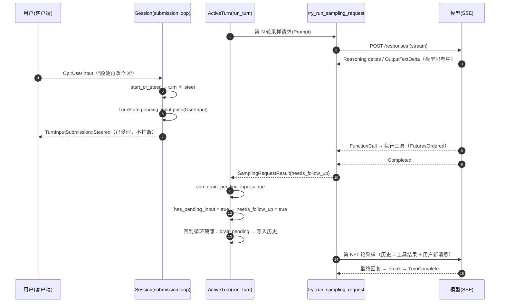
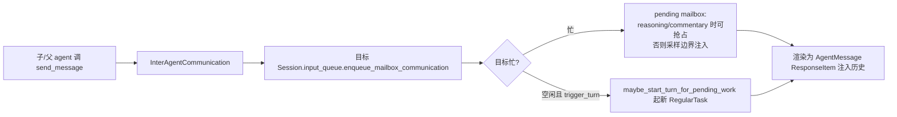
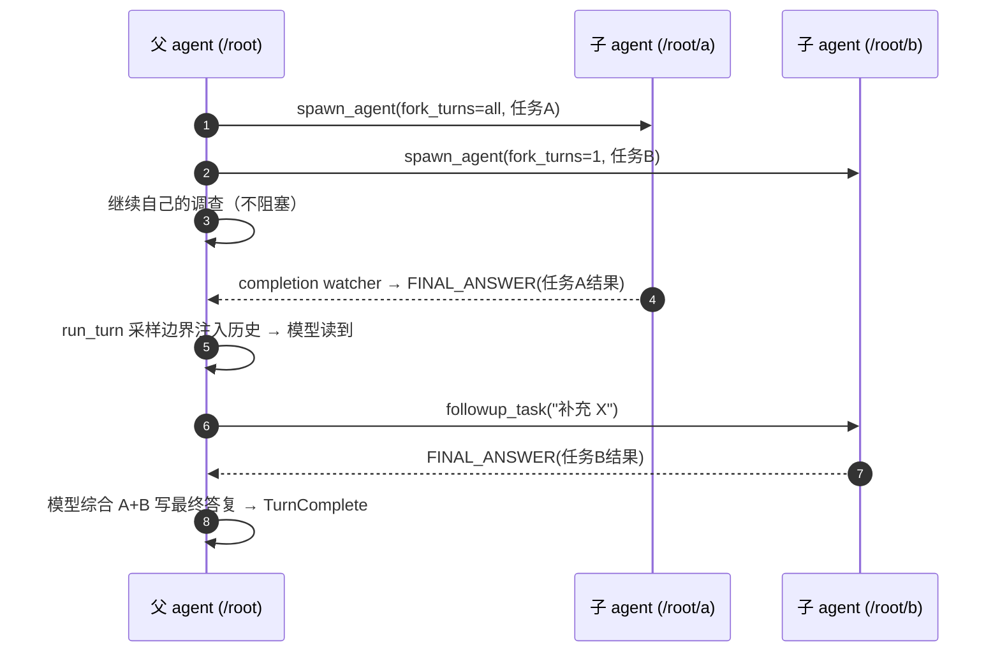

# Codex 核心技术架构：Agent Harness 原理与实现

> 基于 codex-rs（release-0.151.0）源码整理。
> 所有引用标注 `文件:行号`，路径以 `codex-rs/` 为根。
> 内容分两条线：先讲 Agent Harness 的通用原理，再逐层落到 Codex 的具体实现（控制循环、统一协议、输入与 steering、工具系统、上下文管理、multi-agent 协作）。

---

## 目录

- [1. Agent Harness 原理](#1-agent-harness-原理)
  - [1.1 什么是 Agent Harness](#11-什么是-agent-harness)
  - [1.2 通用原理与取舍](#12-通用原理与取舍)
  - [1.3 原理 → Codex 映射](#13-原理--codex-映射)
- [2. Codex 总体架构](#2-codex-总体架构)
  - [2.1 定位与能力](#21-定位与能力)
  - [2.2 分层与 crate 地图（节选）](#22-分层与-crate-地图节选)
  - [2.3 核心概念词汇表](#23-核心概念词汇表)
- [3. 运行时对象模型](#3-运行时对象模型)
  - [3.1 对象链路](#31-对象链路)
  - [3.2 `CodexThread`：外部 API 门面](#32-codexthread外部-api-门面)
  - [3.3 `Session` 与提交循环](#33-session-与提交循环)
  - [3.4 `ActiveTurn` / `TurnState` / `RunningTask`](#34-activeturn--turnstate--runningtask)
  - [3.5 任务抽象：RPITIT + 手动 dyn 擦除](#35-任务抽象rpitit--手动-dyn-擦除)
- [4. Agent Loop：控制循环的实现](#4-agent-loop控制循环的实现)
  - [4.1 三层循环总览](#41-三层循环总览)
  - [4.2 层 1：`RegularTask::run` —— 防丢输入的兜底循环](#42-层-1regulartaskrun--防丢输入的兜底循环)
  - [4.3 层 2：`run_turn` —— turn 级循环与"采样边界"](#43-层-2run_turn--turn-级循环与采样边界)
  - [4.4 层 3：`try_run_sampling_request` —— SSE 事件循环](#44-层-3try_run_sampling_request--sse-事件循环)
  - [4.5 Turn 生命周期与中止](#45-turn-生命周期与中止)
- [5. 模型交互协议](#5-模型交互协议)
  - [5.1 入参：`Prompt`](#51-入参prompt)
  - [5.2 历史条目：`ResponseItem`](#52-历史条目responseitem)
  - [5.3 出参：`ResponseEvent`](#53-出参responseevent)
  - [5.4 客户端协议：`EventMsg`](#54-客户端协议eventmsg)
- [6. 输入模型与 Steering](#6-输入模型与-steering)
  - [6.1 输入的类型：`TurnInput`](#61-输入的类型turninput)
  - [6.2 提交决策：`start_or_steer`](#62-提交决策start_or_steer)
  - [6.3 pending input 的消费时机（关键状态机）](#63-pending-input-的消费时机关键状态机)
  - [6.4 运行中用户消息的完整时序](#64-运行中用户消息的完整时序)
  - [6.5 例外：多 agent mailbox 可抢占流](#65-例外多-agent-mailbox-可抢占流)
- [7. 工具系统](#7-工具系统)
  - [7.1 三层结构](#71-三层结构)
  - [7.2 并发执行与串行闩锁](#72-并发执行与串行闩锁)
  - [7.3 工具列表按 turn/step 动态构建](#73-工具列表按-turnstep-动态构建)
  - [7.4 审批与沙箱（概览）](#74-审批与沙箱概览)
- [8. 上下文管理与持久化](#8-上下文管理与持久化)
  - [8.1 历史与 prompt 视图](#81-历史与-prompt-视图)
  - [8.2 压缩（Compaction）](#82-压缩compaction)
  - [8.3 上下文注入规范（AGENTS.md 摘录）](#83-上下文注入规范agentsmd-摘录)
  - [8.4 持久化与可观测性](#84-持久化与可观测性)
- [9. Multi-Agent 协作](#9-multi-agent-协作)
  - [9.1 概念模型：`AgentPath` 树](#91-概念模型agentpath-树)
  - [9.2 控制面：`AgentControl`](#92-控制面agentcontrol)
  - [9.3 spawn 流程](#93-spawn-流程)
  - [9.4 通信：`InterAgentCommunication` + mailbox](#94-通信interagentcommunication--mailbox)
  - [9.5 完成回传：completion watcher 与 FINAL_ANSWER](#95-完成回传completion-watcher-与-final_answer)
  - [9.6 工具清单：V1 vs V2](#96-工具清单v1-vs-v2)
  - [9.7 资源约束与生命周期](#97-资源约束与生命周期)
  - [9.8 结果聚合：去中心化设计](#98-结果聚合去中心化设计)
- [10. 设计要点与工程取舍](#10-设计要点与工程取舍)
- [11. 关键文件索引](#11-关键文件索引)
- [12. 深挖路线图](#12-深挖路线图)

---

## 1. Agent Harness 原理

### 1.1 什么是 Agent Harness

LLM 本身只会"文本进、文本出"。要让它在真实环境里完成编码任务（读写文件、跑命令、搜索、长任务编排），需要一个外层运行时把它包起来——这个运行时就是 **agent harness（智能体脚手架）**。

一个完整的 coding agent harness 必须解决七件事：

| # | 职责 | 核心问题 |
|---|---|---|
| 1 | **控制循环（Agent Loop）** | 如何反复"请求模型 → 执行工具 → 回灌结果"，直到任务完成 |
| 2 | **统一协议** | 模型输入/输出、工具调用、会话事件如何用一套数据结构表达 |
| 3 | **工具执行** | 工具如何注册、路由、并发、审批、限权 |
| 4 | **上下文管理** | 历史如何累积、何时压缩、如何避免超窗与缓存失效 |
| 5 | **输入与中断** | 运行中新输入（steer）、打断、取消如何安全生效 |
| 6 | **多 Agent 协作** | 如何派生、通信、回收子 agent，结果如何汇总 |
| 7 | **可靠性与可观测** | 输入不丢、状态可恢复、成本有界、全链路可追踪 |

### 1.2 通用原理与取舍

**控制循环**：本质是一个状态机：`模型输出 → 解析（文本 or 工具调用）→ 工具结果作为新输入 → 再请求模型`。循环边界通常不是"单次请求"，而是"任务"（turn）：一轮里可能包含多次采样和多个工具调用。健壮的实现需要多层循环——任务层（保证输入不丢）、turn 层（管理采样边界）、采样层（消费流式事件），这是 Codex 采用的结构。

**统一协议**：优秀 harness 会让"历史条目"、"模型输入"、"工具调用结果"用同一种数据模型表达（Codex 用 `ResponseItem`），否则每加一个概念都要维护平行协议。

**输入与 steer 语义**：用户可能在模型思考中途发言。主流设计有两条路线：
- *打断式*：取消当前请求，立刻重启——时延低但破坏流状态、浪费已计算的推理；
- *排队式*：输入进队列，在"安全的采样边界"（本轮输出与工具全部完成）注入——不打断、无损、可预测。
  健壮 harness 还会定义*例外抢占*（如子 agent 完成通知可在思考期插队）与*不可 steer 场景*（压缩/审查等特殊 turn）。

**多 Agent**：核心设计问题是隔离与聚合。隔离包括：独立上下文（防止相互污染）、独立并发配额、树的深度/数量上限；聚合有两种哲学：
- *确定性聚合*（merge/join 的显式语义，如 map-reduce）；
- *去中心化聚合*（子结果作为消息回到父 agent，由父 LLM 阅读判断）。
  后者简单、通用、与模型能力同步进化，但依赖父模型的编排质量——Codex 选择后者。

**可靠性**：输入永不丢失（队列 + 兜底重启 + 落盘）、取消可传播（取消令牌贯穿全栈）、资源 RAII（drop 即释放）、全链路 span/指标。

### 1.3 原理 → Codex 映射

| 原理 | Codex 落地 |
|---|---|
| 多层控制循环 | `RegularTask::run` → `run_turn` → `try_run_sampling_request`（§4） |
| 统一数据模型 | `ResponseItem`（历史/输入/agent 消息/压缩标记复用，§5） |
| 双协议分层 | 模型侧 `ResponseEvent`、客户端侧 `EventMsg`（§5） |
| 排队式 steer + 例外抢占 | `pending_input` 队列 + mailbox `preempt_for_mailbox_mail`（§6） |
| 工具契约与并发 | `ToolExecutor` + `RwLock<()>` 闩锁 + `FuturesOrdered`（§7） |
| 多层压缩与上下文有界 | pre-turn/mid-turn/manual compaction + `fork_turns` 截断继承（§8） |
| 去中心化 multi-agent 聚合 | mailbox 投递 FINAL_ANSWER，父 LLM 判断（§9） |
| 取消与资源 RAII | `CancellationToken`、`AbortOnDropHandle`、`AgentExecutionGuard`（§3/§4） |

---

## 2. Codex 总体架构

### 2.1 定位与能力

Codex 是一个本地运行的 coding agent harness：

- **模型侧**：把本地会话历史/工具清单组装成 Responses API 请求，流式消费模型事件，执行工具并回灌结果，直到模型给出最终答复。
- **客户端侧**：以统一事件流（`EventMsg`）向 CLI、TUI、app-server（IDE/云端前端）暴露状态。
- **能力侧**：文件读写、shell、apply patch、MCP、沙箱与审批、多 agent 协作。

### 2.2 分层与 crate 地图（节选）

```text
入口层        cli / tui / app-server / exec / mcp-server / cloud-tasks...
                  │  Op（用户意图）          ▲  EventMsg（统一事件）
                  ▼                          │
编排层        core（codex-core）
              ├─ session/     会话与 turn 生命周期、输入队列、steering
              ├─ tasks/       任务类型（Regular/Review/Compact/UserShell）
              ├─ agent/       多 agent 控制面（control/registry/residency）
              ├─ tools/       工具注册、路由、并发执行、处理器
              └─ state/       ActiveTurn / TurnState / RunningTask
                  │
协议层        protocol（codex-protocol）     client_common（Prompt）
              codex-api（HTTP/SSE/WS 传输与 ResponseEvent）
                  │
能力层        tools（ToolExecutor 抽象）/ sandboxing / codex-mcp / connectors
                  │
基础设施      async-utils / otel / analytics / features / history
              thread-store / agent-graph-store / context-fragments ...
```

关键点：`core` 被刻意控制体积，新概念优先拆 crate（AGENTS.md 明确要求）；协议类型（`protocol`）与传输（`codex-api`）与应用编排（`core`）解耦。

### 2.3 核心概念词汇表

| 概念 | 类型（示例） | 含义 |
|---|---|---|
| **Thread** | `CodexThread` | 一段可恢复的会话（rollout 持久化单位） |
| **Session** | `Session` | thread 的运行时，持有输入队列、历史、工具运行时 |
| **Turn** | `TurnContext.sub_id` | 用户在 UI 上感知的"一次任务"，一个 turn 内可多次采样 |
| **Task** | `RegularTask/ReviewTask/CompactTask/UserShellCommandTask` | turn 的执行载体（`SessionTask` trait） |
| **Step** | `StepContext` | 一次采样请求的"世界快照"（模型、可用工具、环境） |
| **Item** | `ResponseItem` / `TurnItem` | 对话历史条目 / UI 流式条目 |
| **Op** | `protocol::Op` | 客户端提交的意图（UserTurn、Interrupt、Compact...） |
| **Event** | `EventMsg` | core 向客户端广播的统一事件 |

---

## 3. 运行时对象模型

### 3.1 对象链路



### 3.2 `CodexThread`：外部 API 门面

`core/src/codex_thread.rs`：

```rust
pub async fn submit(&self, op: Op) -> CodexResult<String>;                 // :257 通用入口
pub async fn start_or_steer_turn(&self, request: TurnInputRequest)          // :348 推荐入口
    -> CodexResult<TurnInputSubmission>;
pub async fn start_turn_if_idle(...) -> CodexResult<StartIfIdleSubmission>; // :360
pub async fn agent_status(&self) -> AgentStatus;                            // :591
```

`TurnInputSubmission` 三态：`Started { turn_id }` / `Steered { .. }` / `NotSubmitted { reason }`（`codex_thread.rs:368-377`）——"提交输入"这个动作本身就承载 harness 的核心语义：**要么起新 turn、要么并入活动 turn、要么明确拒收**（绝不静默丢弃）。

### 3.3 `Session` 与提交循环

- `Op` 由 `SessionIo::submit` 进入 session 的 submission loop（`core/src/session/handlers.rs` 等按 `Op` 分派）。
- `Session` 持有：`active_turn: Mutex<Option<ActiveTurn>>`、`input_queue: InputQueue`、`services: Arc<SessionServices>`（模型客户端、telemetry、agent_control、工具运行时……）。

### 3.4 `ActiveTurn` / `TurnState` / `RunningTask`

`core/src/state/turn.rs`：

```rust
pub(crate) struct ActiveTurn {            // :32
    pub(crate) task: Option<RunningTask>,
    pub(crate) turn_state: Arc<Mutex<TurnState>>,
}

pub(crate) enum MailboxDeliveryPhase {    // :49
    StartOfTurn,
    CurrentTurn,
    NextTurn,
}

pub(crate) enum TaskKind { Regular, Review, Compact, /* ... */ }   // :68

pub(crate) struct RunningTask {           // :74
    pub(crate) done: Arc<Notify>,
    pub(crate) handle: AbortOnDropHandle<()>,          // drop=abort
    pub(crate) kind: TaskKind,
    pub(crate) task: Arc<dyn AnySessionTask>,          // 类型擦除后的任务
    pub(crate) cancellation_token: CancellationToken,  // 取消传播
    pub(crate) turn_context: Arc<TurnContext>,
    _agent_execution_guard: AgentExecutionGuard,       // 并发配额（RAII）
    _diagnostics_guard: GaugeGuard,                    // 指标（RAII）
    _timer: Option<Timer>,
}

pub(crate) struct TurnState {             // :89
    pending_input: TurnInputQueue,
    mailbox_delivery_phase: MailboxDeliveryPhase,
    token_usage_at_turn_start: TokenUsage,
    tool_calls: usize,
    ...
}
```

设计要点：**一个 Session 同时最多一个 ActiveTurn**（`active_turn: Mutex<Option<..>>`），"新 turn 替换旧 turn"通过 `abort_all_tasks(TurnAbortReason::Replaced)` 实现（`tasks/mod.rs:275`）。

### 3.5 任务抽象：RPITIT + 手动 dyn 擦除

`core/src/tasks/mod.rs`：

```rust
pub(crate) trait SessionTask: Send + Sync + 'static {          // :177
    fn kind(&self) -> TaskKind;
    fn run(self: Arc<Self>, session: Arc<Session>, ctx: Arc<TurnContext>,
           input: Vec<TurnInput>, cancellation_token: CancellationToken,
    ) -> impl Future<Output = SessionTaskResult> + Send;       // RPITIT
}

pub(crate) trait AnySessionTask: Send + Sync + 'static {       // :219 面向 dyn
    fn run(self: Arc<Self>, ...) -> BoxFuture<'static, SessionTaskResult>;
}

impl<T: SessionTask> AnySessionTask for T { ... Box::pin(SessionTask::run(...)) }  // :235
```

任务注册与启动（`tasks/mod.rs:269-413`）：

```text
spawn_task(task)
  ├─ abort_all_tasks(Replaced)          // 旧任务取消
  ├─ start_task
  │   ├─ drain mailbox → TurnState.pending_input
  │   ├─ cancellation_token = CancellationToken::new()
  │   ├─ agent_execution_guard（并发配额）
  │   ├─ tokio::spawn(task.run(...).instrument(span "turn"))
  │   └─ ActiveTurn.task = RunningTask { done: Notify, AbortOnDropHandle, ... }
  └─ on_task_finished（统一收尾：flush rollout、TurnAborted/错误、pending 处理）
```

任务类型（`tasks/mod.rs:1-66`）：

| 任务 | 文件 | 用途 | 可 steer？ |
|---|---|---|---|
| `RegularTask` | `tasks/regular.rs` | 常规对话 turn | ✅ |
| `ReviewTask` | `tasks/review.rs` | code review 流程 | ❌（`NonSteerableTurnKind::Review`） |
| `CompactTask` | `tasks/compact.rs` | 手动/自动上下文压缩 | ❌ |
| `UserShellCommandTask` | `tasks/user_shell.rs` | `!` shell 直通 | ❌ |

---

## 4. Agent Loop：控制循环的实现

### 4.1 三层循环总览



各层职责：

| 层 | 函数 | 循环条件 | 结束语义 |
|---|---|---|---|
| 1 | `RegularTask::run`（`tasks/regular.rs:76`） | 该 turn 结束后 `input_queue.has_pending_input()` 仍为 true | turn 彻底结束，`on_task_finished` 收尾 |
| 2 | `run_turn`（`turn.rs:304`） | `needs_follow_up = model_needs_follow_up \|\| has_pending_input` | 模型给出最终消息且无待办 |
| 3 | `try_run_sampling_request`（`turn.rs:2203`） | SSE 流未结束 | 一次采样（可能含多个 tool call）完成 |

### 4.2 层 1：`RegularTask::run` —— 防丢输入的兜底循环

`core/src/tasks/regular.rs:39-96`（简化）：

```rust
let mut next_input = input;
loop {
    let last_agent_message = run_turn(
        Arc::clone(&sess), Arc::clone(&ctx), next_input,
        prewarmed_client_session.take(),
        cancellation_token.child_token(),
    ).await?;
    if ctx.terminal_error.lock().await.is_some() { return Ok(last_agent_message); }
    if !sess.input_queue.has_pending_input(&sess.active_turn).await {
        return Ok(last_agent_message);          // 真正结束
    }
    next_input = Vec::new();                     // pending 自己会在新一轮被 drain
}
```

存在意义：新输入恰好落在"`run_turn` 即将返回"的窗口时，输入已被收进 `pending_input` 但来不及被 turn 循环消费——层 1 直接重启一次 `run_turn`，保证**输入永不丢失**。

### 4.3 层 2：`run_turn` —— turn 级循环与"采样边界"

`core/src/session/turn.rs:156-603`。核心骨架：

```rust
// 前置：pre-turn compaction、记录输入、构建首次 StepContext、注入 skills/plugins
let mut can_drain_pending_input = input.is_empty();     // :268

let mut next_step_context = Some(first_step_context);
loop {                                                  // :304
    // (A) 采样前：消费 pending input 并写入历史（仅当允许）
    let pending_input = if can_drain_pending_input {
        sess.input_queue.get_pending_input(&sess.active_turn).await.0
    } else { Vec::new() };                              // :308-315
    run_hooks_and_record_inputs(&sess, &turn_context, &pending_input, ...).await;

    // (B) 构建主张量输入（历史做 for_prompt 处理），发采样
    let sampling_request_input = sess.clone_history().await
        .for_prompt(&step_context.settings.model_info.input_modalities);  // :373-379
    let result = run_sampling_request(...).await;        // :384

    // (C) 采样后决策
    match result {
        Ok(output) => {
            if model_needs_follow_up {                   // 有 tool call 要回灌
                sess.input_queue.accept_mailbox_delivery_for_current_turn(...).await;
            }
            can_drain_pending_input = true;              // :411 采样结束 → 放行 drain
            let has_pending_input = sess.input_queue.has_pending_input(&sess.active_turn).await;
            let needs_follow_up = model_needs_follow_up || has_pending_input;   // :426

            if should_roll_over { /* 上下文超限：compaction 后 continue */ 
                can_drain_pending_input = !model_needs_follow_up;               // :499
                continue;
            }
            if !needs_follow_up {
                last_agent_message = ...;
                /* stop hooks、legacy after-agent hook */
                break;                                   // :562 turn 结束
            }
            continue;                                    // 下一轮采样
        }
        Err(TurnAborted) => return Err(err),
        Err(e) => { /* 发 Error 事件，break，让用户继续对话 */ }
    }
}
```

三个关键变量：

| 变量 | 含义 | 在何处翻转 |
|---|---|---|
| `can_drain_pending_input` | 是否允许在**本轮采样前**把 pending input 写入历史 | 初始 `input.is_empty()`（:268）；采样后 `= true`（:411）；auto-compact 后 `= !model_needs_follow_up`（:499） |
| `model_needs_follow_up` | 来自采样层：是否有未完成的工具调用需要回灌 | `SamplingRequestResult`（:400） |
| `has_pending_input` | 队列里是否有 steer/mailbox 等待注入 | :415-416 |

两个初始条件的含义：

- 初始值 `input.is_empty()`：如果本轮由新输入启动，先让新输入被采样；如果本轮是被 mailbox 唤醒（无输入），先注入 mailbox 再采样。
- auto-compact 后 `!model_needs_follow_up`：压缩完成后若模型还要续 tool 链，先让它续上，避免 steer 插队破坏 tool-call 配对；否则立即注入。

### 4.4 层 3：`try_run_sampling_request` —— SSE 事件循环

`core/src/session/turn.rs:2203` 起。职责：

1. 发请求：`client_session.stream(...)`，拿 SSE `ResponseEvent` 流。
2. 逐事件处理（`match` 穷尽 `ResponseEvent` 变体）：
   - `OutputItemAdded`：建 `TurnItem`，向客户端流式输出；
   - `OutputItemDone`：调用 `handle_output_item_done` → 若是 tool call，返回 `tool_future`，`in_flight.push_back(tool_future)`（`FuturesOrdered`，:2419-2421）；
   - `Completed`：收束。
3. 工具并发：`FuturesOrdered` 保序收集，`drain_in_flight`（:2154）等待全部完成，工具结果写入历史。
4. `needs_follow_up |= output_result.needs_follow_up`（:2425）。
5. **mailbox 抢占检查**（唯一能打断流的地方，:2389-2432）：

```rust
let preempt_for_mailbox_mail = match &item {
    ResponseItem::Message { role, phase, .. } =>
        role == "assistant" && matches!(phase, Some(MessagePhase::Commentary)),
    ResponseItem::Reasoning { .. } => true,        // 模型还在思考：可抢
    ResponseItem::AgentMessage { .. } => false,    // 正在输出最终消息：不抢
    /* 其余全部 false，包括 FunctionCall/Output 等 */
};
...
if preempt_for_mailbox_mail && sess.input_queue.has_pending_mailbox_items().await {
    break Ok(SamplingRequestResult { needs_follow_up: true, last_agent_message });  // :2427
}
```

注意：`AgentMessage`（真实回复文本）出现后不抢占；`Reasoning`（思考中）和 `Commentary`（过程性旁白）可抢——**多 agent 消息能打断思考、但不打断最终输出**。

### 4.5 Turn 生命周期与中止

`Session::on_task_finished`（`tasks/mod.rs:589`）统一收尾：

- `Ok(Some(last_msg))` → 正常结束（`TurnComplete`）；
- `Err(TurnAborted)` → 走 aborted 生命周期（`TurnAbortedEvent`）；
- 其他错误 → `EventMsg::Error` + telemetry；
- 取出剩余 `pending_input` 并 `run_hooks_and_record_inputs` 落盘（保证输入不丢）；
- 指标（token usage、tool calls、network proxy）统一 emit。

Abort 路径（`tasks/mod.rs:512-587`）：

```text
abort_all_tasks(reason)
  ├─ take_active_turn → task.cancellation_token.cancel() → abort() 钩子
  ├─ emit TurnAbort 生命周期事件
  ├─ input_queue.clear_pending（先让任务观察到取消，再清 pending）
  └─ 若 reason == Interrupted → maybe_start_turn_for_pending_work()（mailbox 唤醒新 turn）
```

`maybe_start_turn_for_pending_work`（`tasks/mod.rs:430-510`）：session 空闲且 mailbox 有 `trigger_turn` 邮件（或有 durable sleep）时，直接起一个 `RegularTask` 把邮件变成新 turn。

`GRACEFULL_INTERRUPTION_TIMEOUT_MS = 100`（`tasks/mod.rs:68`）：中断后给任务最多 100ms 优雅收尾。

---

## 5. 模型交互协议

### 5.1 入参：`Prompt`

`core/src/client_common.rs:19`：

```rust
pub struct Prompt {
    pub input: Vec<ResponseItem>,          // 全部对话上下文（历史+输入）
    pub(crate) tools: Arc<[ToolSpec]>,     // 本 step 的可用工具
    pub(crate) parallel_tool_calls: bool,
    pub base_instructions: BaseInstructions,   // 系统提示词
    pub output_schema: Option<Value>,      // 结构化输出（JSON schema）
    pub output_schema_strict: bool,
    pub(crate) cyber_access_program: Option<...>,
}
```

要点：**对模型而言没有"消息列表"概念，只有扁平的 `Vec<ResponseItem>` 序列**——user 消息、assistant 消息、reasoning、工具调用/结果、压缩标记……都是同一枚举的变体。

### 5.2 历史条目：`ResponseItem`

`protocol/src/models.rs:975` 附近，变体包括：

```text
Message{role, phase, content}       // 对话消息（phase 区分 commentary/final）
Reasoning{...}                      // 思考（含 summary/encrypted content）
FunctionCall / FunctionCallOutput   // 普通函数工具
CustomToolCall / ...Output          // 自定义工具（apply_patch 等）
LocalShellCall / ToolSearchCall / WebSearchCall / ImageGenerationCall
AgentMessage{...}                   // 多 agent 消息（v2）
Compaction / CompactionTrigger / ContextCompaction   // 压缩相关
AdditionalTools / Other
```

### 5.3 出参：`ResponseEvent`

`codex-api/src/common.rs:98`（全部变体）：

```rust
pub enum ResponseEvent {
    Created,
    SafetyBuffering(SafetyBuffering),
    OutputItemDone(ResponseItem),
    OutputItemAdded(ResponseItem),
    ServerModel(String),
    ModelVerifications(Vec<ModelVerification>),
    TurnModerationMetadata(TurnModerationMetadataEvent),
    ServerReasoningIncluded(bool),
    Completed { response_id, token_usage, usage_metadata, end_turn },
    OutputTextDelta(String),
    ToolCallInputDelta { item_id, call_id, delta },     // 工具参数流式增量
    ReasoningSummaryDelta { delta, summary_index },
    ReasoningSummaryDone { item_id, text, summary_index },
    ReasoningContentDelta { delta, content_index },
    ReasoningSummaryPartAdded { summary_index },
    RateLimits(RateLimitSnapshot),
    ModelsEtag(String),
}
```

传输层把 SSE 字节流（`response.output_text.delta` 等）映射成该枚举（`codex-api/src/sse/responses.rs` 的 `process_sse`），也支持 Responses WebSocket（`codex-api/src/endpoint/responses_websocket.rs`）。上层只消费 `ResponseEvent`，**不感知 HTTP/SSE 细节**。

### 5.4 客户端协议：`EventMsg`

`protocol/src/protocol.rs:1335`，例如：

```text
TurnStarted / TurnComplete / TurnAborted
AgentMessageEvent / AgentMessageDeltaEvent / UserMessageEvent
ReasoningContentDeltaEvent / ReasoningSummaryDeltaEvent
ExecCommandBegin/End、ApplyPatch 事件、TokenCount、Error、Warning ...
```

三层协议关系：



**总结**：内部（模型交互）与外部（客户端）各自有统一协议，`ResponseItem` 是贯穿两层的核心数据模型（历史持久化、多 agent 消息、压缩标记都复用）。

---

## 6. 输入模型与 Steering

### 6.1 输入的类型：`TurnInput`

`core/src/session/input_queue.rs:22`：

```rust
pub enum TurnInput {
    UserInput { content: Vec<UserInput>, client_id: Option<String> },  // 用户消息
    FunctionCallOutput(ResponseItem),                                  // 工具直答
    ResponseItem(#[serde(with = "turn_input_response_item")] ResponseItemEnvelope), // 注入
    InterAgentCommunication(InterAgentCommunication),                  // 多 agent 邮件
}
```

### 6.2 提交决策：`start_or_steer`

`CodexThread::start_or_steer_turn`（`codex_thread.rs:348`）→ `submit_turn_input_with_mode(TurnInputMode::StartOrSteer)` 的核心逻辑（`core/src/session/turn_input.rs:232` 起）：



`steer_input`（`turn_input.rs:546`）做三件事：

1. 追加到活动 `TurnState.pending_input`（`TurnInputQueue`）；
2. 更新 `InputQueue.activity_tx`（`watch` 通道）→ 通知所有 `subscribe_activity` 观察者（如 `wait_agent`、`sleep` 工具会因此被唤醒）；
3. 回复客户端 `Steered`。

### 6.3 pending input 的消费时机（关键状态机）

单个 turn 内 `pending_input` 只会在以下三个时点被 drain：

| # | 时点 | 代码位置 | 条件 |
|---|---|---|---|
| 1 | turn 开始时 | `turn.rs:268/308` | `can_drain_pending_input = input.is_empty()`（本轮由空输入唤醒才先 drain） |
| 2 | 每次采样结束后、下一轮采样前 | `turn.rs:411/304` | 采样结束置 `true`，回到循环顶部 drain |
| 3 | auto-compact 之后的下一轮 | `turn.rs:499/308` | `= !model_needs_follow_up`（若模型还要续 tool 链则延后） |

以及层 1 兜底：`run_turn` 返回后若队列非空 → `RegularTask` 重启 `run_turn`（`tasks/regular.rs:91`）。

### 6.4 运行中用户消息的完整时序



行为总结（用户视角）：

- 消息**立即被受理**（`Steered` 应答），但**不会打断**当前采样：模型本轮思考照常进行完；
- 用户消息在"本轮模型输出 + 所有工具调用全部结束"后、下一轮采样前进入历史；
- 若显式 interrupt（`Op::Interrupt`），当前任务被取消（`TurnAborted`），随后 pending 输入会触发新 turn（或被 `RegularTask` 层重启）；见 `tasks/mod.rs:512-539`。
- Review/Compact/UserShell turn 拒绝 steer（`NonSteerableTurnKind`，`protocol.rs:1810`）。

### 6.5 例外：多 agent mailbox 可抢占流

- 普通用户 steer 只在采样边界生效（§6.3），**永不打断流**；
- 但 **`InterAgentCommunication` mailbox** 可以：在 `Reasoning` 或 `Commentary` 阶段，模型收到第一条 mailbox 消息即中断本次采样（`needs_follow_up=true`），立即开始下一轮（`turn.rs:2389-2432`）。
- 交付阶段由 `MailboxDeliveryPhase` 管理（`state/turn.rs:49`）：`StartOfTurn` / `CurrentTurn` / `NextTurn`，`accept_mailbox_delivery_for_current_turn`（`state/turn.rs:218`）把投递窗口限定在"当前 turn 内可注入"。
- 设计意图：多 agent 编排对时延敏感（父 agent 等待多个子任务），而人类手动输入不急于打断 1-2 秒的思考——两类输入故意用了**不同抢占策略**。

---

## 7. 工具系统

### 7.1 三层结构

```text
ToolSpec（模型可见描述/JSON schema）
   ↑ 由
ToolExecutor<Invocation>（执行契约，tools/src/tool_executor.rs:106）
   ├─ tool_name / spec / exposure / search_info / supports_parallel_tool_calls
   └─ handle(invocation) -> ToolExecutorFuture  （Pin<Box<dyn Future>>，:11/:127）
   ↑ 注册进
ToolRegistry（core/src/tools/registry.rs）→ ToolRouter（turn 内路由）
```

`ToolExposures` 用 bitflags 描述暴露面（`tool_executor.rs:14`）：`DIRECT`（首屏工具列表）/ `DEFERRED`（tool search 发现）/ `CODE_MODE`（嵌套脚本内可调用）。

### 7.2 并发执行与串行闩锁

`core/src/tools/parallel.rs`：

```rust
pub(crate) struct ToolCallRuntime {          // :41
    session: Arc<Session>,
    step_context: Arc<StepContext>,          // 保留"广告出该工具的那次 step"上下文
    tracker: SharedTurnDiffTracker,
    parallel_execution: Arc<RwLock<()>>,     // :46 读=可并发，写=独占
}
```

- 支持并行的工具拿读锁并发执行；需要独占的工具（如涉及工作区 diff 一致性）拿写锁串行。
- 采样层用 `FuturesOrdered` 保持"按提交顺序收集"。
- 工具结果不是直接发回模型，而是转成 `ResponseItem::FunctionCallOutput` 写入历史，等下一轮 `run_turn` 打包进 `Prompt.input`。

### 7.3 工具列表按 turn/step 动态构建

`core/src/tools/spec_plan.rs` 是"本 step 给模型看哪些工具"的决策点。多 agent 工具的门控示例（`spec_plan.rs:645-702`）：

```rust
fn collab_tools_enabled(...) -> bool {
    match turn_context.multi_agent_version {
        MultiAgentVersion::Disabled => false,
        MultiAgentVersion::V1 => !exceeds_thread_spawn_depth_limit(...),   // 深度上限
        MultiAgentVersion::V2 => /* 顶层 or 模型声明支持 v2 */,
    }
}
// V1 管理工具: send_input / wait_agent / resume_agent / close_agent
// V2 管理工具: send_message / followup_task / interrupt_agent / list_agents
//              (+ 可选 wait_agent，由 config.multi_agent_v2.wait_agent_enabled 控制)
```

### 7.4 审批与沙箱（概览）

- 沙箱：`sandboxing` crate（Seatbelt/Landlock 等平台实现），由 `Environment` 选择策略；
- 审批：工具执行前经 approval 管道（`EventMsg::ExecApprovalRequest` 上行，客户端回 `Op::ExecApproval`）；
- unified_exec：统一执行入口（`tools/handlers/unified_exec`），聚合 shell/后台进程/PTY。

---

## 8. 上下文管理与持久化

### 8.1 历史与 prompt 视图

- 历史是全量 `ResponseItem` 序列（含 reasoning、工具输出、压缩标记）。
- 发请求前做 `for_prompt(...)` 变换（`turn.rs:373-379`）：按模型支持的输入模态过滤/转换（例如 reasoning 的保留策略），而不是重写历史。

### 8.2 压缩（Compaction）

- 触发：pre-turn（turn 开始前）、mid-turn（`should_roll_over`，`turn.rs:461-501`）、手动 `Op::Compact`（`CompactTask`）；
- 机制：用模型生成总结，插入 `ResponseItem::Compaction`，后续请求用压缩后的历史；
- auto-compact 与 steer 的交互：`can_drain_pending_input = !model_needs_follow_up`（先保 tool 链完整）。

### 8.3 上下文注入规范（AGENTS.md 摘录）

对注入模型的每段内容有硬性要求：必须是 `core/context` 中实现 `ContextualUserFragment` 的 struct、有界大小、单项 <10K tokens、单条 >1K tokens 需额外审查、禁止历史重写（只增量追加）、避免频繁变更导致 prompt cache miss。

### 8.4 持久化与可观测性

- **Rollout**：thread 的事件/条目持久化（`codex_thread_store`），`flush_rollout` 在任务收尾时强制落盘（`tasks/mod.rs:376`）；
- **Session store / agent-graph-store**：多 agent 的 spawn 边与状态（`ThreadSpawnEdgeStatus`）；
- **Telemetry**：`codex-otel` 指标（turn 时长、token usage、tool call 数、mailbox 深度）+ `#[tracing::instrument]` span 树；
- **Analytics**：`TurnProfileFact` / `TurnTokenUsageFact` 等事实记录。

---

## 9. Multi-Agent 协作

### 9.1 概念模型：`AgentPath` 树

`protocol/src/agent_path.rs:15`：`pub struct AgentPath(String)`，形如 `/root`、`/root/worker1`、`/root/worker1/child`。校验绝对路径、防非法构造。每个 agent（thread）在树上有确定身份：`author` / `recipient` 都是 `AgentPath`。

### 9.2 控制面：`AgentControl`

`core/src/agent/control.rs:116`：

```rust
#[derive(Clone)]
pub(crate) struct AgentControl {
    session_id: SessionId,                    // 整棵 agent 树共享
    manager: Weak<ThreadManagerState>,        // Weak 破环！见下
    thread_id_generator: ThreadIdGenerator,
    state: Arc<AgentRegistry>,                // 注册的 agent/状态/深度检查
    v2_residency: Arc<V2Residency>,           // v2: 活跃 agent LRU 驻留管理
    agent_execution_limiter: Arc<AgentExecutionLimiter>,  // 并发执行配额
    rollout_budget: Arc<RolloutBudget>,       // 整树共享 rollout/成本预算
}
```

- `Weak<ThreadManagerState>` 注释写明是为了打破 `ThreadManagerState → CodexThread → Session → SessionServices → AgentControl` 的引用环（`control.rs:117-124`）。
- 每个 agent 的 `Session` 都持有同一个（clone 的）`AgentControl`——**控制面是树级共享的**。

### 9.3 spawn 流程

入口：`agent/control/spawn.rs:583` 的 `spawn_agent_internal`。关键设计：

```text
spawn_agent(role, fork_turns, initial_input...)
  ├─ 校验：turn 身份、并发上限、深度上限（registry.rs:91 exceeds_thread_spawn_depth_limit）
  ├─ 分配 AgentPath（父路径 + nickname），登记 registry
  ├─ 新建 Thread/Session（继承 provider/model/沙箱配置）
  ├─ fork_turns：all / N / none —— 从父 rollout 截断复制最近 N 个 turn 作为子上下文
  │    （truncate_rollout_to_last_n_fork_turns，spawn.rs:879）
  ├─ 初始输入 SpawnInitialInput::{UserInput, InterAgentCommunication}
  ├─ 记录 spawn 边（agent-graph-store）
  └─ 启动子 agent 的第一个 turn（或仅待命，trigger_turn=false）
```

- 子 agent 拥有独立的 turn 循环与工具栈，但共享 registry/budget/limiter。
- `fork_turns` 是上下文继承机制：既让子 agent "知道"父的调查进展，又避免把整棵历史搬过去（成本/噪声控制）。

### 9.4 通信：`InterAgentCommunication` + mailbox

`protocol/src/protocol.rs:783`：

```rust
pub struct InterAgentCommunication {
    pub id: Option<ResponseItemId>,
    pub author: AgentPath,
    pub recipient: AgentPath,
    pub other_recipients: Vec<AgentPath>,
    pub content: String,
    pub encrypted_content: Option<String>,          // 可加密内容
    pub internal_chat_message_metadata_passthrough: Option<...>,
    pub trigger_turn: bool,                          // 是否唤醒空闲 agent 起 turn
}
```

投递路径：



- 入队：`input_queue.rs:122 enqueue_mailbox_communication`（`VecDeque` + watch 通知 + gauge 指标）；
- 空闲唤醒：`maybe_start_turn_for_pending_work`（`tasks/mod.rs:430`），条件：有 `trigger_turn` 邮件（或有 durable sleep 需要被邮件唤醒）；
- 渲染：`InterAgentCommunication::to_model_input_item`（`protocol.rs:~859`）把消息转成 `Message Type: NEW_TASK | MESSAGE` 的 commentary 消息（或加密内容）；子 agent 完成事件的 `Message Type: FINAL_ANSWER` 由 `core/src/context/inter_agent_completion_message.rs:42` 渲染。

### 9.5 完成回传：completion watcher 与 FINAL_ANSWER

- 每个 spawn 出来的子 agent，父侧注册 completion watcher：`maybe_start_completion_watcher`（`control.rs:569`）；
- watcher 订阅子 thread 的 `AgentStatus` 变化；终态时把结果格式化并**投递进父 agent 的 mailbox**：

```rust
// core/src/agent/control.rs:623 调用；core/src/session_prefix.rs:19 实现
pub(crate) fn format_inter_agent_completion_message(
    task_name: AgentPath, sender: AgentPath, status: &AgentStatus,
) -> Option<String> {
    let payload = match status {
        AgentStatus::Completed(Some(message)) => message.clone(),      // 子 agent 最终回复
        AgentStatus::Completed(None) => String::new(),
        AgentStatus::Errored(error) => format!("Agent errored: {error}\n\n{ERROR_NEXT_ACTION}"),
        AgentStatus::Shutdown => "Agent shut down.".to_string(),
        AgentStatus::NotFound => "Agent was not found.".to_string(),
        AgentStatus::PendingInit | AgentStatus::Running | AgentStatus::Interrupted => return None,
    };
    Some(InterAgentCompletionMessage::new(task_name, sender, payload).render())
}
```

`AgentStatus`（`protocol.rs:1788`）：`PendingInit / Running / Interrupted / Completed(Option<String>) / Errored(String) / Shutdown / NotFound`。

**关键结论**：子 agent 的最终结果是作为一条 `FINAL_ANSWER` 类型的 agent 消息进入父 agent 的**普通对话历史**的，经由正常的 `run_turn` 循环被父 LLM "读到"。

### 9.6 工具清单：V1 vs V2

| 版本 | 工具 | 特点 |
|---|---|---|
| V1 | `spawn_agent`, `send_input`, `wait_agent`, `resume_agent`, `close_agent` | `wait_agent` 可阻塞等待并直接拿结果；深度限制基于 session_source |
| V2 | `spawn_agent`, `send_message`, `followup_task`, `interrupt_agent`, `list_agents`（+ 可选 `wait_agent`） | 消息驱动、`list_agents` 查询、`trigger_turn` 语义、LRU residency、agent-graph 追踪 |

gating 逻辑见 §7.3（`spec_plan.rs:645-702`），由 `MultiAgentVersion`（`protocol.rs:2935`：`Disabled/V1/V2`）与模型元数据决定。

### 9.7 资源约束与生命周期

| 机制 | 位置 | 作用 |
|---|---|---|
| `max_concurrent_threads_per_session` | `core/src/config/mod.rs:1259-1277`（`MultiAgentV2Config`） | 每个 session 树并发上限 |
| spawn 深度上限 | `agent/registry.rs:91` `exceeds_thread_spawn_depth_limit` | 防止无限递归 |
| `AgentExecutionLimiter` | `control.rs`（`AgentControl` 字段） | turn 启动前 `ensure_execution_capacity_for_turn_start`，拿 RAII 配额 |
| `RolloutBudget` | `AgentControl` 字段 | 整树共享预算（token/成本），超限走 `TurnAbortReason::BudgetLimited` |
| `V2Residency` | `control.rs` 字段 | 活跃子 agent 的 LRU 驻留（冷 agent 释放内存/句柄，保留可恢复状态） |
| completion watcher 生命周期 | `control.rs:569` | 子 agent 终态即回调；父侧不轮询 |

### 9.8 结果聚合：去中心化设计

- **没有"结果合并器"**。子 agent 的 `Completed(Some(final_message))` 被格式化为一条 FINAL_ANSWER 消息投递给父 agent；
- 父 agent 在下一轮采样中像读普通消息一样读到它，**由父 LLM 自己决定**：继续等（`wait_agent`）、追问（`send_message`/`followup_task`）、组合多个子结果写最终答复；
- 辅助判断手段：
  - `list_agents`：查看所有子 agent 的 `AgentStatus`；
  - `wait_agent`（V1 默认持有 / V2 可选）：阻塞式等待特定子 agent 完成（V1 返回内容，V2 走 mailbox 通知）；
  - mailbox 抢占：多个子 agent 同时完成时，FINAL_ANSWER 陆续注入，模型能及时感知；
- 因此**聚合质量取决于父 agent 的提示词与模型的编排能力**，harness 只保证：不丢消息、顺序一致（FIFO mailbox）、有界（队列有 gauge 监控）。

典型协作时序：



---

## 10. 设计要点与工程取舍

1. **输入永不丢失**：steer 队列 + `RegularTask` 兜底循环 + `on_task_finished` 落盘 pending，保证任何窗口期提交的输入都会被处理。
2. **steer 不打断、mailbox 可抢占**：人类消息牺牲时延换流稳定性；agent 消息牺牲流稳定性换编排时延。策略差异集中在 `preempt_for_mailbox_mail` 一个判定函数里。
3. **统一数据模型**：`ResponseItem` 贯穿历史、模型输入、多 agent 消息、压缩标记——新概念优先做变体，避免引入平行协议。
4. **双层协议解耦**：模型侧 `ResponseEvent` / 客户端侧 `EventMsg`，中间由 core 编排；换传输（SSE/WS）不影响上层。
5. **被动事件 + RAII 资源**：`CancellationToken`（取消）、`AbortOnDropHandle`（任务）、`AgentExecutionGuard`（配额）、`GaugeGuard`（指标）——资源生命周期全交给类型系统。
6. **多 agent 是"树"，不是"图"**：`AgentPath` + 深度限制 + 单树共享 budget/limiter/registry；通信只走 mailbox（无共享内存），天然可审计。
7. **结果聚合去中心化**：不写确定性 merge，让父 LLM 编排——harness 只负责可靠投递与状态可查询。
8. **上下文成本可预测**：`fork_turns` 截断继承、压缩注入、`V2Residency` LRU 驱逐、rollout budget，全部围绕"agent 数量与上下文规模有界"。

---

## 11. 关键文件索引

| 主题 | 文件 |
|---|---|
| 任务抽象与生命周期 | `core/src/tasks/mod.rs`（SessionTask/AnySessionTask/spawn_task/abort/on_task_finished） |
| 常规任务循环 | `core/src/tasks/regular.rs` |
| turn 循环与采样边界 | `core/src/session/turn.rs`（run_turn:156、drain_in_flight:2154、try_run_sampling_request:2203） |
| steer 决策 | `core/src/session/turn_input.rs`（start_or_steer:232、steer_input:546） |
| 输入队列/mailbox | `core/src/session/input_queue.rs`（TurnInput:22、enqueue:122、subscribe_activity:99） |
| 活动 turn 状态 | `core/src/state/turn.rs`（ActiveTurn:32、MailboxDeliveryPhase:49、RunningTask:74、TurnState:89） |
| 模型入参 | `core/src/client_common.rs`（Prompt:19） |
| 模型事件 | `codex-api/src/common.rs`（ResponseEvent:98）、`codex-api/src/sse/responses.rs` |
| 协议类型 | `protocol/src/protocol.rs`（InterAgentCommunication:783、AgentStatus:1788、NonSteerableTurnKind:1810、MultiAgentVersion:2935、EventMsg:1335） |
| 历史条目 | `protocol/src/models.rs`（ResponseItem:975） |
| agent 路径 | `protocol/src/agent_path.rs`（AgentPath:15） |
| 多 agent 控制面 | `core/src/agent/control.rs`（AgentControl:116、completion watcher:569） |
| spawn | `core/src/agent/control/spawn.rs`（spawn_agent_internal:583、fork_turns） |
| 深度/注册 | `core/src/agent/registry.rs`（exceeds_thread_spawn_depth_limit:91） |
| 完成消息渲染 | `core/src/session_prefix.rs`（format_inter_agent_completion_message:19） |
| 工具契约 | `tools/src/tool_executor.rs`（ToolExecutor:106、ToolExposures:14） |
| 工具并发 | `core/src/tools/parallel.rs`（ToolCallRuntime:41） |
| 工具门控 | `core/src/tools/spec_plan.rs`（collab_tools_enabled:653、required_child_management_tool_names:667） |
| 多 agent 工具实现 | `core/src/tools/handlers/multi_agents_v2/`、`core/src/tools/handlers/multi_agents/` |
| 配置 | `core/src/config/mod.rs`（MultiAgentV2Config:1259） |
| thread 门面 | `core/src/codex_thread.rs`（submit:257、start_or_steer_turn:348） |

---

## 12. 深挖路线图

按依赖顺序阅读效果最好：

1. `state/turn.rs` + `tasks/mod.rs` → 理解任务/turn 状态机；
2. `tasks/regular.rs` + `session/turn.rs`（只看 156-603）→ 吃透三层循环；
3. `session/turn_input.rs` + `session/input_queue.rs` → steer 全链路；
4. `codex-api/src/common.rs` + `sse/responses.rs` → 模型流协议；
5. `agent/control.rs` + `control/spawn.rs` + `session_prefix.rs` → 多 agent；
6. `tools/parallel.rs` + `tools/spec_plan.rs` → 工具执行与门控。

进阶专题：

- **Residency 与淘汰**：`core/src/agent/`（V2Residency 的 LRU 细节、被驱逐 agent 的恢复路径）；
- **Agent graph 持久化**：`agent-graph-store/src/types.rs`（`ThreadSpawnEdgeStatus` 状态机）；
- **Mailbox 加密与策略**：`InterAgentCommunication.encrypted_content` 的生成/校验路径；
- **Compaction 细节**：`session/turn.rs` 的 `run_auto_compact` 与 `CompactionPhase`；
- **工具审批**：`tools/` 下 approval 管道与沙箱策略选择。
