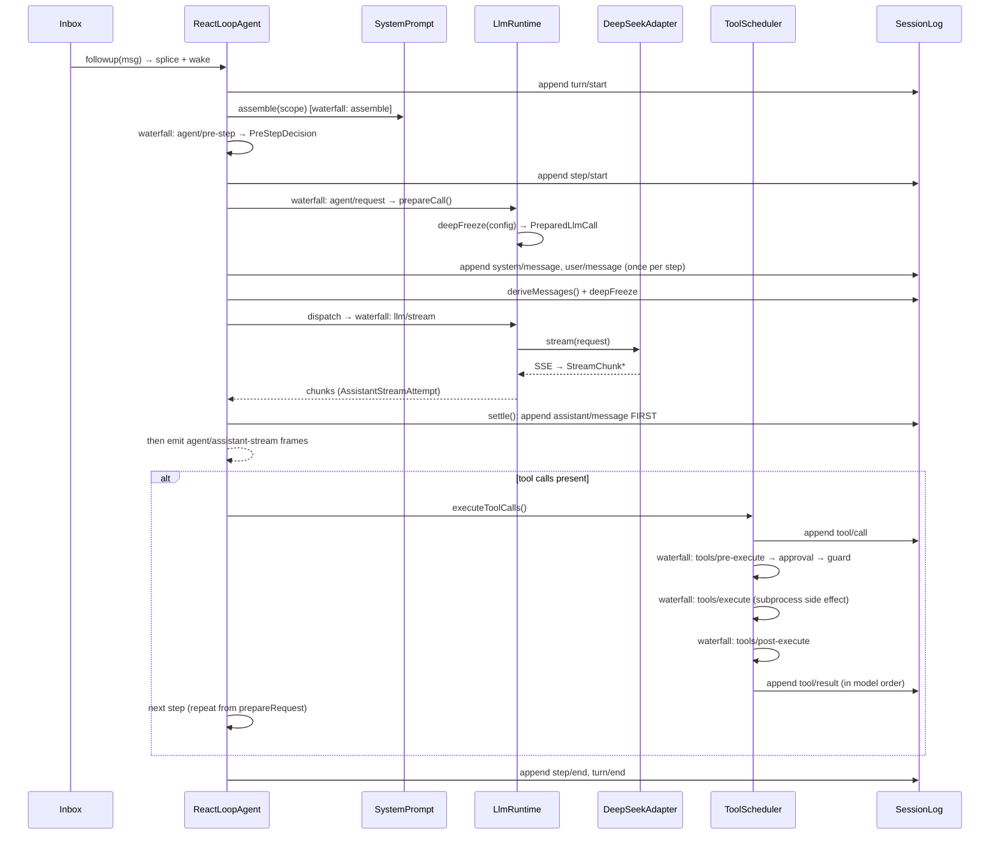
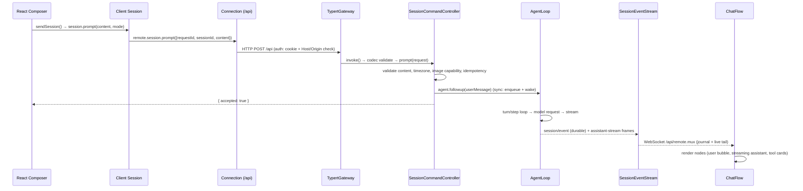

# DeepSeek Harness 技术架构详解

> 基于源码的架构分析（git tag：`dsh-v0.2.1-alpha.2`）

---

## 目录

1. [项目概览](#1-项目概览)
2. [内核：Cordis 插件模型](#2-内核cordis-插件模型)
3. [启动与组合：Profile / Bundle 机制](#3-启动与组合profile--bundle-机制)
4. [核心运行时：一次 Turn 的完整生命周期](#4-核心运行时一次-turn-的完整生命周期)
5. [Web 前后端架构](#5-web-前后端架构)
6. [安全模型：分层拦截与授权](#6-安全模型分层拦截与授权)
7. [多运行面](#7-多运行面)
8. [工程与质量体系速查](#8-工程与质量体系速查)
9. [设计模式总结](#9-设计模式总结)

---

## 1. 项目概览

### 1.1 dsh 是什么

DeepSeek Harness（命令名 `dsh`）是 DeepSeek 开源的 **Agent Harness**。它本身不实现某个具体 agent 的业务逻辑，而是提供「模型适配 + 工具执行 + 会话日志 + 沙箱 + 多端 UI」的完整运行时。与「一个调用 LLM API 的应用」的本质区别在于：它把 agent 运行时的每一个部件都做成了可替换的插件。

### 1.2 核心设计哲学：一切皆插件

底层框架是 [Cordis](https://github.com/cordiverse/cordis)（vendored 在 `vendor/cordis`）。产品没有需要打补丁的「特权内核」——模型适配器、工具注册表、会话日志、甚至 agent loop 本身都是 Cordis 插件，每个都可以从配置整体替换。扩展 dsh 的方式是「在旁边挂一个插件」，而不是修改核心代码。

### 1.3 仓库顶层布局

```
deepseek-harness/
├── vendor/          # Cordis 框架及基础库的源码级拷贝（9 个包）
├── packages/        # 产品本体，约 331 个 workspace 包（packages/<组>/<包>）
│   ├── core/        #   session、agent、agent-loop、tools、system-prompt
│   ├── llm/         #   LLM 适配器缝、llm-deepseek、llm-retry、token-meter
│   ├── session/     #   JSONL 持久化、格式迁移 v0→v4、投影、标题、遥测
│   ├── api/         #   gateway + session/workspace/settings/... 控制器
│   ├── host/        #   webserver、frontend-static、目录选择器
│   ├── client/      #   浏览器内核 + 约 60 个 ui-* 特性包
│   ├── sdk/         #   JSON-RPC SDK（protocol / client / server）
│   ├── acp/         #   ACP 自动化协议服务器
│   ├── bundle/      #   profile 的组成层：base / web-app / headless / sdk-app / acp-app
│   ├── shell/ subprocess/ sandbox/ fs/ terminal/ skill/ ...   # 能力提供者
│   └── experimental/ test-support/ util/
├── apps/
│   ├── cli/         # dsh 命令行入口（bin）
│   ├── web/         # Vite SPA 前端
│   ├── desktop/     # Electron 桌面壳
│   └── desktop-host/# Electron 的私有 Node 主机进程
├── python/          # Python SDK（子进程 + JSON-RPC 客户端）
├── native/          # Landlock / flock 原生 addon
├── scripts/         # 45+ 个 verify-* 门禁、17+ 个 gen-* 生成器、run-gates 调度器
├── docs/            # 中英双语文档 + 生成式目录
└── snapshots/       # 无 key 的录制会话回放测试语料
```

依赖方向：`apps/cli` → `bundle/*` → 各能力包 → `core/*` → vendored `cordis`。包之间只用包名互相引用，由 tsconfig `paths` 解析到 `src`。

### 1.4 与经典 Agent 六要素的对照

经典 Agent 架构图（Planning & Reasoning / Memory / LLM Core / Tools / Agent actions / Environment，observe-act 闭环）在本项目中的落点：

| 六要素 | dsh 中的对应 | 关键位置 |
|---|---|---|
| **LLM Core** | 极小的 `ReactLoopAgent` turn/step 状态机 + `ctx.llm` 双层适配缝（`LlmAdapter` / `LlmRuntime.prepareCall`） | `core/agent-loop/src/agent.ts`、`llm/llm/src/index.ts` |
| **Planning & Reasoning** | 推理本身在模型内；harness 只做三件外围事：① 注入 prompt 段塑形（`PLAN_POLICY`、goal round 提示词）；② 外载规划状态（`todo_write`/`goal` 工具 → session 事件）；③ 确定性护栏（超时、重复提醒、pre-step 拒绝） | `plan/plan-mode`、`goal/goal-round-driver`、`guard/*` |
| **Memory** | 「日志即记忆」：append-only Session 日志 = 模型上下文唯一来源（短期）+ projection 折叠（中期）+ compaction 压缩（长期修剪）+ prompt 注入（请求期）。见 §4.12 | `core/session`、`session/session-projection`、`compaction/*` |
| **Tools** | 作用域注册表 + 五段事件管线；schema 每步经 `SystemPrompt.assemble()` 进 prompt，工具元数据白名单永不泄漏 | `core/tools/src/index.ts` |
| **Agent actions** | tool call（`tool/call`→`tool/result`）、人机交互（`ask_user_question`/approval）、用户响应（`assistant/message` + 流帧）、委派（subagent） | `agent-loop/src/tool-calls.ts`、`interaction/*`、`subagent/*` |
| **Environment** | capability seam 三角色（Definition/Provider/Consumer）分包：`ctx.fs`/`ctx.shell`/`ctx.terminals`/`ctx.web`/`ctx.browserUse`/`ctx.computerUse`/`ctx.sandbox`。换 provider 即换执行世界，Consumer 零改动。见 §6 | `fs/*`、`shell/*`、`sandbox/*`、… |

两条贯穿性分工原则：

- **模型负责想，harness 负责喂、存、拦**：循环本体只做「claim 输入 → 组装 prompt → 事件瀑布 → 调模型 → 落日志 → 调度工具 → 重复」，所有产品行为通过 `agent/*` / `tools/*` / `system-prompt/*` waterfall 挂载（"Plugins, not loop changes"）。
- **observe 比 act 宽松**：读文件通常只留 `fs/observed` 痕迹，写文件要过 sandbox + approval + observation policy 三道闸——观察错了可修正，动作错了产生不可逆外部后果。

---

## 2. 内核：Cordis 插件模型

理解 dsh 的一切行为之前，先要理解三个 Cordis 概念。

### 2.1 Service 与依赖注入

插件类继承 `Service`，通过 `ctx.provide('key', ...)` 发布服务、`ctx.inject(['key'])` 声明依赖。Cordis 在插件树加载时按声明解析依赖、决定激活顺序；服务不可用时依赖它的插件不会激活。这使得「换掉一个 provider，所有 consumer 不变」成为可能。

### 2.2 事件三模式

`ctx.on()` 监听事件，分三种派发模式，语义严格区分：

| 模式 | 语义 | 约束 |
|---|---|---|
| `emit` | 广播，不等结果 | 无 |
| `serial` | 串行 `await` 每个监听器 | 监听器按注册顺序执行 |
| `waterfall` | 链式传递，每个监听器可改写 payload | **必须调用 `next()`** 委托下游；不调用即短路整条链 |

`waterfall` 是 dsh 最关键的扩展点：`system-prompt/assemble`、`agent/pre-step`、`agent/request`、`llm/stream`、`tools/pre-execute`、`tools/execute`、`tools/post-execute` 全部是 waterfall。

### 2.3 注册即副作用

一切注册（工具、命令、路由、监听器）都通过 `ctx.effect()` / `ctx.on()` 完成，并返回 **disposer（逆操作函数）**。插件卸载时 Cordis 自动按逆序回滚全部注册。这条纪律带来两个直接结果：

- **HMR 可信**：热重载卸载旧插件时，它的所有注册自动清理，不会泄漏；
- **运行时自我修改可行**：`extensions/` 插件可以给运行中的自己挂新插件，事务边界由 disposer 保证。

---

## 3. 启动与组合：Profile / Bundle 机制

### 3.1 三个概念

| 概念 | 定义 | 位置 |
|---|---|---|
| **Profile** | 命名的插件组合，存于 `$DSH_HOME/profiles/<name>/` | 用户目录 |
| **Bundle** | 一层 Cordis 配置 patch + 其挂载代码的分发单元 | `packages/bundle/*` |
| **Patch** | 对配置行的 `insert` / 替换操作，按 id 定位，**整 config 替换（不 merge）** | `cordis.patch.yml` |

`dsh-base` 是 `web` / `headless` / `sdk` / `acp` 四个 profile 共享的第一层：llm、session、tools、agent、typert、settings、sandbox 等核心行都从 `packages/bundle/base/cordis.patch.yml` insert 进来。上层 bundle 和用户自己的 `cordis.patch.yml` 可以按 id 替换其中任何一行——**最后写入者胜**。

内置 profile 模板：`web`、`headless`、`sdk`、`sdk-minimal`、`acp`。

### 3.2 Patch 层的应用顺序

对空的根 `cordis.yml`（内容就是一个空数组 `[]`）依次叠加：

```
profile 声明的 bundles（按 dsh.profile.bundles 顺序）
  → profile 自己的 cordis.patch.yml
  → $DSH_HOME/cordis.patch.yml（机器级，覆盖 profile 级）
  → --patch 命令行 overlay（按 argv 顺序）
  → telemetry 开关
```

查看本机实际组合结果：`dsh --profile web --dump-config`。

### 3.3 启动链路（源码走读）

入口是 `apps/cli/src/bin.ts`：

```
node apps/cli/src/bin.ts                # pnpm dsh 经 tsx ESM hook 运行源码
  └ parseDshArgs(process.argv)          # apps/cli/src/args.ts
  └ runProfile({...})                   # apps/cli/src/profile-boot.ts:244
      ├ installProxyFromEnvironment()   # 先装 fetch 代理（.env 里的代理也生效）
      ├ prepareProfile(name)            # 加载 profile、重写空根 cordis.yml
      ├ createRuntimeResolution()       # boot 前冻结运行时插件包解析
      ├ 安装 SIGTERM/SIGINT 处理 + installFailLoud
      └ boot(NAME, rootConfig, patches, hostCtx => {…})
            # packages/boot/app-boot/src/index.ts:975
            #   new Context() → 解析配置树 → 逐行加载插件 → 依赖解析 → 激活
```

`runProfile` 在 `boot()` 的 prepare 回调里注入三样启动事实：`profileContext`、不可变的 launch environment 快照、`cmdlineArgs`（内层参数，供 app 插件读取）。App 层的 flags 不由 launcher 解释——`dsh web --no-open` 里的 `--no-open` 是 web-app 插件从 `ctx.cmdlineArgs` 读的。

### 3.4 五个 profile 的组成差异

| Profile | 组成 | 特点 |
|---|---|---|
| `web` | base + web-app | HTTP 服务器 + 静态前端，默认 `127.0.0.1:3080` |
| `headless` | base + headless | 无服务器；解析位置参数里的任务，创建 Agent，打印结果后退出 |
| `sdk` | base + sdk-app | 换行分隔 JSON-RPC over stdio 的服务器 |
| `sdk-minimal` | 单独完整 bundle | 刻意不叠 base，最小显式 SDK 树 |
| `acp` | base + acp-app | ACP v1 自动化协议，仅自动化无 UI |

**没有任何一个 profile 是特权入口**——差别只是 bundle 里多挂了哪个 app 插件。`scripts/verify-application-entrypoints.ts` 强制禁止绕过 `dsh` 的任何 Node 应用入口。

---

## 4. 核心运行时：一次 Turn 的完整生命周期

这是整个项目的灵魂，集中在 `packages/core/{session,agent,agent-loop,tools,system-prompt}` 与 `packages/llm/llm`。

### 4.1 Session：append-only 事件日志

`packages/core/session/src/index.ts`（1452 行）实现每个会话一份的 **append-only `SessionEvent` 日志**。两条不变量贯穿全系统：

1. **模型可见 ⟺ 已记录**：任何到达模型请求的输入，都必须能从日志重建。新增模型可见输入必须新增会话事件。
2. **校验先于发布**：`Session.append()`（`index.ts:798`）执行 JSON 无损快照 → 赋 `seq` → deepFreeze → 校验，然后 `commit()`（`index.ts:876`）——`surfaceManager.validateNext()` 通过后才 `log.push()` 并通知观察者。

`SESSION_FORMAT_VERSION = 4`（`types.ts:89`）。事件类型集中在 `SessionEventMap`（`types.ts:281-428`），用 TypeScript declaration merging 让各包扩展自己的事件类型。

### 4.2 Surface 投影：压缩改写视图，不删日志

`surface.ts` 定义了从事件到模型消息的投影。每个消息节点记录起止 `seq`，投影时可以「改写」节点内容——这是 **compaction（上下文压缩）的实现基础**：

- 压缩把旧节点标记为 shadowed，以摘要消息替代；**日志原文不变**（fork、转录、审计都靠它）；
- 不变量由代码强制：system 节点 0 受保护（`assertSystemHeadRewrite`，`surface.ts:493`），tool result 只能改 `content` 不能改调用参数（`assertToolResultRewrite`，`surface.ts:456`）。

`deriveMessages()`（`index.ts:984`）按 `surface.contentGeneration` 缓存地投影出模型历史——同一条历史在 fork / 重试 / 恢复时构造出逐字节一致的 messages。

### 4.3 Agent 契约与 AgentLoop 驱动

**契约**（`packages/core/agent`）：`Agent` 接口只有一个字段 `readonly id: SessionId`（`types.ts:15`），其余全部通过 declaration merging 扩展。`ctx.agents` 是注册表，`enter`/`announce` 协议配合**成对 disposer 边**，保证陈旧 disposer 不会误删同 id 的新对象。`dispatch.ts:107` 的 `agentEvents` 是融合分发器：按 agent 的 scope 选中监听器的同时注入 `this: Scoped<Agent>`，监听器永远不需要按 id 查 agent。

**驱动**（`packages/core/agent-loop`）：`AgentLoop`（`index.ts:341`）实现 `AgentFactory`；`ReactLoopAgent`（`agent.ts`）是默认驱动：

- 外层循环：`kick()` = `while (await this.turn())`（`agent.ts:252`）；
- 入队：`followup`（下一 turn）/ `steer`（当前 turn 的下一步）/ `inject`（不唤醒）都走 `send()` → `inbox.splice()`（append `agent/inbox/spliced` 事件）→ `wakeDriver()`（`agent.ts:153-173`）。执行中收到新消息的完整消费语义见 §4.11。

### 4.4 一次 Turn 的端到端时序



关键细节：

- **`PreparedLlmCall` 的 TOCTOU 防护**：`prepareCall()`（`llm/src/index.ts:933`）冻结配置；`dispatch()` 时再校验调用方 config 与 prepared config 一致，漂移即抛 `INVALID_PREPARED_CALL`——防止准备与流式之间配置被篡改。
- **瞬时帧晚于持久事件**：`AssistantStreamAttempt.settle()`（`assistant-stream.ts:78`）**先 append 持久事件，再发布瞬时 chunk**。UI 显示的任何内容，冷读端都能从日志重建。
- **重试是插件**：`llm-retry` 监听 `agent/request-error` waterfall，可 append `llm/retry` 事件、等待、返回 `{kind:'retry'}`——循环在 `step()` 内原地重试，**不重复装配、不重复 `agent/pre-step`、不重复接纳用户消息**。
- **Checkpoint 策略**（`session-checkpoint-policy/src/index.ts`）：在 `llm/stream`（` :64`）、`tools/execute`（` :70`）、`agent/pre-step`（` :79`）三处 flush 日志，失败则**阻断副作用**——这是「崩溃后已接受的事实一定在日志里」的保障。

### 4.5 工具系统

`packages/core/tools/src/index.ts`（1991 行）：

- **作用域注册表**：`register()` 返回 disposer；`view(scope)` 单次遍历推导一个 scope 的完整工具面。不变量：**restrictions 只过滤继承来的面，不过滤本 scope 自己注册的工具**（`index.ts:1184-1215`）。
- **执行管线**（`index.ts:1512 / 1612 / 1789`）：`tools/pre-execute`（策略/人工审批/`guardReason`）→ `tools/execute`（真正副作用）→ `tools/post-execute`（可覆写结果）。guard 是单调的——没有 `allow` 结果，监听器顺序永远不能把拒绝翻转成放行（`:724-731`）。
- **并发调度**（`agent-loop/src/tool-calls.ts`）：`isConcurrencySafe(args)` 只有返回**字面 `true`** 才并行（fail-closed，默认 `DEFAULT_MAX_PARALLEL_TOOL_CALLS = 10`，`constants.ts:6`）；并行池 `fillPool`（`tool-calls.ts:199`）派发可重叠，但结果**按模型顺序提交**。

### 4.6 系统提示词装配

`packages/core/system-prompt/src/index.ts`：

- 分区（section）+ 上下文（context）两层，按固定 `SECTION_ORDERS`（`:131`）排序；
- 任何包可 `ctx.systemPrompt.section(...)` 注册内容；工具 schema 不是存储的列表，而是 provider（每次装配按当前 scope 重新计算，`tools/index.ts:855` 注册）；
- `{{name}}` 插值遇到未知名字**直接抛错**（`:361-364`）——提示词拼写错误 fail-loud，不会带着字面量发给模型；
- 装配走 `system-prompt/assemble` waterfall，监听器可改写但必须 `next()`。

### 4.7 LLM 适配层与请求协议

**缝**（`packages/llm/llm`）：`LlmAdapter` 抽象类（providerInfo / listModels / resolveModel / prepareCall / `stream()`），`LlmRuntime`（`index.ts:342`）管理适配器注册与路由。流词汇 `StreamChunk`：`message-start` / `text-delta` / `reasoning-delta` / `tool-call-delta` / `finish` / `error`。

**DeepSeek 实现**（`llm-deepseek`）：POST `/messages` + SSE，`translate.ts` 把 Anthropic 风格事件翻译为 `StreamChunk`。**「结束 vs 继续调工具」是协议级信号**（`translate.ts:90-95`）：`stop_reason: end_turn/stop_sequence` → `{kind:'stop'}`；`tool_use` → `{kind:'tool-calls'}`。畸形响应（未知 stop_reason、块索引错乱、空内容、流未等到 message_stop）全部抛 `LlmError`，绝不猜测。

### 4.8 请求参数与缓存命中设计

每次 step 的 HTTP body 由 `llm-deepseek/src/serialize.ts:151-172` 构造：

```jsonc
{
  "model": "deepseek-chat",
  "stream": true,
  "max_tokens": 65536,
  "thinking": { "type": "enabled" },
  "output_config": { "effort": "high" },
  "system": "…完整系统提示词…",
  "messages": [ /* deriveMessages() 从日志投影，deepFreeze */ ],
  "tools": [ { "name": "bash", "description": "…", "input_schema": {…} } ],
  "dsh_session_log": { … },          // DeepSeek 旁路扩展，模型不可见
  "dsh_plugin_packages": { … }
}
```

HTTP 层无状态、每次全量重发，但工程上靠四点保证 **KV cache 命中率**：

1. **前缀顺序固定**：`system → tools → messages` 拼装顺序固定，请求对象 deepFreeze，前缀逐字节稳定；
2. **变更一律增量**：支持 `systemPromptUpdate: 'in-history'` 的路由把 prompt 变更作为 system 消息**插入历史**而非重写（`serialize.ts:109-111`）；工具增删走 `developer/message` 声明；
3. **重试不重建**：原地循环复用已冻结的 `PreparedLlmCall`；
4. **usage 单独计量** `cacheReadTokens` / `cacheWriteTokens`（互斥不重叠），命中效果可观测。

另外 `request/header` / `request/context` 也按变化增量写入日志（`agent.ts:637-682`）——「这次请求用的什么配置」同样可从日志重建。

### 4.9 Skills：渐进式披露

技能不在 `tools` 列表里铺开，而是「目录常驻 system + 一个元工具 + 全文按需注入」：

- **system 里**只有目录：每个技能一行名字 + 摘要 + 使用规则（`tool-skill/src/index.ts:262-268`）；
- **tools 里**只有一个 `skill` 工具（`:84`）：「调用它加载某技能全文」；
- **全文进入 messages**，两条路径：
  1. 模型调用 `skill` 工具 → 全文作为 tool_result 返回；
  2. 用户输入第一行 `/技能名` → `agent/pre-step` 监听器（`:176-208`）识别手势，以 `user` 消息注入（source 标记 `skill-invocation`）。

两条路径共用同一渲染器 `renderSkillContent()`（`skill/src/index.ts:168`），产出 `<skill_content name="…"><skill_resources/><skill_instructions>…</skill_instructions></skill_content>`。**全文不进 system** 的原因：保缓存前缀、生命周期语义（临时任务指令 vs 恒定身份规则）、与调用绑定、system 节点 0 受 surface 规则保护。

### 4.10 上下文膨胀治理

`packages/compaction/compaction-basic`：监听 `ctx.tokenMeter` 压力，按 `thresholdRatio`（占上下文窗口比例阈值）在 step 边界触发；另有 context-overflow 恢复路径绕过常规阈值（`:261-277`）。压缩 = surface 节点 shadowing + 摘要替代（不删日志）。配套 `compaction-tool-result-pruner` 单独裁剪工具结果——通常是最大的 token 消耗者。

上下文曲线：**线性增长 → 触及阈值 → 压缩为摘要 → 继续增长 → 再压缩**，模型可见历史始终在窗口内。

### 4.11 执行中的插话与中断

模型正在执行任务（step 流式输出中、工具执行中）时用户又发来消息，处理原则是一句话：**用户消息从不打断进行中的模型请求或工具执行**（唯一例外是显式 Stop），而是进一个持久化的 inbox，在最近的**边界**（step 边界 / turn 边界）被 claim 消费。

**三个入口 API**（`agent-loop/src/agent.ts:154-173`，两队列定义 `agent/src/types.ts:38-45`）：

| API | 目标队列 | 唤醒 | 语义 |
|---|---|---|---|
| `followup(msg)` | `next-turn` | ✅ | 开新 turn 消费（标准"排队"） |
| `steer(msg)` | `next-step` | ✅ | 最近 step 边界消费，**延续当前 turn**（"插话"） |
| `inject(msg)` | `next-step` | ❌ | 同 steer 但不唤醒，插件注入上下文用（plan narration、runtime context） |

每次入队先持久化 `agent/inbox/spliced` 事件（`inbox.ts:235`）再发 `agent/inbox/inserted`（`:239-241`）——**排队中的消息重启后依然存在**，Web 队列 UI 就是这个投影的快照。走哪条由用户决定：Web busy 时 `busyEnter = 'queue' | 'steer'` 设置决定 Enter 行为（`submission-policy.ts:30-39`），Host 端 `commands.ts:364-365` 据此分派 `followup`/`steer`。

**入队 ≠ 打断**：`send` 只做 `inbox.splice()` + 可选 `wakeDriver()`，而 driver 正在 running 时 `wakeDriver` 直接返回（`agent.ts:215-224`）。`steer` 不触碰 AbortController（turn 的中止信号只被 `cancel()` abort，`:180`），所以流式中每个 chunk 检查的 `signal.throwIfAborted()`（`:457-459`）不会因插话触发——**当前 step 照常跑完**。

**按消息到达时刻分情况**（前提：用户输入 wakeup=true）：

| 到达时刻 | followup（queue） | steer |
|---|---|---|
| **idle** | `wakeDriver` 立即启动 driver，新 turn 消费（`:225-234`） | 同样开新 turn（idle 时 steer 即首批） |
| **step 执行中**（流式/工具） | 躺在 `next-turn`，当前 turn 完全不受影响，等 turn 边界 | 躺在 `next-step`，`step/end` 后下一圈 `preStep` claim → **发起新模型请求**，消息已合并进上下文 |
| **turn 即将自然结束** | turn 结束后由 `:392-397` 开下一 turn 消费 | `agent.ts:361-365` 双重检查：`agent/turn-stopping`（serial）期间监听器塞入 next-step → 复检非空 → **不关 turn，再走一步** |
| **已 abort / Stop 后** | `wakingAfterAbort`（`:157-158`）**强制重分类为 `next-turn`**——唤醒输入不能加入已中止活动；`wakeRequested` latch（`:220-222`）在 driver 收敛 idle 的 finally 重放（`:259-263`） | 同左，重分类为 next-turn |
| **多条同时到达** | FIFO 追加；每 turn 边界只 claim **恰好一条** next-turn（`inbox.ts:111`），N 条 = N 个 turn 由同一 driver 连跑（`:392-397`），不需 N 次唤醒 | step 边界**整批 claim**（`:110` 取走全部 next-step），按插入顺序合并 |

**claim → 进入模型**：

```
preStep (agent.ts:267-288)
  ├─ inbox.claim(target)        → inbox.ts:103-114（turn 边界: 全部 next-step + 1 条 next-turn; step 边界: 仅 next-step）
  ├─ systemPrompt.assemble()
  └─ agent/pre-step waterfall   → 默认 {kind:'enter', messages:[...claimed]}（:274-284）
step() 首次 attempt
  └─ session.append('user/message', ...)   → :426-437（重试不重复准入）
buildRequest
  └─ session.deriveMessages()   → :688 从日志冻结请求 → 发给模型
```

两个要点：① `agent/pre-step` 有权**改写/拒绝**这批消息（`PreStepDecision`，`runtime-types.ts:111-119`），reject 则 turn 以 `blocked` 关闭且**被 claim 的消息就此消失**（`:289-293`）；② 消息在排队期是 `agent/inbox/spliced`，被消费才升格为 `user/message`——保证 Model-visible ⟺ logged。

**显式 Stop 是唯一真打断**：`cancel()`（`agent.ts:175-181`）abort 当前 turn。Web Stop 按钮 / 双击 Esc → `commands.ts:511-525` → `agent.cancel({kind:'user'}, {keepInbox: true})`——**保留队列**，取消静默后 FIFO 恢复。效果：流在下个 chunk 前停止 → 已投递文本以 `interrupted: true` 的 `assistant/message` 结算（`:465-482`，不丢已输出部分）→ `turn/end {kind:'aborted'}`（`:370-373`）。`cancel` 默认还会 `inbox.clear()`，所以 UI 特意传 `keepInbox`。

**三种行为对照**：

| | queue（followup） | steer | Stop（cancel） |
|---|---|---|---|
| 打断当前 step？ | 否 | 否 | **是**（下个 chunk 前中止） |
| 消费时机 | turn 边界（一轮轮排） | step 边界（最近的下次请求） | 当前 turn 立即 `aborted` |
| 延续当前 turn？ | 否（新 turn） | **是**（可让 turn 无限延续） | 否 |
| 排队消息 | 保留 | 保留 | 保留（`keepInbox:true`） |

一个直接推论：**循环没有内置 turn 预算**——工具调用或 steering 会延续当前 turn，限流需自己在 `agent/turn-stopping` 挂 cancel（`agent-loop/README.md:220`）。

设计收益：模型请求永远是 `deriveMessages()` 冻结的不可变完整快照，不存在"请求中途被塞消息"的一致性问题；插话时效性靠 step 边界（通常几秒）保证，而不靠抢占。

### 4.12 记忆体系：两种分类法的映射

§4.1（日志）、§4.2（surface 投影）、§4.9（skill）、§4.10（compaction）分别讲了记忆的各个部件；这里用两种分类法把它们组织成完整的「记忆」概念。

**按工程生命周期分层**（怎么存、怎么不失效）：

| 层 | 机制 | 位置 |
|---|---|---|
| 短期：对话历史 | append-only 日志 + `deriveMessages()` 投影 | §4.1/§4.2 |
| 中期：持久化 | JSONL + 格式迁移 v0→v4 + projection seam 折叠成状态 | `session/*` |
| 长期：修剪 | compaction 摘要替换（日志原文不变） | §4.10 |
| 请求期：注入 | `agent.inject()` → next-step inbox → 下一个被接受的请求 | §4.3 |

**按认知功能分类**（存什么）——与上表是矩阵关系，不是竞争关系：

| 认知分类 | dsh 中的实现 | 关键源码 |
|---|---|---|
| **情节记忆**（何时发生什么） | Session 事件日志是主体；compaction 摘要 = **记忆固化**（把长情节折叠为可续接 checkpoint）；`session-title`/`session-turn-outline` 是**线索式回忆索引**（投影，不进模型上下文） | `core/session`、`compaction-basic/src/summarizer.ts:22-33`、`session-title` |
| **语义记忆**（不绑定情节的事实） | ① `agent-instructions`：工作区 AGENTS.md 类文件渲染成常驻 prompt 段；② working-directory、sandbox-policy 等 prompt context（`CONTEXT_ORDERS`，`system-prompt/index.ts:170-175`）；③ settings、`session/title` | `context/agent-instructions/src/render.ts:91-312` |
| **程序记忆**（怎么做） | ① skills 渐进披露（§4.9）；② 工具 schema 每步装配进 prompt；③ plan policy、preset 组合出的行为套路 | `skill/*`、`core/tools` |
| **工作记忆**（当前活跃） | inbox 双队列 + runtime context 注入 + todo/goal 投影的 active 态 | `agent-loop/src/inbox.ts` |

两个重要的设计取舍：

- **刻意没有向量知识库式的语义记忆**：事实靠「渲染进 prompt + 存日志」，检索靠 grep/glob 工具**实时做**（`tool-fs-search`），而非预先嵌入。这保持了与代码库状态的一致性（向量库会过期），代价是每次都要现场检索。
- **三类记忆被同一条不变量统摄**：无论哪种记忆，只要模型可见就必须有对应 session 事件（Model-visible ⟺ logged）。skill 加载结果、指令文件内容都以事件落库——**任何一类记忆都能从日志重建**。这是它与「记忆散在多个存储」的常见 agent 框架最大的区别。

层次适用差异：情节记忆需要全部四层（存→投影→修剪→注入）；程序记忆基本只走 prompt 装配层（工具描述变更记 `developer/message` 但不参与情节折叠）；语义记忆走 context 层且受 `refreshContext()` 保护——step 重试只刷新运行时事实，不重跑 section（`system-prompt/index.ts:578-598`）。

---

## 5. Web 前后端架构

### 5.1 分层

`docs/api-gateway.md` 明确的顺序：**remotes → gateway → connection → webserver**。

| 层 | 包 | 职责 |
|---|---|---|
| 业务 Remote 服务 | `packages/api/*-controller` | `@Remote` 标注的方法（如 `SessionCommandController.prompt`） |
| RPC 分发 | `packages/api/gateway` | `TypertGatewayService.invoke()`（`index.ts:357`） |
| 浏览器↔Host 线路 | `packages/client/connection` | HTTP `/api` 桥 + 浏览器认证 |
| HTTP 服务器 | `packages/host/webserver` | `WebServer extends Service`（`index.ts:261`） |

### 5.2 Typert 类型安全 RPC

`@Remote` / `@RemoteScope` 标注的方法在 Host 构建期由 `packages/typert/generator` 生成客户端桩（`typert.remote-client.js` + 类型）。**客户端方法是普通对象上的具体函数，不是 JS Proxy**——编译期就有完整类型。参数校验用生成的 codec 在 gateway 完成，wire 上不传 TypeScript 类型信息但有运行时校验。

### 5.3 传输

- **一元 RPC**：HTTP POST `/api`（`connection/src/api-path.ts:7`）；二进制附件走 multipart，默认缓冲上限 300 MiB；
- **流**：单条 WebSocket 复用通道 `/api/remote.mux`（`gateway/src/stream-protocol.ts:7`）；
- **事件转发**：allowlist 的 Cordis 事件经 `$events` / `$events/result` 内部流转发到浏览器，客户端 waterfall 监听器同样必须 `next()`。

### 5.4 一次 Web 对话的执行链路



细节：前端先 `beginSubmission()` 做乐观占位并铸 `requestId`；Host 侧 `commands.ts:311` 的 `prompt()` 做内容校验、时区规范化、图片能力检查、**幂等去重**（`hasPromptRequest`）、附件接纳，然后 `agent.followup()`（queue）或 `agent.steer()`（插入当前 step）。回程双通道：**瞬时**打字机帧（`history.ts:54` 订阅 `agent/assistant-stream`，折叠成可重连基线）+ **持久**日志流（`SessionEventStream extends RemoteJournalStream`，`transport.ts:137`，提供快照优先 + 有序 live 尾随 + 断线间隙修复）。

### 5.5 前端架构

`packages/client` 内核**框架无关**（`modules` / `store` / `connection` 不依赖 React）；只有 `ui-renderer` 和约 60 个 `ui-*` 特性包使用 React 18。客户端 bundle 是「CJS closure factory + `window.__ModuleLoader__`」的自定义模块系统，CSS 经 lightningcss 内联。页面 boot：`web/src/boot.ts` → 挂 Cordis Loader → 逐行 `loader.create` → `loader.await()`。

### 5.6 Host / Client 双编译面

根 `tsconfig.json` 是无 include 的 solution，只引用 `tsconfig.host.json` 与 `tsconfig.client.json` 两个聚合。两侧对 cordis `Context` 做**同名 declaration merging 但服务不同**，所以一个 `ts.Program` 不能同时看到两边。6 个 split 包（api/gateway、api/remotes、session/workspace-controller、client/connection 等）包根 solution-only，各有一个 host/client 叶子配置；`check-workspace-constraints.ts` 遍历 project reference 图强制校验。

### 5.7 认证模型

单操作者、本机信任模型（`connection/README.md`）：

1. **启动令牌**：每次进程铸随机 token，打印并打开 `http://127.0.0.1:3080/?token=…`；仅 `GET /` 接受一次，换取签名 cookie 后重定向到干净 URL；
2. **签名 cookie**：密钥在 `ctx.credentials`（`$DSH_HOME/.credentials.yaml`）；`HttpOnly` + `SameSite=Strict`，默认 30 天，绑定 authority（HTTPS 的 cookie 无法被 HTTP 冒充）；缺失/过期 → 401；
3. **请求信任**：认证前过 `api-request-trust.ts`——Host 必须是 loopback / 监听器绑定 IP / `trustedHosts` 命中，`Origin` 必须同 authority，`sec-fetch-site: cross-site` 拒绝 → 403（防 DNS rebinding）；
4. **WebSocket 升级同准入**（`ctx.connection.admit`），无旁路；
5. **webserver 拒绝通配绑定**（`0.0.0.0` 加载即失败），默认 loopback。

模型 API key 独立存放于 Host 的凭据存储，**从不下发浏览器**。

---

## 6. 安全模型：分层拦截与授权

本章回答「怎么保证安全，比如防止误删文件」。核心事实：**dsh 没有一个叫"删除保护"的模块**——安全是分层叠加出来的，且各层的防护强度刻意不同。

### 6.1 威胁模型

harness 是开发工具，威胁模型前提是「**工作区内的破坏可由版本控制恢复**」，因此优先保证的是两件事：

1. **沙箱外零副作用**（内核级保证）；
2. **所有副作用可审计**（每个 tool/call、tool/result、approval 决策都落 session 日志）。

明确**不保证**的是工作区内的 `rm -rf` 误删——那条路靠 git 兜底。`SAFETY.md:11-13` 直接声明 sandboxing/approval/permission 不能保证隔离。

### 6.2 防误删：五道拦截链

以「模型想删文件」为威胁，从内到外：

**第 1 道：工具词汇表——模型根本没有"删除"这个动词**（最有效的一道）

- `ctx.fs` 抽象接口**在定义层就没有 delete/rename/move/copy**（`fs/README.md:115` Known Limitations 明文列出）；
- `tool-fs` 只注册 4 个工具：`read`、`read_image`、`write`、`edit`；全仓库 grep 不到任何 `rm/delete/trash/undo` 类模型工具；
- `tool-str-replace-editor` 命令枚举只有 `view/create/str_replace/insert`。

设计逻辑：**删除不是被拦截的，而是从未进入模型的能力面**。模型能做的最坏 fs 操作是 `write`（整文件覆盖）和 `edit`（局部替换），两者由第 2 道管。

**第 2 道：fs 层「先读后写 + 版本守卫」——防盲目覆盖**

| 机制 | 行为 | 位置 |
|---|---|---|
| 观察策略 | 目标从未被读过 → `FS_NOT_OBSERVED`，模型收到修复指令 "read the file, then retry" | `fs-observation-policy/index.ts:119-129`、`fsio.ts:557-568` |
| 版本 token | write/edit 携带读取时版本（inode/size/纳秒 mtime），期间被改 → `FS_STALE_VERSION` 要求重读 | `fs-local/index.ts:118-131,214-223` |
| 唯一匹配 | str_replace 多处匹配 → `FS_AMBIGUOUS_EDIT` 拒绝 | `fsio.ts:814-834` |
| 原子写 | staging + 硬链接 no-replace 发布，崩溃不留半截文件 | `fsio.ts:588-670` |

**第 3 道：fs-sandbox 策略栅栏——限定"能改哪里"**

`SandboxedFileSystem` 只覆写两个 mutation 方法（`fs-sandbox/index.ts:87,108`）：`read-only` 全拒（`:126-128`）、`workspace-write` 做 containment 判定（`:129-143`）、`danger-full-access` 放行（`:125`）。可写根 `writableRoots`（`sandbox/src/roots.ts:52-55`）与 shell 沙箱**共用同一份配置**，避免工具间不对称。注意：这是 JS 层策略栅栏，README 自陈非内核边界、有 TOCTOU 残留（`fs-sandbox/README.md:116-125`）。

**第 4 道：内核级 sandbox——删除通道（bash）的真正关卡**

模型删文件的唯一途径是 bash 的 `rm`，这道闸在 OS 层：

| 平台 | 机制 | 位置 |
|---|---|---|
| Linux | `bwrap --ro-bind /` 全盘只读（workspace-write 才 bind 工作区）→ Landlock 回退 | `sandbox-local/profiles.ts:16-36` |
| macOS | Seatbelt (SBPL)：`deny file-write*` 除白名单 | `profiles.ts:51-58` |
| Windows | ACL restricted-token：对 world SID 加 `FILE_DELETE_CHILD` **Deny ACE**（专防父目录权限绕过删除）+ Low 标签 | `sandbox-windows-acl/acl.ts:10-15,408` |

fail-loud 纪律：无可用 confinement → 拒绝启动（`sandbox-local/index.ts:503-507`）；runner 失败 → `SANDBOX_UNAVAILABLE`，**绝不降级为未沙箱执行**（`bash-sandbox/index.ts:122,129`）。拒绝渲染为模型可见的 stderr marker `[sandbox: file access denied under <mode> mode]` + "不要换路子重试" 的提示（`tool-bash/render.ts:43-66`、`tool-bash/index.ts:98`）。

`rm -rf` 出不了工作区；在工作区内**不受阻**（合法开发操作，靠 git 和第 5 道兜底）。

**第 5 道：审批与升级——把"越界"变成一次人工决策**

- 所有工具执行先过 `tools/pre-execute` waterfall：`allow/deny/cancel/ask`（`core/tools/index.ts:141-152`）；`ask` 走 `serviceAsk`（`:1735-1775`），**无 approval 服务 / 无 answerer / 被拒 / 被取消全部 fail-closed**，拒绝原因作为 `isError` 文本返回模型；
- 工具 schema 可声明 `sandbox_permissions`：模型请求一次性更宽模式时，`approveEscalation()`（`sandbox/src/escalation.ts:171-207`）**先弹人审批、后放行、且只对本次调用生效**；被拒的错误文案直接命令模型 "stop and explain instead of working around it"（`:202`）——防绕过；
- 出厂策略绑定（`bundle/base/cordis.patch.yml:241,257`）：默认 `workspace-write` + approval `ask`；`DSH_PERMISSION_MODE=danger-full-access` 时 approval 同步降为 `never`（宽模式与宽松审批绑定，不出现"全放开却步步弹窗"的错配）。配置层 fail-safe 默认是 `read-only`（`sandbox-policy/index.ts:113`）；
- 所有 ask/decide 成对落 `approval/asked`/`approval/decided` 审计事件（`user-approval/index.ts:215-234`）。

### 6.3 审批的三段式决策链：谁决定"是否有人干预"

「是否有人干预由大模型决策」只对一半。准确的分工是：

| 阶段 | 决定者 | 说明 |
|---|---|---|
| ① 要不要**请求**干预 | **模型** | 选择调不调 `ask_user_question`、`exit_plan_mode`（不调就没人干预）；有发起权，无结果决定权 |
| ② 这次请求**走不走**人工通道 | **部署策略（Config）** | `ctx.approval` 的 `ask \| never`（`user-approval/index.ts:152`）；`never` 直接吞掉；无 answerer 归一为 `'unavailable'` fail-closed（`types.ts:32`）；沙箱升级无 approval 服务直接 throw |
| ③ 批准还是拒绝 | **人** | `ApprovalOutcome = 'allowed-once' \| 'rejected' \| 'cancelled' \| 'unavailable'`，只有 `allowed-once` 放行 |

即：**模型有发起权，策略有路由权，人有决定权**。同一原则也解释了 Planning 的分工——模型负责想，harness 负责喂（prompt）、存（日志）、拦（waterfall 护栏），见 §1.4。

### 6.4 防失控循环（Guard 层）

防止"反复改坏再删"：

- `guard/timeout-policy`：对声明了 `timeoutMs` 的工具装 deadline，超时返回 `TOOL_TIMEOUT`（`index.ts:56-80`）；bash 的 60s 是 executor deadline，不走此 guard；
- `guard/repeat-tool-reminder`：`tools/post-execute` 检测同参连续调用（阈值 `[3,5,8]`），注入提醒 context——**建议性不 veto**（`index.ts:196-231`）；
- guard 单调性：无 `allow` 结果，监听器顺序永远不能把拒绝翻转成放行（§4.5）。

### 6.5 已知缺口（源码可核查）

1. **bash 无命令级拦截**：`tool-bash/index.ts:9-10` 留着 `TODO(permissions)`——`rm` 只要落在 `writableRoots` 内即被内核放行，唯一防护是描述性提示（`:96` "verify the resolved absolute path"）。**最大缺口**；
2. **无 trash/回收站/undo/备份**：`workspace-changes` 的 pre-edit 快照只用于 turn 结束的 diff 卡片，session dispose 即删（`recorder.ts:240-247`），**不能恢复**；
3. **无 `git restore` 类恢复工具**：模型自己误删后也无法程序化回滚；
4. **fs-sandbox 是 JS 层**，TOCTOU 残留；bash 拒绝判定靠 stderr 签名可能漏判（`bash-sandbox/helpers.ts:12`）；mutation 锁仅进程内（`fs-local/README.md:137`）；
5. **`config.cwd` 不是 containment**：绝对路径和 `..` 可逃逸，真正 containment 靠 fs-sandbox + sandbox（`fs-local/README.md:131`）；
6. **`danger-full-access` 档下以上缺口全部暴露**：fs-sandbox 完全放行，approval 同步降为 `never`。

### 6.6 限制强度的刻意不对称

observe 的限制远比 act 宽松：读文件通常只留 `fs/observed` 痕迹，写文件要过 sandbox + approval + observation policy 三道闸。这个不对称是有意的——**观察错了可修正，动作错了产生不可逆外部后果**。另一条边界：`ctx.credentials` 虽属"环境"，但只解析 LLM provider 凭据，**与 act 授权无关**（`credentials/index.ts:183`），两条权限轴不混。

---

## 7. 多运行面

### 7.1 Electron 桌面版

`apps/desktop` 是「薄壳 + 完整 dsh」：

- 主进程以 `ELECTRON_RUN_AS_NODE=1` 拉起 `apps/desktop-host`，后者调用 `runProfile({profile:'desktop', …})`——与 CLI 完全相同的 profile runner；
- 窗口加载打包的 Web 资源（`dsh-app://app/`），HTTP/WS 经主进程 IPC 转发给带认证的本地 Host，渲染进程拿不到账号 token；
- 端口由 OS 分配（不与 Web 的 3080 冲突）；独占 `$DSH_HOME/profiles/desktop`；
- 自带 Python/Node/pnpm 运行时（`scripts/primary-runtime/`），用户机器无需安装 Node；
- 版本号与 `@deepseek-ai/dsh` 永远一致——同一组合才经过测试。

### 7.2 SDK / ACP

- **SDK**（`packages/sdk`）：换行分隔 JSON-RPC over stdio；`HarnessClient` 起 `dsh --profile sdk` 子进程；
- **ACP**（`packages/acp`）：ACP v1 自动化协议 over stdio，仅自动化，无 DSH UI 能力。

### 7.3 Python SDK

`python/` 不是重写，是**驱动 Node 版 harness 的子进程客户端**：`deepseek-harness-sdk`（高层 turn API + JSON-RPC 客户端）+ `deepseek-harness-runtime-bin`（打包的 `dsh` CLI 可执行文件）。启动必须显式指定 Harness home，从不悄悄读 `~/.dsh`。与 TS SDK 共享同一协议、同一 profile/patch 组合。

### 7.4 远程部署边界

前后端协议上可分离（HTTP + WS），webserver 支持绑定具体 IP + TLS；但「分开部署」改变的是**工具执行发生的机器**——agent 的 bash/文件操作跟着 Host 走。产品默认同机部署、loopback 绑定；远程访问应走 SSH 隧道或显式配置 `trustedHosts` + TLS。它不是多租户 SaaS：会话、凭据、沙箱都是单用户单 Harness home 设计。

---

## 8. 工程与质量体系速查

### 8.1 构建管线

```
pnpm run build
  = scripts/build.ts
    → build:native-system            # Landlock/flock addon
    → build:lib:host   = tsc -b tsconfig.host.json
                         + tsdown --env.DSH_BUILD_FACE host   # 含 Typert 代码生成
                         + desktop bundle
    → build:lib:client = tsc -b tsconfig.client.json
                         + tsdown --env.DSH_BUILD_FACE client
    → build:web                       # Vite 构建 apps/web
    → 写 .dsh-build/client-build-environment.json
```

**tsc 出 JS + d.ts 到 `lib/types/`，tsdown 再打包成 `lib/` 运行时**。**源码面 vs 产物面分离**：tsconfig `paths` 把包名映射到 `src`，静态门禁与 vitest 测试在干净树上直接跑；只有 publint、NodeNext 消费者检查、built-bin smoke 显式消费 `lib/`。

### 8.2 测试分层

| 通道 | 用途 |
|---|---|
| `test` | 单测；`thread-safe` / `process-bound` 双 project 隔离进程全局态 |
| `test:coverage` | CI 门：**per-file 100%**（statements/branches/functions/lines） |
| `test:e2e` | 真实 API，无 key 自动 skip |
| `test:snapshot` | **无 key 录制会话回放**：JSONL 既是回放输入又是期望持久化输出；`llm-replay` 适配器喂录制 chunk |
| `test:web` | Playwright 真浏览器 + in-process Host |
| `test:bench` | 性能门，独占 runner |

### 8.3 门禁与钩子

- `scripts/run-gates.ts`（1668 行）调度 19 种模式（`ci-primary` / `ci-coverage` / `hygiene` / `doc-sync`…），gate 间 `needs`/`after` DAG，执行前环检测；
- 45+ `verify-*`（workspace 约束、no-unknown-casts、md 包装、文档预算、README 规范、i18n 配对）+ 17+ `gen-*`（每个生成器都有 `--check` 孪生）；
- lefthook：pre-commit 跑 staged oxlint、i18n 配对、THIRD_PARTY_NOTICES 再生成、vendor manifest 校验；pre-push 跑 `pnpm run typecheck`。

### 8.4 vendor 策略

Cordis 框架 9 个包源码级拷贝进 `vendor/`，rescope 为 `@deepseek-ai/*`。目的：**完全拥有框架层**（可审计、可打补丁、版本精确锁定）。`vendor/README.md` 维护 23 条本地修改的穷举日志（含 include 的 patch 语义修复——先 insert 的行可被后续 patch 命中，这正是 dsh 多层组合所依赖的行为）。上游更新走固定同步流程 + 门禁强制 manifest 一致。

### 8.5 日常命令

```sh
pnpm install && pnpm run build     # 首次
pnpm dsh web                       # Web UI（源码形态）
pnpm dsh --profile headless "任务"  # 一次性任务（需 DEEPSEEK_API_KEY）
pnpm run dev:web                   # 开发模式：构建+服务+增量重建
pnpm run test / test:snapshot / typecheck / lint / doc-sync / check:all
pnpm dsh --profile web --dump-config   # 查看实际插件树
```

---

## 9. 设计模式总结

| 模式 | 表现 | 收益 |
|---|---|---|
| **日志即 API** | inbox、turn 边界、重试计数、prompt 全是 `SessionEvent` 的投影 | resume/fork/审计/回放天然一致 |
| **模型可见 ⟺ 已记录** | 新输入必须有事件；`settle()` 先落日志再发帧 | UI 所见皆可冷读重建 |
| **prepare → enter → announce** | session / agent / 三层资源复用，disposer 与对象成对绑定 | 半创建状态永不外泄 |
| **fail-closed** | 工具并发只认字面 `true`；guard 无 allow；校验先于 push；checkpoint 失败阻断副作用 | 默认安全，顺序不可翻转拒绝 |
| **瞬时晚于持久** | stream 帧在持久 settle 之后发布 | 断线重连不花屏 |
| **重试/压缩/审批皆插件** | loop 只暴露 waterfall 扩展点 | 驱动器无策略负担，可整体替换 |
| **渐进式披露** | skill 目录常驻 system、全文走 messages；`defer_loading` 工具 | 前缀稳定，token 可控 |
| **边界消费** | 用户消息进 inbox 在 step/turn 边界 claim，从不抢占在飞的模型请求；唯一打断是显式 Stop | 请求永远是不可变完整快照，无"中途塞消息"的一致性问题（§4.11） |
| **能力最小化** | 防误删首选不是拦截而是"删除动词根本不在接口层"；工具词汇表即环境边界 | 防护强度与接口面积成反比，模型面越小越安全（§6.2） |
| **发起权/路由权/决定权分离** | 模型请求干预 → 策略（ask/never）路由 → 人裁决，全链 fail-closed | 模型永远无法自行放行越界操作（§6.3） |
| **增量优于重写** | system/tool 变更插入历史；header/context 按变化记录 | KV cache 命中 + 日志不膨胀 |
| **双编译面** | Host/Client 隔离 `ts.Program`，共享 paths 门面 | 大 monorepo 类型安全不塌 |
| **源码面/产物面分离** | 测试走 `src`，冒烟走 `lib` | 干净树可测，发布可验证 |

---


