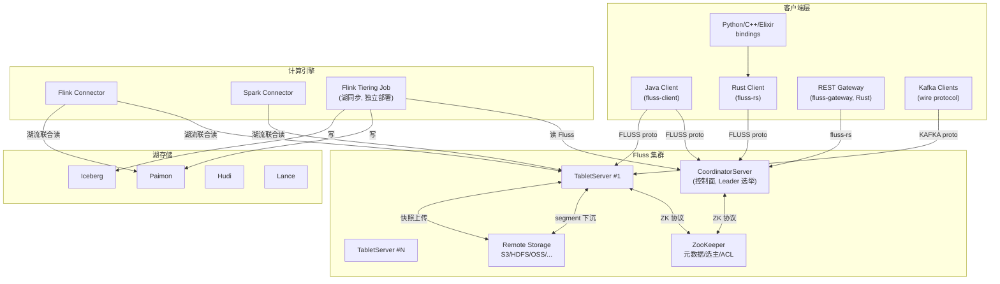
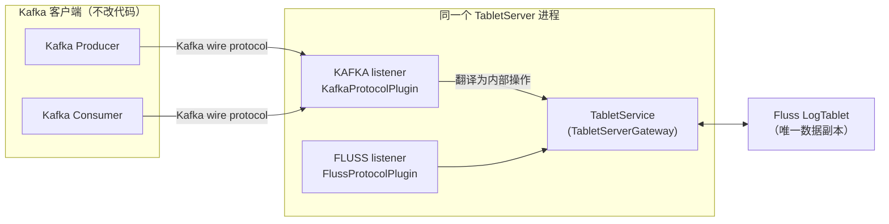

# Apache Fluss 技术架构深度解析

> 基于 Apache Fluss release-1.0.0 源码分析
> 分析日期：2026-10-14
> 仓库：`apache/fluss`（release-1.0.0）

---

## 目录

- [1. 框架定位：Fluss 是什么](#1-框架定位fluss-是什么)
  - [1.1 一句话定位](#11-一句话定位)
  - [1.2 六大核心特性](#12-六大核心特性)
  - [1.3 与相近系统的差异](#13-与相近系统的差异)
- [2. 核心数据模型](#2-核心数据模型)
  - [2.1 表的分类](#21-表的分类)
  - [2.2 Tablet = LogTablet + 可选 KvTablet](#22-tablet--logtablet--可选-kvtablet)
  - [2.3 存储格式](#23-存储格式)
  - [2.4 WAL-first 写入设计（最重要的架构决策）](#24-wal-first-写入设计最重要的架构决策)
  - [2.5 Merge 引擎（`kv/rowmerger/`）](#25-merge-引擎kvrowmerger)
  - [2.6 三级存储层级](#26-三级存储层级)
  - [2.7 Changelog 类型](#27-changelog-类型)
- [3. 服务组件总览](#3-服务组件总览)
  - [3.1 组件关系架构](#31-组件关系架构)
  - [3.2 Maven 模块清单](#32-maven-模块清单)
  - [3.3 可执行进程（仅两个）](#33-可执行进程仅两个)
- [4. 控制面：CoordinatorServer](#4-控制面coordinatorserver)
  - [4.1 两阶段启动：standby → leader](#41-两阶段启动standby--leader)
  - [4.2 Leader 选举（`CoordinatorLeaderElection`）](#42-leader-选举coordinatorleaderelection)
  - [4.3 事件驱动架构](#43-事件驱动架构)
  - [4.4 两大状态机（基于 Kafka 设计，类头注明）](#44-两大状态机基于-kafka-设计类头注明)
  - [4.5 故障处理三条路径](#45-故障处理三条路径)
  - [4.6 RPC 处理面（`CoordinatorService`）](#46-rpc-处理面coordinatorservice)
  - [4.7 Rebalance 子系统](#47-rebalance-子系统)
  - [4.8 AutoPartitionManager](#48-autopartitionmanager)
  - [4.9 元数据管理（`MetadataManager`，纯 ZK 门面）](#49-元数据管理metadatamanager纯-zk-门面)
  - [4.10 湖协调](#410-湖协调)
  - [4.11 安全](#411-安全)
- [5. 数据面：TabletServer](#5-数据面tabletserver)
  - [5.1 启动装配链（`startServices()` `:213-363`）](#51-启动装配链startservices-213-363)
  - [5.2 Replica 模型（`Replica.java`）](#52-replica-模型replicajava)
  - [5.3 副本同步（`replica/fetcher/`）](#53-副本同步replicafetcher)
  - [5.4 延迟操作（`replica/delay/`，purgatory 模式）](#54-延迟操作replicadelaypurgatory-模式)
  - [5.5 Log 存储引擎（`log/`）](#55-log-存储引擎log)
  - [5.6 远程日志分层（`log/remote/`）](#56-远程日志分层logremote)
  - [5.7 KV 存储引擎（`kv/`）](#57-kv-存储引擎kv)
  - [5.8 读写全流程](#58-读写全流程)
  - [5.9 磁盘管理（`storage/LocalDiskManager`）](#59-磁盘管理storagelocaldiskmanager)
- [6. RPC 与协议层](#6-rpc-与协议层)
  - [6.1 协议定义](#61-协议定义)
  - [6.2 Gateway 接口分层](#62-gateway-接口分层)
  - [6.3 编解码与传输](#63-编解码与传输)
  - [6.4 认证](#64-认证)
- [7. 客户端体系](#7-客户端体系)
  - [7.1 Java 客户端（`fluss-client`）](#71-java-客户端fluss-client)
  - [7.2 Rust 客户端与多语言绑定（`fluss-rust`）](#72-rust-客户端与多语言绑定fluss-rust)
  - [7.3 REST 网关（`fluss-gateway`，Rust）](#73-rest-网关fluss-gatewayrust)
- [8. Kafka 兼容层（协议翻译，非存储）](#8-kafka-兼容层协议翻译非存储)
  - [8.1 核心结论](#81-核心结论)
  - [8.2 工作机制](#82-工作机制)
  - [8.3 设计价值](#83-设计价值)
  - [8.4 1.0.0 实现状态（如实说明）](#84-100-实现状态如实说明)
- [9. 湖集成：为什么还要 Hudi/Iceberg/Paimon/Lance](#9-湖集成为什么还要-hudiicebergpaimonlance)
  - [9.1 三个 Fluss 天然解决不了的问题](#91-三个-fluss-天然解决不了的问题)
  - [9.2 三层存储定位](#92-三层存储定位)
  - [9.3 湖抽象（`fluss-common` `org.apache.fluss.lake.*`）](#93-湖抽象fluss-common-orgapacheflusslake)
  - [9.4 DDL 双向同步（lake-first）](#94-ddl-双向同步lake-first)
  - [9.5 联合读（读侧如何拼接）](#95-联合读读侧如何拼接)
- [10. Flink Tiering 作业：湖数据同步机制](#10-flink-tiering-作业湖数据同步机制)
  - [10.1 作业代码位置](#101-作业代码位置)
  - [10.2 部署形态：普通 Flink 作业，Fluss 不控制启动](#102-部署形态普通-flink-作业fluss-不控制启动)
  - [10.3 "无 Flink 状态"设计](#103-无-flink-状态设计)
  - [10.4 作业结构（`LakeTieringJobBuilder.build()`）](#104-作业结构laketieringjobbuilderbuild)
  - [10.5 心跳领表协议](#105-心跳领表协议)
  - [10.6 Split 生成（`TieringSplitGenerator`）](#106-split-生成tieringsplitgenerator)
  - [10.7 读→写（`TieringSplitReader`）](#107-读写tieringsplitreader)
  - [10.8 两阶段提交（偏移一致性核心）](#108-两阶段提交偏移一致性核心)
  - [10.9 清理](#109-清理)
- [11. 计算引擎连接器](#11-计算引擎连接器)
  - [11.1 Flink（`fluss-flink`，版本 1.18/1.19/1.20/2.2/2.3）](#111-flinkfluss-flink版本-1181191202223)
  - [11.2 Spark（`fluss-spark`，3.4/3.5）](#112-sparkfluss-spark3435)
- [12. 文件系统插件与安全](#12-文件系统插件与安全)
  - [12.1 FileSystem 抽象（`fluss-common` `org.apache.fluss.fs.FileSystem`）](#121-filesystem-抽象fluss-common-orgapacheflussfsfilesystem)
  - [12.2 文件系统实现速查表](#122-文件系统实现速查表)
  - [12.3 认证与授权体系](#123-认证与授权体系)
- [13. 部署与运维](#13-部署与运维)
  - [13.1 启动脚本（`fluss-dist/src/main/resources/bin/`）](#131-启动脚本fluss-distsrcmainresourcesbin)
  - [13.2 关键配置（`conf/server.yaml`，79 行模板）](#132-关键配置confserveryaml79-行模板)
  - [13.3 Docker（`docker/`）](#133-dockerdocker)
  - [13.4 Helm（`helm/`，appVersion 1.0.0）](#134-helmhelmappversion-100)
  - [13.5 插件打包（`plugins.xml`）](#135-插件打包pluginsxml)
- [14. 整体数据流向总览](#14-整体数据流向总览)
  - [14.1 写入（一条数据路径，三种客户端门面）](#141-写入一条数据路径三种客户端门面)
  - [14.2 控制流（谁管谁）](#142-控制流谁管谁)
  - [14.3 关键设计决策速查](#143-关键设计决策速查)
- [15. FAQ：常见疑问澄清](#15-faq常见疑问澄清)
  - [Q1：有了自己的表存储，为什么还要 Kafka 兼容层？](#q1有了自己的表存储为什么还要-kafka-兼容层)
  - [Q2：有了 Fluss 存储，为什么还要湖格式（Hudi 等）？](#q2有了-fluss-存储为什么还要湖格式hudi-等)
  - [Q3：Tiering 是 Fluss 自动同步的吗？](#q3tiering-是-fluss-自动同步的吗)
  - [Q4：Tiering 作业是 Fluss 启动/控制的吗？](#q4tiering-作业是-fluss-启动控制的吗)
  - [Q5：Kafka 兼容 = 数据同步吗？](#q5kafka-兼容--数据同步吗)
  - [Q6：为什么主键表 KvTablet 没有副本？](#q6为什么主键表-kvtablet-没有副本)
  - [Q7：一张主键表写入时到底发生什么？（一句话）](#q7一张主键表写入时到底发生什么一句话)
- [附录：关键源码文件索引](#附录关键源码文件索引)

---

## 1. 框架定位：Fluss 是什么

### 1.1 一句话定位

**Apache Fluss**（德语"河流"，读 `/flus/`）是一个**面向实时分析与 AI 的流式存储系统**（streaming storage），定位是 **Lakehouse 架构中的实时数据层**——填补数据流（Data Streaming）与数据湖仓（Data Lakehouse）之间的鸿沟。

来源：README.md *"Apache Fluss is a streaming storage built for real-time analytics & AI which can serve as the real-time data layer for Lakehouse architectures."*

### 1.2 六大核心特性

| 特性 | 说明 | 源码印证 |
|---|---|---|
| **亚秒级数据新鲜度** | 持续写入、立即可读 | LogTablet mmap 追加 + RocksDB 状态下沉 |
| **流湖一体** | 表是统一抽象，实时在 Fluss、历史在湖，读时自动联合 | `LakeSnapshotAndLogSplitScanner`、Flink `FlinkTableSource` 湖流 union read |
| **列存流（Columnar Streaming）** | 基于 Arrow，支持列裁剪与谓词下推 | `LogFormat.ARROW` 默认 + ZSTD；`PbPredicate` 谓词下推；`LocalLog.read` 可按 filter 跳 segment |
| **存算分离** | 状态管理（去重、部分更新、聚合 merge）下沉到存储 | `RowMerger` 引擎族、`PartialUpdater`；Flink Delta Join 依赖 Fluss changelog |
| **ML/AI 就绪** | 行存+列存+向量（Lance）多模态 | `fluss-lake-lance`、历史分区点查 `HistoricalPartitionManager` |
| **内置 Changelog** | 每次写都生成 append-only 变更历史 | KvTablet 写路径强制经 `WalBuilder` 生成 changelog WAL |

### 1.3 与相近系统的差异

- **vs Apache Kafka**：Kafka 是纯 append 日志，无主键、无状态；Fluss 有主键表（RocksDB 状态 + upsert/delete/point lookup），changelog 是副产品而非全部
- **vs Flink State（状态后端）**：Flink State 绑定作业生命周期；Fluss 状态是独立存储层，多作业共享、可湖同步、可外部点查
- **vs Hudi/Iceberg/Paimon**：湖格式为批量/低成本设计，分钟级快照；Fluss 为亚秒新鲜度设计，且湖是它的"下游仓库"而非替代品
- **vs ClickHouse/Doris**：分析型数据库；Fluss 是存储层，计算交给 Flink/Spark

---

## 2. 核心数据模型

### 2.1 表的分类

Fluss 的表分两类（`TableDescriptor.hasPrimaryKey()` 区分）：

| 类型 | 存储组件 | 支持操作 | 典型用途 |
|---|---|---|---|
| **Log 表**（无主键） | 仅 LogTablet | append、流式/批量读 | 事件流、日志、CDC 原始流 |
| **Primary Key 表**（有主键） | LogTablet + KvTablet | upsert、delete、点查、前缀查、全扫 | 维表、状态表、可更新事实表 |

### 2.2 Tablet = LogTablet + 可选 KvTablet

架构文档原文（`website/docs/concepts/architecture.mdx`）：

> *"Table data is divided into multiple buckets based on the defined bucketing policy... Each tablet consists of a LogTablet and, optionally, a KvTablet... Both LogStore and KvStore adhere to the same bucket-splitting and tablet allocation policies. As a result, LogTablets and KvTablets with the same tablet_id are always allocated to the same TabletServer."*

关键约束：
- **LogTablet 支持多副本**（按表配置的 replication factor，ISR 机制，Kafka 风格）
- **KvTablet 目前不支持副本**（v1.0.0 架构注释明确说明）
- 同一 bucket 的 LogTablet 和 KvTablet **永远在同一 TabletServer**（`TabletServer.startServices` 里 `LogManager`/`KvManager` 共享同一 `LocalDiskManager`）

类印证（`replica/Replica.java:155-166` javadoc）：

> *"Physical data structure that represents a replica of a TableBucket... For table with pk, it contains a LogTablet and a KvTablet if the replica is the leader of the table bucket. For table without pk, it contains only a LogTablet."*

### 2.3 存储格式

**Log 格式**（`metadata/LogFormat.java`）：

| 格式 | 定位 | 特点 |
|---|---|---|
| `ARROW`（默认） | 分析型负载 | 列式、支持列裁剪、ZSTD 压缩 |
| `INDEXED` | 事件驱动负载 | 行式、不支持列裁剪 |
| `COMPACTED` | 主键表优化 | 紧凑行式 |

**KV 格式**（`metadata/KvFormat.java`）：`COMPACTED`（默认，高效）/ `INDEXED`（利于部分列快照读）。

配置项：`table.log.format`（默认 arrow）、`table.log.arrow.compression.type`（默认 ZSTD）、`table.kv.format`（默认 compacted）。

### 2.4 WAL-first 写入设计（最重要的架构决策）

主键表写入**先写 WAL（changelog），再落状态**，`KvPreWriteBuffer.java:44-88` javadoc 原文：

> *"In Fluss, when putting a key-value pair, Fluss will first write WAL first. Only when the WAL has been persisted (with fault tolerance), can Fluss safely writing the key-value pair to the underlying kv storage. Otherwise, it'll cause in-consistent data in the kv storage."*
>
> *"we introduce the pre-write buffer... 1. Buffer all the key-value pairs that are waiting for the corresponding WAL to be persisted... 2. A temporary in-memory key-value buffer for put/get a key."*

写入完整链路（PutKv）：

```
客户端 PutKv RPC
  → TabletService.putKv（携带 MergeMode）
    → ReplicaManager.putRecordsToKv
      → Replica.putRecordsToLeader（leaderIsrUpdateLock 读锁，校验 leader/epoch/ISR）
        → KvTablet.putAsLeader（kvLock 写锁）
          → ① flush 预算准入门禁：wouldExceedFlushBudget 超限 → StorageBackpressureException
          → ② KvWriteProcessor.putAsLeader：
               读旧值 → RowMerger.merge/delete（合并引擎）
               → WalBuilder 生成 changelog（Index/Compacted/Arrow 三种 builder）
               → LogTablet.appendAsLeader(changelog)   ← ③ WAL 先落盘
               → 状态暂存进 KvPreWriteBuffer
          → ④ kvPreWriteBuffer.markWalBatchEnd
        → maybeIncrementLeaderHW（高水位推进）
```

**HW 与 KV 的一致性耦合**（`Replica.java:1485-1504`）：log 高水位不得超过已 flush 的 KV offset，否则 follower/reader 可能读到"WAL 已有但 KV 还没有"的 offset：

```java
KvTablet currentKv = this.kvTablet;
if (currentKv != null) {
    long flushedOffset = currentKv.getFlushedLogOffset();
    if (flushedOffset < newHighWatermark.getMessageOffset()) {
        // The KV view must be flushed before the log high watermark becomes visible.
        mayFlushKv(newHighWatermark.getMessageOffset());
        newHighWatermark = new LogOffsetMetadata(flushedOffset);
    }
}
```

异步 flush 状态机（`KvTablet.java:1419-1471` ASCII 图）：

```
IDLE --(new target)--> QUEUED --(worker claims)--> RUNNING --(target reached/fatal)--> IDLE
RUNNING --(storage rejection)--> STORAGE_BLOCKED --(retry timer)--> QUEUED
```

flush 完成回调 `Replica.onKvFlushComplete()` 推进 HW 并触发延迟操作（DelayedWrite）完成。

### 2.5 Merge 引擎（`kv/rowmerger/`）

`RowMerger.create()` 工厂按 `MergeEngineType` 创建 4 种引擎：

| 引擎 | 实现类 | 语义 |
|---|---|---|
| 默认（无） | `DefaultRowMerger` | latest wins；配合 `PartialUpdater` 支持部分更新 |
| `FIRST_ROW` | `FirstRowRowMerger` | 去重保首行（幂等接入） |
| `VERSIONED` | `VersionedRowMerger` | 按版本列取最大版本（需 `table.merge-engine.versioned.ver-column`） |
| `AGGREGATION` | `AggregateRowMerger` | 字段级聚合 |

`MergeEngineType` javadoc（`fluss-common/.../metadata/MergeEngineType.java:20-33`）：

> *"A primary key table with a merge engine is a special kind of table, called 'merge table'... it merges the append rows into a new data set according to the defined MergeEngineType. Therefore, it doesn't support direct UPDATE (also partial-update) and DELETE operations and only supports INSERT or APPEND operations."*

**AGGREGATION 支持的聚合函数**（`AggFunctionType.java:39-57`，共 14 种）：
`SUM, PRODUCT, MAX, MIN, LAST_VALUE, LAST_VALUE_IGNORE_NULLS, FIRST_VALUE, FIRST_VALUE_IGNORE_NULLS, LISTAGG, STRING_AGG, BOOL_AND, BOOL_OR, RBM32, RBM64`

**删除行为**（`DeleteBehavior`）：`ALLOW`（默认）/ `IGNORE`（merge 表默认）/ `DISABLE`，配置 `table.delete.behavior`。

**Merge Mode**（`rpc/protocol/MergeMode`）：`DEFAULT`（服务端合并）/ `OVERWRITE`（绕过合并引擎，Flink 故障恢复 undo 用）。

### 2.6 三级存储层级

| 层 | 存储内容 | 格式 | 保留期 | 读取者 |
|---|---|---|---|---|
| **本地盘** | LogTablet segment + KvTablet RocksDB | 私有（Arrow/indexed/compacted + SST） | 受 retention + 磁盘成本约束 | Fluss TabletServer |
| **远程存储** | 下沉的 log segment + KV 快照 | Fluss 私有格式 | 较长 | Fluss（`RemoteLogManager`、快照下载） |
| **湖** | 全量历史 + 增量 changelog | 开放格式（Parquet/ORC 等） | 长期/永久 | 任意引擎（Spark/Trino/Doris/...） |

`LogTablet.logStartOffset()` = `min(localLogStartOffset, remoteLogStartOffset, lakeLogStartOffset)`——bucket 的可见起始偏移横跨三层。

### 2.7 Changelog 类型

`record/ChangeType.java`（`@PublicStable`）：`APPEND_ONLY("+A")`、`INSERT("+I")`、`UPDATE_BEFORE("-U")`、`UPDATE_AFTER("+U")`、`DELETE("-D")`。

Changelog 镜像模式（`ChangelogImage`）：`FULL`（默认，含 UPDATE_BEFORE）/ `WAL`（不含 UPDATE_BEFORE，配置 `table.changelog-producer`）。

---

## 3. 服务组件总览

### 3.1 组件关系架构



### 3.2 Maven 模块清单

| 模块 | 职责 |
|---|---|
| `fluss-common` | 基础层：类型系统、TableDescriptor/Schema、ConfigOptions、ChangeType、MergeEngine、ACL/认证模型、`org.apache.fluss.lake.*` 湖抽象、`org.apache.fluss.fs.FileSystem` 文件系统抽象 |
| `fluss-metrics` | 指标系统（Prometheus/JMX/InfluxDB reporter） |
| `fluss-rpc` | RPC 框架：proto2 消息（`FlussApi.proto`）、Gateway 接口、Netty 客户端/服务端、协议编解码 |
| `fluss-protogen` | 协议代码生成（衍生自 Splunk LightProto），生成惰性解析 + zero-copy 消息类 |
| `fluss-client` | Java 客户端：Connection/Admin/Table/Writer/Scanner/Lookup、路由、幂等 |
| `fluss-server` | 服务端：CoordinatorServer + TabletServer（控制面 + 数据面全部实现） |
| `fluss-flink` | Flink 连接器（1.18/1.19/1.20/2.2/2.3 + common）+ `fluss-flink-tiering` 湖同步作业 |
| `fluss-spark` | Spark 连接器（3.4/3.5 + common + ut） |
| `fluss-lake` | 湖格式集成：`fluss-lake-{paimon,iceberg,hudi,lance}` |
| `fluss-kafka` | Kafka wire protocol 兼容层（协议翻译插件） |
| `fluss-filesystems` | 文件系统插件：`fluss-fs-{hadoop,hdfs,s3,oss,obs,azure,gs,cos}` |
| `fluss-gateway` | Rust 无状态 REST 网关（独立 Cargo workspace） |
| `fluss-rust` | Rust 官方客户端 `fluss-rs` + Python/C++/Elixir 绑定 |
| `fluss-dist` | 二进制分发：启动脚本、配置模板、插件打包 |
| `fluss-test-utils` | 测试工具（`FlussClusterExtension`、`ZooKeeperExtension`） |
| `fluss-jmh` | 性能微基准 |
| `fluss-docgen` | 配置文档生成 |

### 3.3 可执行进程（仅两个）

从 `fluss-dist/src/main/resources/bin/` 与 `fluss-daemon.sh` 映射确认，Fluss 集群自身只运行两个 JVM 进程：

| 进程 | 主类 | 启动脚本 |
|---|---|---|
| CoordinatorServer | `org.apache.fluss.server.coordinator.CoordinatorServer` | `bin/coordinator-server.sh` |
| TabletServer | `org.apache.fluss.server.tablet.TabletServer` | `bin/tablet-server.sh` |

（`fluss-daemon.sh` 也支持以 `zookeeper` 服务名启动内嵌 ZK，仅用于本地开发。）

**注意**：Flink Tiering 作业、REST 网关都是**独立部署单元**，不由 Fluss 启动托管（详见第 10、7 章）。

---

## 4. 控制面：CoordinatorServer

源码：`fluss-server/src/main/java/org/apache/fluss/server/coordinator/`

类 javadoc（`CoordinatorServer.java:77-85`）：

> *"Coordinator server implementation. The coordinator server is responsible to: manage the tablet servers / manage the metadata / coordinate the whole cluster, e.g. data re-balance, recover data when tablet servers down"*

### 4.1 两阶段启动：standby → leader

**设计动机**：多 Coordinator 部署时只有一个 active leader，其余 standby 只提供健康检查。

**Phase 1 — `initCoordinatorStandby()`（`CoordinatorServer.java:218-320`）**

总是运行的部分，按序装配：

| # | 组件 | 说明 |
|---|---|---|
| 1 | `Endpoint.loadBindEndpoints` | 解析 `bind.listeners` |
| 2 | `FlussScheduler` | 后台定时器线程池 |
| 3 | `MetricRegistry` / `CoordinatorMetricGroup` | 指标 |
| 4 | `ZooKeeperClient` | ZK 客户端 |
| 5 | `CoordinatorLeaderElection` | Leader 选举器 |
| 6 | `LakeCatalogDynamicLoader` | 湖 catalog 动态加载 |
| 7 | `RemoteDirDynamicLoader` | 远程目录选择器 |
| 8 | `CoordinatorMetadataCache` | 元数据缓存 |
| 9 | `ReplicaCapacityController` | KV leader 副本容量控制 |
| 10 | `DynamicConfigManager` | 动态配置管理 |
| 11 | `AuthorizerLoader.createAuthorizer` | 授权器（可为 null） |
| 12 | `LakeTableTieringManager` | 湖同步表状态机 |
| 13 | `MetadataManager` | ZK 元数据门面 |
| 14 | `KvSnapshotLeaseManager` | 快照租约 |
| 15 | `CoordinatorService` | RPC 服务实现 |
| 16 | `RpcServer.create` | Netty 服务端 |
| 17 | `rpcServer.start()` + ZK 注册 | `/coordinators/ids/<serverId>` 临时节点 |

此时 RPC 除 API_VERSIONS 外全部返回 `NotCoordinatorLeaderException`（`FlussRequestHandler.java:66-75` 做 leader 门禁）。

**Phase 2 — `initCoordinatorLeader()`（`CoordinatorServer.java:322-377`）**

仅 leader 执行：

1. `zkClient.fenceBecomeCoordinatorLeader(serverId)` — ZK epoch 递增防脑裂（`ZooKeeperClient.java:260-296`，`BadVersionException` → `CoordinatorEpochFencedException`）
2. `registerCoordinatorLeader()` — 注册 `/coordinators/active` 临时节点
3. 创建 leader 专属资源：`RpcClient`（出站 RPC 到 TabletServer）、`CoordinatorContext`（持有 ZkEpoch）、`CoordinatorChannelManager`、`AutoPartitionManager`、`CoordinatorEventProcessor`
4. `createDefaultDatabase()` — 创建默认库 `fluss`；启用 Kafka 时额外创建 `kafka` 库

**失权清理** `cleanupCoordinatorLeader()`（`:386-456`）：按逆序拆除 leader 资源，恢复 standby 状态并恢复监听动态配置。

### 4.2 Leader 选举（`CoordinatorLeaderElection`）

- 机制：Curator `LeaderLatch`，路径 `/coordinators/election`，latch 携带 serverId
- 状态机（javadoc ASCII 图）：`INITIAL → STANDBY ⇄ LEADER`，`CLOSED` 为终态
- 单线程 `leaderCallbackExecutor` 串行化所有回调——javadoc 注释：*"Curator's LeaderLatchListener callbacks run on its internal EventThread; performing synchronous ZK operations there causes deadlock... Serial execution also guarantees that leader initialization, cleanup, and state transitions never overlap."*
- 初始化失败 → 回落 STANDBY（已初始化的部分资源被清理）

**ZK 路径布局**（`ZkData.java`）：

```
/coordinators/ids/<serverId>      临时节点（存活成员）
/coordinators/election            LeaderLatch
/coordinators/active              临时节点（当前 leader 地址）
/coordinators/epoch               epoch 计数（防脑裂）
```

### 4.3 事件驱动架构

**基础设施**：`CoordinatorEventManager` = `LinkedBlockingQueue<QueuedEvent>` + 单线程 `coordinator-event-thread`（`ShutdownableThread`）。每 5s 通过 `AccessContextEvent` 回读 `CoordinatorContext` 更新指标（因 Context 非线程安全，必须在事件线程访问）。

**三个 ZK Watcher**（`event/watcher/`）把 ZK 变化翻译成事件：

| Watcher | 监听路径 | 产生事件 |
|---|---|---|
| `CoordinatorChangeWatcher` | `/coordinators/ids` | New/DeadCoordinatorEvent |
| `TabletServerChangeWatcher` | `/tabletservers/ids` | New/DeadTabletServerEvent（携带 ServerInfo 含 rack/资源） |
| `TableChangeWatcher` | `/metadata/databases` 全子树 | CreateTable / SchemaChange / DropTable / CreatePartitionEvent...（drop 经 `TableLifecycleThrottler` 限流，防万级分区级联删除饿死事件队列） |

**完整事件清单**（约 30 种，`coordinator/event/`）：

- 元数据：`CreateTableEvent`、`DropTableEvent`、`CreatePartitionEvent`、`DropPartitionEvent`、`SchemaChangeEvent`、`TableRegistrationChangeEvent`
- 成员变更：`NewTabletServerEvent`、`DeadTabletServerEvent`、`NewCoordinatorEvent`、`DeadCoordinatorEvent`
- 副本控制：`AdjustIsrReceivedEvent`、`NotifyLeaderAndIsrResponseReceivedEvent`、`ControlledShutdownEvent`、`DeleteReplicaResponseReceivedEvent`、`RetryOfflineLeaderEvent`
- 快照/分层：`CommitKvSnapshotEvent`（fenced）、`CommitRemoteLogManifestEvent`（fenced）、`CommitLakeTableSnapshotEvent`、`NotifyKvSnapshotOffsetEvent`、`NotifyLakeTableOffsetEvent`
- Rebalance：`RebalanceEvent`、`ListRebalanceProgressEvent`、`CancelRebalanceEvent`、`RebalanceTaskTimeoutEvent`、`RecoverRebalanceEvent`
- 其他：`AccessContextEvent`、`Add/RemoveServerTagEvent`、`Add/RemoveServerTagByRackEvent`、`ResumeDropEvent`、`ShutdownEventThreadEvent`

**Fenced 事件校验**：`FencedCoordinatorEvent` 携带 coordinatorEpoch + bucketLeaderEpoch，`CoordinatorEventProcessor.validateFencedEvent`（`:2522-2564`）拒绝未知表/bucket、更高 coordinator epoch（`InvalidCoordinatorException`）、过期 leader epoch（`FencedLeaderEpochException`）。

### 4.4 两大状态机（基于 Kafka 设计，类头注明）

**Bucket 状态机**（`TableBucketStateMachine`，`BucketState`）：

```
NonExistentBucket → NewBucket → OnlineBucket ⇄ OfflineBucket → NonExistentBucket
```

转换触发：建表/加载分配 → New；选主+通知 → Online；leader 故障/controlled shutdown → Offline；删除。

**Replica 状态机**（`ReplicaStateMachine`，`ReplicaState`）：

```
NonExistentReplica → NewReplica → OnlineReplica ⇄ OfflineReplica
OfflineReplica → ReplicaMigrationStarted → ReplicaDeletionStarted → ReplicaDeletionSuccessful → NonExistentReplica
```

各转换的 RPC 副作用：
- `OnlineReplica`：发 `NotifyLeaderAndIsr`（isNew=false）
- `OfflineReplica`：发 `StopReplica(delete=false)`、移出 ISR、通知剩余副本
- `ReplicaMigrationStarted`：`StopReplica(deleteLocal=true, deleteRemote=false)`（副本迁移）
- `ReplicaDeletionStarted`：`StopReplica(deleteLocal=true, deleteRemote=true)`（物理删除）

**Leader 选举策略**（`ReplicaLeaderElection`）：
- `DefaultLeaderElection`：候选 = 分配集 ∩ 存活 ∩ ISR
- `ControlledShutdownLeaderElection`：额外排除正在关闭的节点
- `ReassignmentLeaderElection`：必须尊重 rebalance 计划指定的目标 leader（newReplicas 首元素）
- 主键表 standby 优先提升逻辑：有 standby 先提 standby，否则取首个可用；从剩余中选新 standby

### 4.5 故障处理三条路径

**路径 A — Watcher 驱动**（`processDeadTabletServer` `:1395-1455`）：

1. 移除离线 bucket、存活成员、channel
2. **先推 `UpdateMetadataRequest` 到所有存活 TabletServer** —— 注释：*"prevent the scenario where NotifyLeaderAndIsrRequest gets sent before UpdateMetadataRequest, which could cause the leader to incorrectly adjust isr"*
3. 死节点主导的 bucket → `OfflineBucket` → `triggerOnlineBucketStateChange()` 重选主
4. 死节点上的全部 replica → `OfflineReplica`（发 StopReplica、移出 ISR）

**路径 B — 请求失败驱动**（`onReplicaBecomeOffline` `:1266-1298`）：NotifyLeaderAndIsr 被拒 → replica 标记离线选举排除 → bucket 重选主 → 定时 `RetryOfflineLeaderEvent` 重试。

**路径 C — 优雅关闭**（`tryProcessControlledShutdown` `:2433-2520`）：加入 shuttingDown 集合 → 批量用 `ControlledShutdownLeaderElection` 选新 leader → follower 转 OfflineReplica → 返回剩余 leader bucket 列表。

### 4.6 RPC 处理面（`CoordinatorService`）

`CoordinatorService extends RpcServiceBase implements CoordinatorGateway`，处理分三类线程模型：

**① 只读元数据（继承 `RpcServiceBase`）**：listDatabases、getTableInfo、getTableSchema、listPartitionInfos、getLatestKvSnapshots、getLakeSnapshot、listAcls、describeClusterConfigs 等 15+ 方法。

**② DDL 直写 ZK（RPC/IO 线程）**：
- `createTable` 完整流水线（`:480`）：解析校验 → KV/log 表权限 → `applySystemDefaults`（默认 bucket 数/副本因子、多级分区强制 num-precreate=0、湖格式覆盖、merge 表强制 delete-behavior=IGNORE）→ 生成 `TableAssignment` → `ReplicaCapacityController.checkCanCreateKvLeaderReplicas` → **lake-first 建湖表** → 选远程目录 → ZK 注册
- `alterTable`：三选一（properties/schema/distribution）；schema 变更**先同步湖**（`syncSchemaChangesToLake`）再写 ZK
- `dropTable`：只删 ZK 节点，物理删除由 watcher 驱动（异步）

**③ 事件队列化**（返回 CompletableFuture，由事件线程完成）：adjustIsr、commitKvSnapshot、commitRemoteLogManifest、commitLakeTableSnapshot、controlledShutdown、rebalance 三件套、getClusterHealth、metadata、alterClusterConfigs。

**④ IO 执行器**（ZK/文件系统工作）：listRemoteLogManifests、listKvSnapshots、快照租约三件套、producer offset 三件套（EOS）、`prepareLakeTableSnapshot`（湖两阶段第一阶段）、`lakeTieringHeartbeat`。

**集群健康**：`computeClusterHealth`（`:1693-1731`）按 active leader 副本数 / ISR 完整度计算 GREEN/YELLOW/RED。

### 4.7 Rebalance 子系统

**三个目标**（`GoalType`，按优先级优化）：

| 目标 | 语义 |
|---|---|
| `REPLICA_DISTRIBUTION(0)` | 各 TabletServer 副本数均衡（avg × (1±balance%)） |
| `LEADER_DISTRIBUTION(1)` | leader 副本分布均衡 |
| `RACK_AWARE(2)` | 机架感知，同 bucket 副本不落同机架 |

**`RebalanceManager`**（javadoc：*"This manager can only be used in CoordinatorEventProcessor as a single threaded model"*）：
- 同时只跑一个 rebalance；任务队列逐 bucket 串行执行
- 计划持久化 ZK `/cluster/rebalance`，leader 重启后 `RecoverRebalanceEvent` 恢复
- 单 bucket 任务 2 分钟超时，30s 检查一次

**Bucket 迁移协议**（`onBucketReassignment` javadoc `:1776-1847`，记号：RS=当前副本集, TRS=目标集, AR=新增, RR=移除）：

- 阶段 A（TRS ⊄ ISR）：bucket epoch+1 → NotifyLeaderAndIsr 通知 ORS∪TRS → AR 建 NewReplica
- 阶段 B（TRS ⊆ ISR）：AR → OnlineReplica → 必要时 TRS 内重选主 → RR → OfflineReplica（缩 ISR）→ RR → MigrationStarted（StopReplica delete）→ **最后才把 RS=TRS 写回 ZK** —— 注释：*"we have to update RS in ZK with TRS last since it's the only place where we store ORS persistently. This way, if the coordinatorServer crashes before that step, we can still recover."*

### 4.8 AutoPartitionManager

- 周期任务（`AUTO_PARTITION_CHECK_INTERVAL`）+ 单表即时触发
- **预建**：按 `AutoPartitionStrategy`（timeUnit/timeZone/numPreCreate）计算未来 N 个分区；日分区带 0~1379 分钟随机 jitter 防热点
- **过期**：`numToRetain < 0` 永不删；否则删 `headMap(lastRetainPartitionTime)`；历史系统分区（`HISTORICAL_PARTITION_VALUE`）显式跳过
- **容量门禁**：主键表建分区前 `checkCanCreateKvLeaderReplicas`

### 4.9 元数据管理（`MetadataManager`，纯 ZK 门面）

**ZK 布局**（`ZkData.java`）：

```
/metadata/databases/<db>/                          数据库
/metadata/databases/<db>/tables/<table>            表注册（TableRegistration JSON）
/metadata/databases/<db>/tables/<t>/schemas/<id>   schema 版本
/metadata/databases/<db>/tables/<t>/partitions/<p> 分区注册
/metadata/table_seqid                              全局表 ID 分配器
/metadata/partition_seqid                          分区 ID 分配器
/metadata/writer_id                                writerId 分配器（幂等）
/tabletservers/tables/<tableId>/buckets/<bucketId> 桶分配
  .../leader_isr                                   leader+ISR（版本即 epoch）
  .../snapshots                                    KV 快照句柄
  .../remote_logs                                  远程日志 manifest 句柄
  .../laketable                                    湖快照元数据
/tabletservers/server_tags                         服务器标签
/cluster/rebalance                                 rebalance 计划
/producers                                          EOS producer offset
/leases/kv_snapshot                                快照租约
/config + /config/changes                          动态配置
/fluss-acls                                        ACL
```

敏感配置脱敏：`SENSITIVE_TABLE_OPTIONS = {password, secret, key}`。

Schema 变更能力（`SchemaUpdate.java`）：**当前仅支持 AddColumn**（必须加在最后、必须可空），Drop/Rename/Modify 抛 `SchemaChangeException`。

### 4.10 湖协调

**`LakeTableTieringManager`**（7 状态机，javadoc ASCII 图）：

```
New → Initialized → Scheduled →(新鲜度落后)→ Pending →(领表)→ Tiering
Tiering →(完成)→ Tiered
Tiering →(超时2min/失败)→ Failed →(重试)→ Pending
```

- 驱动 RPC：`lakeTieringHeartbeat`（CoordinatorService `:1301-1374`）——一次请求处理 failed/tiering/finished 三类表 + 可选 `requestTable()` 返回待同步表
- epoch 校验：`validateTieringServiceRequest` 抛 `FencedTieringEpochException` 防旧作业实例抢任务

**湖快照两阶段提交**：
1. `prepareLakeTableSnapshot`：与 ZK 中上一次 `LakeTable` 合并桶偏移 → 偏移文件写远程存储 → 返回路径
2. `commitLakeTableSnapshot` → `CommitLakeTableSnapshotEvent` → 湖快照元数据写 ZK（v2 格式大元数据落文件）→ `NotifyLakeTableOffsetEvent` 通知所有副本

**`RemoteStorageCleaner`**：删表/分区时清理远程 KV 目录、远程 log 目录、湖元数据目录（即使湖曾启用后被关闭也清理残留）。

### 4.11 安全

- **授权**：`Authorizer` SPI，默认 `DefaultAuthorizer`（ACL 存 ZK `/fluss-acls`，变更走 `ZkNodeChangeNotificationWatcher` 通知）；资源层级 TABLE→{table,database,cluster}，操作 DESCRIBE 蕴含全部
- **认证**：`security.protocol.map` 按 listener 配置 PLAINTEXT/SASL；`SaslAuthenticationPlugin`（目前仅 PLAIN）；`super.users` 超级用户
- 开关：`authorizer.enabled` 默认 false；启用后所有 DDL/读写路径都有 `authorize` 检查

---

## 5. 数据面：TabletServer

源码：`fluss-server/src/main/java/org/apache/fluss/server/`

类 javadoc（`TabletServer.java:87-90`）：*"Tablet server implementation. The tablet server is responsible to manage the log tablet and kv tablet."*

### 5.1 启动装配链（`startServices()` `:213-363`）

| # | 组件 | 说明 |
|---|---|---|
| 1 | `FlussScheduler` | 后台定时器（ISR 过期、flush、retention） |
| 2 | `MetricRegistry` / `TabletServerMetricGroup` / `UserMetrics` | 指标 |
| 3 | `ZooKeeperClient` | ZK |
| 4 | `LakeCatalogDynamicLoader` / `MetadataManager` / `DynamicConfigManager` | 元数据与动态配置 |
| 5 | `TabletServerMetadataCache` | 元数据缓存 |
| 6 | `LocalDiskManager` | 磁盘目录锁/水位监控/写保护 |
| 7 | `LogManager` + `startup()` | 加载全部本地 log tablet |
| 8 | `KvManager` + `startup()` | RocksDB 实例池（共享 RateLimiter/BlockCache/WriteBufferManager） |
| 9 | `Authorizer`（可选） | |
| 10 | `RpcClient` + `CoordinatorGateway` | 出站 RPC |
| 11 | `ioExecutor` / `replicaStateChangeExecutor` | IO 池 / 副本状态变更单线程 |
| 12 | `ScannerManager` | 服务端 KV 全扫会话管理 |
| 13 | `ReplicaManager` + `startup()` | 副本管理器（内含 RemoteLogManager 等，见 5.2） |
| 14 | `TabletService` | RPC 服务实现 |
| 15 | `RpcServer.create` + `start()` | Netty 服务端 |
| 16 | 动态重配置注册 | logManager/kvManager/replicaManager/localDiskManager 等 |
| 17 | ZK 注册 | `/tabletservers/ids/<serverId>` 临时节点（NodeExists 重试） |

**注意**：`RemoteLogManager` 实际在 `ReplicaManager` 构造函数内创建（`ReplicaManager.java:282-289`），不在 TabletServer 直接持有。

**`ReplicaManager` 内部组件**（构造 `:248-382`）：
- 每数据目录一个 `OffsetCheckpointFile`（`high-watermark-checkpoint`）
- `DelayedOperationManager<DelayedWrite>` —— acks=-1 等 follower ack
- `DelayedOperationManager<DelayedFetchLog>` —— minBytes/maxWaitMs 拉取等待
- `ReplicaFetcherManager` + `AdjustIsrManager`
- `KvSnapshotResource` + `DefaultSnapshotContext`
- `HistoricalPartitionManager` —— 湖历史分区协调

**关闭顺序**（`stopServices()` `:432-564`，注释刻意强调）：

> *"Stop dispatching new RPC calls and drain the request processors before shutting down the components that can access tablets... ReplicaManager is shut down below before the tablet managers to stop those operations as well as snapshot and replica-fetcher activity."*

rpcServer → tabletService → replicaStateChangeExecutor → rpcClient/scheduler/scannerManager → ReplicaManager → tabletManagers（kvManager DISCARD / remoteLogManager / logManager）→ localDiskManager/authorizer/zk。

### 5.2 Replica 模型（`Replica.java`）

关键成员：`logTablet`（必有）、`kvTablet`（无主键或未成为 leader 时为 null）、`followerReplicasMap`、`isrState`、`leaderEpoch`、`bucketEpoch`、`coordinatorEpoch`、`isStandbyReplica`。

**生命周期关键方法**：

- `makeLeader(NotifyLeaderAndIsrData)`（`:481-553`）：写锁；校验 bucket epoch；新 leader epoch → `onBecomeNewLeader()`：**KV 表 dropKv() 再 createKv()**（从远程快照 + WAL 回放重建状态）
- `makeFollower`（`:555-610`）：KV 表 dropKv（follower 无本地 KV）
- `initKvTablet()`（`:851-965`）：**有远程快照 → 下载 + 从 snapshot.logOffset 回放 WAL；无 → 从 0 全量回放**
- `createKv()`：重试 5 次初始化，然后 `startPeriodicKvSnapshot()`

**写入口**（均在 `leaderIsrUpdateLock` 读锁下）：

- `appendRecordsToLeader`（`:1202-1236`）：**拒绝主键表** —— 注释：*"Primary-key writes must go through PUT_KV so the log and local KV state are updated together. PRODUCE_LOG is only valid for append-only tables."*
- `putRecordsToLeader`（`:1264-1301`）：`kvTablet.putAsLeader(...)`

**高水位推进** `maybeIncrementLeaderHW`（`:1438-1518`）：由 ISR 变化 / follower LEO 变化触发，HW = ISR 内最小 LEO；KV 联动见 2.4。

**读入口**：
- `fetchRecords`（follower 拉取 + 客户端 fetch，支持 HW/LOG_END 隔离、投影、谓词过滤）
- `lookups` / `lookupsFromBufferOrKv` / `prefixLookup` / `limitKvScan` / `openScan` / `limitLogScan`

### 5.3 副本同步（`replica/fetcher/`）

- **`ReplicaFetcherManager`**：按 (leaderId, fetcherId) 建 `ReplicaFetcherThread`，fetch 线程数 = `numFetchersPerServer`
- **`ReplicaFetcherThread`**：`doWork → maybeFetch → leader.fetchLog(...).get(timeout) → handleFetchLogResponse`
  - 成功路径分本地/远程：本地 `appendRecordsToFollower` + 更新 HW（注释引用 KIP-101）；远程路径 leader 返回 `RemoteLogFetchInfo` 时 follower **全截断跳跃**到远程段末尾（`truncateFullyAndStartAt`），重建 writer 状态快照
  - 传播 leader 的 KV `minRetainOffset` 给 follower（防截断破坏快照恢复）
  - offset 越界/不一致：Kafka 风格截断对齐（`fetchOffsetAndTruncate`）
- **`kv/RemoteLogFetcher`**：仅 KV 恢复时使用，预取窗口 + 并发下载远程段

### 5.4 延迟操作（`replica/delay/`，purgatory 模式）

- `DelayedWrite`：acks=-1 时 `tryComplete` → `checkEnoughReplicasReachOffset`；follower fetch 推进 HW 后 `forceComplete`
- `DelayedFetchLog`：可读字节 ≥ minFetchBytes 或 maxWaitMs 到期
- `ReplicaManager.maybeAddDelayedWrite/maybeAddDelayedFetchLog` 实现 "tryCompleteElseWatch" 模式

### 5.5 Log 存储引擎（`log/`）

**分层**：

```
LogManager（创建/获取/清理入口，recovery-point checkpoint）
  └── LogTablet（bucket 视图：本地+远程统一、HW、offset 管理、retention）
        └── LocalLog（全部变更受 LogTablet.lock 保护）
              └── LogSegments（排序 Map）
                    └── LogSegment（.log + .index + .timeindex，mmap）
```

**`LogSegment`**（javadoc）：*"A segment of the log. Each segment has two components: a log and an index... A segment with a base offset of [base_offset] would be stored in two files, a [base_offset].index and a [base_offset].log file."* 另有 `.timeindex` 与 writer 快照文件。

**追加路径**（`LogTablet.append` `:915-1022`）：
1. `analyzeAndValidateRecords`：CRC 校验、单调性、最大时间戳
2. 锁内：leader 分配 offset+timestamp（原地修改 `DefaultLogRecordBatch`）；`maybeRoll` 滚动 segment（同时 writer 状态快照）
3. 幂等去重：重复 leader batch 返回先前 offset 且 `setDuplicated(true)`；重复 follower batch 抛 `DuplicateSequenceException`
4. `LocalLog.append` → active segment 追加 + mmap 索引
5. 周期 flush（`logFlushIntervalMessages`）

**读路径**（`LogTablet.read` `:536-553`）：`FetchIsolation.LOG_END` / `HIGH_WATERMARK`；`LocalLog.read` 支持谓词过滤跳 segment（上限 `MAX_FILTER_SCAN_SEGMENTS`）。

**Retention 三删除器**（`cleanupSegments` `:850-910`）：
1. `deleteSegmentsAlreadyExistsInRemote`：清理到 `min(remoteLogEndOffset, highestCopiedEndOffset)`
2. `deleteExpiredSegments`：本地 TTL
3. tiered 段清理受 `tieredLogLocalSegments` / `effectiveLocalLogTtlMs` 约束

**三级起始偏移**：`logStartOffset() = min(localLogStartOffset, remoteLogStartOffset, lakeLogStartOffset)`

### 5.6 远程日志分层（`log/remote/`）

**`RemoteLogManager`** javadoc：

> *"The entry point for remote log management. The remote log manager is responsible for managing log tiering from local log segments to remote log segments, expiring remote log segments, and providing APIs to fetch log indexes and metadata about remote log segments."*

**`LogTieringTask.runOnce()` 四阶段算法**：

1. **候选**：从 `max(copiedOffset+1, localLogStartOffset)` 到 **HW**（只下沉已提交数据）
2. **拷贝**：按段打包 `LogSegmentFiles`（log+offset index+time index+writer 快照），构建 `RemoteLogSegment`（UUID id、base/end offset、max timestamp、size）→ `RemoteLogStorage.copyLogSegmentFiles`
3. **提交 manifest**：`trimAndMerge` → 上传 manifest 文件 → `CommitRemoteLogManifestRequest` 到 Coordinator（重试至多 10 次）
4. **收尾**：成功删过期远端段 + 清 index cache；失败删除刚拷贝的段（回滚）

`RemoteLogIndexCache`：LFU（TinyLFU）缓存远程索引文件，目录 `$logDir/remote-log-index-cache`，重启从磁盘恢复。

### 5.7 KV 存储引擎（`kv/`）

**`KvManager`**：创建/加载/清理 KvTablet；共享 RocksDB `RateLimiter`/BlockCache/WriteBufferManager；`KvFlushScheduler` 统一 flush 调度；`RowMerger.create` + `AutoIncrementManager`（ZK 分配自增 ID 段）。

**`KvTablet`** 结构：`logTablet`（WAL）+ `rocksDBKv` + `kvPreWriteBuffer` + `kvWriteProcessor` + `kvFlushScheduler` + `flushedLogOffset`。

**写准入门禁**（`putAsLeader` `:796-807`）：`wouldExceedFlushBudget` 超限 → 抛 `StorageBackpressureException`（错误码 72），防止 RocksDB 写缓冲失控。

**flush 批量**：`writePreparedFlush` 按 `writeBatchSize`/500 条切分 Native WriteBatch；历史分区删除转 `HISTORICAL_TOMBSTONE` put。重试指数退避（100ms→1000ms），注释：*"Retries are unbounded ... since giving up would permanently stall flushedLogOffset and thus the high watermark."*

**`kv/wal/` WAL 构建器**（按 LogFormat 选择）：
- `INDEXED` → `IndexWalBuilder`
- `COMPACTED` → `CompactedWalBuilder`
- `ARROW` → `ArrowWalBuilder`（单 batch，不限大小——*"all the changelogs should be in a single batch"*）

**`kv/snapshot/`**：
- `PeriodicSnapshotManager`：周期触发
- `RocksIncrementalSnapshot`：RocksDB 原生增量快照
- `CompletedSnapshot`：上传完成后的元数据（快照 ID、文件句柄、自增 ID 段）
- `DefaultCompletedKvSnapshotCommitter`：提交到 Coordinator
- `SharedKvFileRegistry`：共享 SST 文件去重

**`kv/scan/`**：
- `ScannerManager`：服务端扫描会话（UUID 寻址、跨多次批量 fetch、TTL 淘汰、leader 丢失时关闭会话）
- `ScannerContext`：pin RocksDB 快照 + 迭代器 + 资源租约；`OpenScanResult` 携带 snapshot 时的 logOffset（保证快照→log 交接不丢不重）

**`kv/partialupdate/`**：`PartialUpdater`（部分列更新，未指定列填 null）；**`kv/autoinc/`**：自增 ID 段管理（持久化在快照）；**`kv/historical/`**：历史分区键编码（按原分区名命名空间）+ 湖回查 memo。

**KV 恢复**（`KvRecoverHelper`）：读 WAL（含远程已下沉段经 `RemoteLogFetcher`）→ 处理 schema 演进（按 schemaId 解码）→ 写 pre-write buffer/RocksDB。

### 5.8 读写全流程

**Append（Log 表，acks=-1）**：

```
TabletService.produceLog
  → ReplicaManager.appendRecordsToLog
    → localDiskManager.ensureWritable()          磁盘写保护检查
    → replica.appendRecordsToLeader               （拒绝主键表）
      → LogTablet.appendAsLeader
        分配offset → 滚动 → 幂等去重 → mmap追加 → maybeIncrementLeaderHW
    → maybeAddDelayedWrite                        DelayedWrite.tryCompleteElseWatch
```

follower 每次 FetchLog → `updateFollowerFetchState` → `maybeExpandISr` → `maybeIncrementLeaderHW` → `tryCompleteDelayedOperations` → DelayedWrite 完成。

**Put（主键表）**：见 2.4 WAL-first 链路。

**Lookup 点查**：`ReplicaManager.lookups` → `kvTablet.multiGet`（双重读锁）→ 返回 value body；`insertIfNotExists` 模式内部转 put + `lookupsFromBufferOrKv` 重读（因 acks != -1 时响应可能先于异步 flush）。

**FetchLog 三级降级**（`readFromLog` `:1784-1893`）：本地读 → `LogOffsetOutOfRangeException` → 尝试湖（`canFetchFromLakeLog`）→ 尝试远程（`fetchLogFromRemote`，返回 `RemoteLogFetchInfo`）→ 都不行抛错。`isRemoteFirstClientFetch` 时直接优先远程。

**ScanKv 全扫**：首请求 `createScanner` pin 快照 → 注册 ScannerManager → 后续批量 fetch 迭代 → TTL/leader 丢失清理。

### 5.9 磁盘管理（`storage/LocalDiskManager`）

javadoc：

> *"Manages the local data directories used by a TabletServer. The manager has two responsibilities: 1. During startup, validate configured data directories, recover or create disk.properties, and hold a .lock file for every live directory. 2. After startup, provide runtime helpers for path resolution and simple per-disk load accounting used by replica placement."*

- 每目录 flock + `DiskPropertiesCheckpoint`（原子写）
- `DiskUsageMonitor` 周期采样 → 超阈值 `isDiskWriteLocked`（volatile）→ 写入口 `ensureWritable()` 拒绝
- `selectDataDirForNewBucket(hasPrimaryKey)`：新桶选盘
- 动态重配置：`disk.write-limit`

---

## 6. RPC 与协议层

源码：`fluss-rpc/`、`fluss-protogen/`

### 6.1 协议定义

**唯一生产 proto 文件**：`fluss-rpc/src/main/proto/FlussApi.proto`（1487 行，proto2、LITE_RUNTIME）。

文件头注释（迁移铺路）：

> *"NOTICE: To ensure a smooth upgrade to Proto3 syntax while maintaining backward compatibility: 1. DO NOT USE "default" keyword 2. DO NOT USE "enum" type"*

**主要消息分组**：

| 分组 | 代表消息 |
|---|---|
| 握手/错误 | ApiVersions、Authenticate、ErrorResponse |
| DDL | Create/Alter/Drop/List Database/Table、Create/DropPartition |
| 元数据传播 | MetadataRequest/Response、UpdateMetadataRequest（含 PbServerNode/Table/Partition/BucketMetadata） |
| 数据面（log） | ProduceLog、FetchLog（含 PbRemoteLogFetchInfo）、ListOffsets |
| 数据面（KV） | PutKv（含 agg_mode）、Lookup、PrefixLookup、LimitScan、ScanKv |
| 副本控制 | NotifyLeaderAndIsr、StopReplica、AdjustIsr、ControlledShutdown、CommitKvSnapshot |
| 远程日志/湖 | CommitRemoteLogManifest、NotifyRemoteLogOffsets、Prepare/CommitLakeTableSnapshot、NotifyLakeTableOffset、LakeTieringHeartbeat、GetLakeSnapshot |
| 快照租约 | GetLatestKvSnapshots、Acquire/Release/DropKvSnapshotLease、ListKvSnapshots |
| 安全 | List/Create/DropAcls、GetFileSystemSecurityToken |
| 集群管理 | Describe/AlterClusterConfigs、ServerTag、Rebalance 三件套、GetClusterHealth |
| EOS | Register/Get/DeleteProducerOffsets |
| 谓词下推 | PbPredicate、PbLeafPredicate、PbCompoundPredicate、PbLiteralValue |

**ApiKeys**（`protocol/ApiKeys.java`）：注释 *"reserve 0~999 for kafka protocol compatibility"*；Fluss 自用 **1000–1066**（`API_VERSIONS(1000)` … `REMOVE_SERVER_TAG_BY_RACK(1066)`），每 key 带版本范围与 `ApiVisibility`（PUBLIC/PRIVATE，PRIVATE 仅集群内部）。

版本演进注释示例：`PRODUCE_LOG(1014,0,1)` v1=历史分区写、`PUT_KV(1016,0,3)` v2=StorageBackpressure 错误码 72、v3=历史写、`ALTER_TABLE(1044,0,1)` v1=桶数修改。

### 6.2 Gateway 接口分层

```
RpcGateway（apiVersions + authenticate 占位）
 ├── AdminReadOnlyGateway（16 个只读方法：listDatabases/getTableInfo/metadata/getLatestKvSnapshots/...）
 │    └── AdminGateway（DDL + ACL + rebalance + EOS offset + 快照租约 + listKvSnapshots...）
 │         └── CoordinatorGateway（+ adjustIsr/commitKvSnapshot/commitRemoteLogManifest/
 │                                 prepare/commitLakeTableSnapshot/lakeTieringHeartbeat/controlledShutdown）
 └── AdminReadOnlyGateway
      └── TabletServerGateway（notifyLeaderAndIsr/updateMetadata/stopReplica/produceLog/fetchLog/
                               putKv/lookup/prefixLookup/limitScan/scanKv/getTableStats/listOffsets/
                               initWriter/notifyRemoteLogOffsets/notifyKvSnapshotOffset/notifyLakeTableOffset）
```

`@RPC(api = ApiKeys.X)` 注解绑定；`ApiManager` 静态注册两个 Gateway 的全部方法，校验命名约定（方法 `foo` 必须收 `FooRequest` 返 `CompletableFuture<FooResponse>`）。

### 6.3 编解码与传输

**帧格式**（`protocol/MessageCodec.java`）：
- 请求头 8 字节：`int16 apiKey + int16 apiVersion + int32 requestId`
- 成功响应头 5 字节：`int8 ResponseType + int32 requestId`
- 帧：`int32 frameLength + header + protobuf payload`
- **零拷贝发送**：bytes records 字段不进 protobuf payload，Netty 直接追加独立 `Send` 块（`zeroCopySize()`）

**惰性解析**：`fluss-protogen`（衍生自 Splunk LightProto）生成的消息类支持 `isLazilyParsed()` + `parseFrom(ByteBuf, size)`，bytes 字段不拷贝。

**Netty 服务端**：
- `NettyServer` 按 listener 绑定协议插件（`NetworkProtocolPlugin` SPI）：`FlussProtocolPlugin` 常驻 + `kafka.enabled` 时加载 `KafkaProtocolPlugin`
- `RequestProcessorPool`：N worker 线程各自轮询 `RequestChannel`
- `NettyServerHandler`：认证状态机（`channelActive` → AUTHENTICATING/READY；AUTHENTICATE challenge-response 循环）→ 请求入队
- `FlussRequestHandler`：线程绑定 Session（principal/listener/isInternal），coordinator 非 leader 门禁，反射调用 Gateway 方法

**Netty 客户端**：
- `ServerConnection` 状态机：`CONNECTING → CHECKING_API_VERSIONS → AUTHENTICATING → READY → DISCONNECTED`
- 握手：ApiVersions（携带 client 版本）→ 校验 server_type → Authenticate 循环（可重试错误指数退避）→ flush 待发队列
- 版本协商：取双方交集最高版本；特定版本门禁（历史 PRODUCE_LOG < v1 / PUT_KV < v3 / ALTER_TABLE < v1 拒绝）
- `RetryableGatewayClientProxy`：可重试错误自动单次重试 + 合并元数据刷新（`inFlightRefresh` 去重）

**错误码**：`protocol/Errors.java` ~90 种异常↔错误码映射（错误码是协议的一部分，注释：*"The names can be changed but the error code cannot."*）。

### 6.4 认证

- Wire：`AUTHENTICATE` ApiKey 1038，`AuthenticateRequest{protocol, token}` / `AuthenticateResponse{challenge}`
- Server 侧：`ServerAuthenticator` 按 listener 插件化；principal 传入 Session 供 ACL
- Client 侧：`ClientAuthenticator`；配置 `client.security.protocol` / `client.security.sasl.*`
- 插件：`PlainTextAuthenticationPlugin`、`SaslAuthenticationPlugin`（`fluss-common/.../security/auth/`）

---

## 7. 客户端体系

### 7.1 Java 客户端（`fluss-client`）

**`Connection`** javadoc：

> *"A cluster connection encapsulating lower level individual connections to actual Fluss servers... The connection object contains logic to find the Coordinator, locate table buckets out on the cluster, keeps a cache of locations and then knows how to re-calibrate after they move."*

`FlussConnection` 共享一个 `RpcClient` + `MetadataUpdater`，懒建 `WriterClient`/`LookupClient`/`FlussAdmin`。

**`Admin`**（879 行）：40+ 管理操作——数据库/表/分区 CRUD、schema 读取、快照/租约、offset 查询、表统计、ACL、集群配置、server tag、rebalance 三件套、EOS producer offset 三件套、集群健康。

实现 `FlussAdmin` 挂**两个代理**：写操作直连 Coordinator（非幂等，不能盲目自动重试）；只读操作经 `RetryableGatewayClientProxy` 指向随机 TabletServer。

**写入**：

| API | 表类型 | 说明 |
|---|---|---|
| `Append` → `AppendWriter.append(InternalRow)` | Log 表 | |
| `Upsert` → `UpsertWriter.upsert/delete(InternalRow)` | 主键表 | 支持 `partialUpdate(cols)`、`mergeMode(OVERWRITE)` |
| `TypedAppendWriter` / `TypedUpsertWriter` | 同上 | POJO 类型化 |
| `MultiTableWrite` | 多表 | |

部分更新语义（`UpsertWrite.java:43-56` javadoc）：*"For delete operation, the entire row will not be removed, but only the specified columns except primary key will be set to null. The entire row will be removed when all columns except primary key are null."*

**写入管线**：`WriterClient` = `RecordAccumulator`（per-bucket WriteBatch 队列，格式 ARROW_LOG/INDEXED_LOG/COMPACTED_LOG/INDEXED_KV/COMPACTED_KV）+ `Sender` 线程（`fluss-write-sender`）。关键配置：
- `client.writer.acks` 默认 **all**（0/1/-1 语义同 Kafka）
- `client.writer.enable-idempotence` 默认 **true**（要求 retries>0 + acks=all；max-inflight=5）
- `client.writer.batch-size` / `batch-timeout` / `request-max-size`（默认 10mb）
- KV 反压：`PbPutKvRespForBucket.pressure` → `RecordAccumulator.updateThrottle`

**幂等**：`writerId`（非 producerId）由服务端 `InitWriter` RPC 分配（分配器在 ZK `/metadata/writer_id`）；`IdempotenceManager`（Kafka 派生）维护 per-bucket batch sequence，处理 `OutOfOrderSequenceException`/`UnknownWriterIdException`。

**路由**：
- `MetadataUpdater` 维护不可变 `Cluster` 缓存（`TableBucket → BucketLocation` 索引，仅含有 leader 的桶"可用"）
- `leaderFor(TablePath, TableBucket)`：miss 时最多 3 次 `updateMetadata` 刷新
- `BucketAssigner`：`HashBucketAssigner`（有 bucket key）/ `RoundRobinBucketAssigner` / `StickyBucketAssigner`（无 key，默认 Sticky）
- `DynamicPartitionCreator`：客户端自动建分区（`client.writer.dynamic-create-partition.enabled`）

**读取**：

| API | 说明 |
|---|---|
| `Scan.createLogScanner()` | 流式订阅（poll/wakeup/subscribe(bucket, offset)） |
| `Scan.createBatchScanner(...)` | 主键表 RocksDB 全扫（ScanKv）；Log 表需 limit |
| `Scan.createBatchScanner(bucket, snapshotId)` | 主键表快照直读 |
| `Lookup` / `TypedLookuper` | 点查/前缀查（`lookupBy` 列须等于 bucket key 且为主键前缀）；`enableInsertIfNotExists` |

扫描实现：`LogScannerImpl`（per-node 批量 fetch + RemoteLogDownloader）、`KvBatchScanner`/`LimitBatchScanner`/`KvSnapshotBatchScanner`/`KvSnapshotAndLogBatchScanner`/`LakeSnapshotAndLogSplitScanner`/`CompositeBatchScanner`、多表 `MultiTableBatchScanner`。

**`LookupClient`**：单 `fluss-lookup-sender` 线程 + 队列批量合并；配置 `client.lookup.{queue-size,max-batch-size,max-inflight-requests,batch-timeout,max-retries}`。

**安全 token**：`token/SecurityTokenManager` 周期向 Coordinator `getFileSystemSecurityToken` 获取远程存储临时凭证。

### 7.2 Rust 客户端与多语言绑定（`fluss-rust`）

**`fluss-rs` crate**（官方 Rust 客户端，独立 Cargo workspace，edition 2024）：
- 能力：Connection（bootstrap/SASL/优雅关闭）、Admin（库/表/分区/offset）、Log 表（单行+Arrow RecordBatch append、scan subscribe/poll）、KV 表（upsert/delete/点查/**前缀查**/分区 KV）、全类型集
- 存储后端经 `opendal`（memory/fs/s3/oss）

**绑定**：
- **Python**（PyO3，PyPI 包）
- **C++**（FFI + Arrow C++，支持 filter pushdown 到服务端 RecordBatch 裁剪）
- **Elixir**（Rustler NIF，目前仅 log 表 append+scan）

### 7.3 REST 网关（`fluss-gateway`，Rust）

**定位**（README）：

> *"A stateless REST gateway for Apache Fluss. It exposes REST APIs for writing to Fluss tables and performing DDL operations, while keeping no session, cursor, or replay state: any instance can serve any request behind a plain load balancer."*

**架构**：

```
HTTP 客户端
  → axum 路由（protocol/rest/*）
    中间件：request-id / body 上限 413 / deadline 504 / panic→500 /
            access log / per-group Semaphore 429+Retry-After / draining guard
  → trait FlussBackend（backend/mod.rs）
    → NativeFlussBackend（backend/client.rs）
      → fluss-rs（FlussConnection/FlussAdmin/AppendWriter/UpsertWriter）
        → Fluss 集群 RPC
```

**连接管理**（`backend/connection.rs`）：每集群一个懒加载共享连接（`ConnectionCache`），30s 周期清理空闲（`connection.idle-timeout`），冷启动并发请求串行化为一次连接尝试，关闭时排空。

**REST 端点**（OpenAPI 2268 行，utoipa 生成 + drift 测试）：

| 方法 | 路径 | 功能 |
|---|---|---|
| GET | `/health`、`/ready` | 健康/就绪 |
| GET | `/v1/openapi.json` | OpenAPI 文档 |
| GET | `/v1/clusters` | 集群发现 |
| GET/POST/DELETE | `.../databases[...]` | 库列表/建库/删库 |
| GET/POST | `.../tables` | 表列表/建表 |
| GET/PATCH/DELETE | `.../tables/{table}` | 表详情/改表/删表 |
| GET/POST/DELETE | `.../partitions[...]` | 分区列表/建分区/删分区 |
| POST | `.../tables/{table}/records` | 批量写（append/upsert/delete + partial_update_columns，per-entry 结果） |

**安全**：默认 plaintext；`connection.security.protocol: sasl` 可配服务账号；`identity-mode: user` 暂不支持（需 Fluss act-as）。

**未实现**（README 声明的 follow-up）：lookup/prefix-lookup API、HTTP 调用方认证、用户身份透传。

---

## 8. Kafka 兼容层（协议翻译，非存储）

模块：`fluss-kafka/`（仅 5 个主类 + SPI 注册文件）

### 8.1 核心结论

**Kafka 兼容层不是"历史存储"，而是"客户端协议适配"——它不存数据，只做 wire protocol → Fluss 内部操作的翻译。** 数据从头到尾只有 Fluss 一份。

### 8.2 工作机制



1. **同一 Netty 服务、双协议监听**：`NettyServer.loadProtocols` 在 `kafka.enabled=true` 时通过 SPI 加载 `KafkaProtocolPlugin`，Kafka 监听器从 Fluss 插件的 listener 集合中剥离，各自独立绑定
2. **真实 Kafka 库解码**：`KafkaCommandDecoder` 使用 `org.apache.kafka.common` 的 `RequestHeader.parse` + `AbstractRequest.parseRequest` 解析，请求经 hash 分发到 `RequestChannel`（与 Fluss 请求同构）
3. **topic ↔ 表映射**：`kafka.database` 配置（默认 `"kafka"`），`CoordinatorServer.createDefaultDatabase()` 启用 Kafka 时预建该库——**一个 Kafka topic = 该库下的一张 Fluss 表**
4. **响应顺序**：Kafka 客户端要求响应按序（`InFlightRequests.completeNext`），`KafkaCommandDecoder` 用 Deque 保证 in-order 发送；acks=0 的 PRODUCE 直接丢弃不回响应

### 8.3 设计价值

- 存量 Kafka 应用**不改代码、不换客户端**迁移到 Fluss
- 迁移后获得亚秒新鲜度、主键表、列存下推等能力
- Fluss 原生客户端还能用 Kafka 协议之外的功能（lookup、湖联合读等）

### 8.4 1.0.0 实现状态（如实说明）

`KafkaRequestHandler.processRequest`（`:49-148`）中：

| API | 状态 |
|---|---|
| `API_VERSIONS` | **已实现**（`KafkaRequestITCase` 验证真实 NetworkClient 握手；METADATA ≤ v11、FETCH ≤ v12，因不支持 TopicId） |
| METADATA / PRODUCE / FETCH / FIND_COORDINATOR / OFFSET_* / 消费组全套 / 事务全套 / CREATE_TOPICS / ... | **空桩**（dispatch case 存在但 handler 为空，不完成响应 future） |

协议框架、编解码、listener 装配、默认库预建均已就绪，数据面 API 属后续版本落地内容。

---

## 9. 湖集成：为什么还要 Hudi/Iceberg/Paimon/Lance

### 9.1 三个 Fluss 天然解决不了的问题

| 问题 | 说明 |
|---|---|
| **① 成本与保留期** | Fluss 本地存储（mmap segment + RocksDB）为高频读写设计，保留期受磁盘成本约束；远程分层虽降低部分成本但是 **Fluss 私有格式，只有 Fluss 能高效读**。湖格式（Parquet/ORC + 元数据快照）在对象存储上保存数月~数年历史，成本低一个数量级 |
| **② 开放生态** | Iceberg/Paimon/Hudi 是行业开放表格式：Spark、Trino、Doris、StarRocks、Flink 直接读，**不需要 Fluss 在线**。这正是 *"serve as the real-time data layer for Lakehouse architectures"*——Fluss 管新鲜数据层，湖管历史/共享层 |
| **③ 跨引擎统一视图** | 计算引擎读表时自动做"湖快照 + Fluss 增量"联合读，用户视角只有一张表，不关心数据在哪层 |

### 9.2 三层存储定位

| 层 | 存储 | 格式 | 定位 |
|---|---|---|---|
| LogTablet 本地 | mmap segment + RocksDB | Arrow 列存/私有 | 秒级新鲜度、流式读写 |
| 远程存储 | S3/HDFS 私有 segment 文件 | Fluss 私有 | 本地磁盘降本、日志下沉 |
| **湖** | **开放表格式** | **Parquet/ORC/...** | **长期历史、跨引擎共享、AI/特征库** |

### 9.3 湖抽象（`fluss-common` `org.apache.fluss.lake.*`）

**注**：无 `fluss-lake-common` 模块，公共接口在 fluss-common；四个格式模块（`fluss-lake-{paimon,iceberg,hudi,lance}`）各自实现并经 Java SPI 注册。

```
LakeStoragePlugin（SPI, identifier + createLakeStorage）
  └── LakeStorage
        ├── createLakeTieringFactory() → LakeTieringFactory
        │     ├── createLakeWriter(WriterInitContext) → LakeWriter（可选 SupportsRecordBatchWrite Arrow 零拷贝）
        │     └── createLakeCommitter(CommitterInitContext) → LakeCommitter
        │           ├── commit(committable, snapshotProperties)   ← 快照属性含 "fluss-offsets"
        │           └── getMissingLakeSnapshot(...)               ← 恢复：找回湖已提交未上报的快照
        ├── createLakeCatalog() → LakeCatalog（createTable/alterTable，与 Fluss DDL 双向同步）
        └── createLakeSource(TablePath) → LakeSource（湖侧读，支持 project/filter/limit 下推）
```

**各格式能力矩阵**：

| 格式 | Writer | LakeSource | 服务端点查 | 特点 |
|---|---|---|---|---|
| Paimon | AppendOnlyWriter / MergeTreeWriter | ✅ | ✅ `PaimonLakeTableLookuper` | Arrow batch 支持最完整 |
| Iceberg | AppendOnly/Delta TaskWriter | ✅ | ❌ | |
| Hudi | HudiLakeWriter | ✅ | ❌ | 含 compaction service |
| Lance | ShardedArrowBatchWriter | ❌（未实现） | ❌ | 向量格式，AI 场景 |

### 9.4 DDL 双向同步（lake-first）

`LakeCatalog` javadoc 强调桶数同步语义：

> *"A TableChange.ModifyBucketCount is Fluss's coordinator-orchestrated bucket count rescale: implementations supporting rescale must apply it to their bucket layout option... User-facing changes to the lake-native bucket option (e.g. Paimon bucket) keep being rejected to prevent the two systems from diverging."*

流程：`createTable` 先 `lakeCatalog.createTable` 再 ZK 注册；`alterTableSchema` 先 `syncSchemaChangesToLake`；`alterBucketCount` 传播到湖桶布局。

### 9.5 联合读（读侧如何拼接）

**Flink**（`FlinkTableSource`）：`isDataLakeEnabled` 时构建 `LakeSource<LakeSplit>` 传入 source；投影/过滤同时下推湖侧；PK 表用 `LakeSnapshotSplit + FlussLogSplit` 拼接。

**Spark**（`FlussLakeUtils.createLakeSource`）：同样机制，`FlussLakeAppendPartitionReader` / `FlussLakeUpsertPartitionReader`。

**客户端**：`KvSnapshotAndLogBatchScanner` / `LakeSnapshotAndLogSplitScanner`。

**历史分区**：主键表历史数据可存湖中，`HistoricalPartitionManager`（TabletServer 侧）协调湖点查（`HistoricalLakeLookupManager` Caffeine 缓存湖表 lookuper，限 10 表、每表 1/10 磁盘预算）。

---

## 10. Flink Tiering 作业：湖数据同步机制

### 10.1 作业代码位置

| 模块 | 内容 |
|---|---|
| `fluss-flink/fluss-flink-tiering/` | 薄入口：`FlussLakeTieringEntrypoint`（main）、`FlussLakeTiering`（构建作业、装饰器插件）、`LakeTieringDecoratorPlugin` SPI |
| `fluss-flink/fluss-flink-common/.../tiering/` | 作业本体：`LakeTieringJobBuilder`（装配 pipeline）、`TieringSource`/`TieringSourceEnumerator`/`TieringSplitReader`（读端）、`TieringCommitOperator`/`FlussTableLakeSnapshotCommitter`（提交端） |

独立 jar（`fluss-flink-tiering-*.jar`）存在的原因（`src/README.md`）：避免与 Flink `lib/` 里的 `fluss-flink.jar` 类加载器冲突。

### 10.2 部署形态：普通 Flink 作业，Fluss 不控制启动

**关键结论**：
- 作业形态是**标准 Flink DataStream 作业**，有 main()，像任何作业一样 `flink run` 提交，可跑共享 Flink 集群或独立部署
- 检查过 `fluss-dist` 启动脚本、`helm/`、`docker/`——**没有任何地方托管或拉起这个作业**
- **进程生命周期**（部署/启动/扩容/停止）：归 Flink/用户
- **工作内容调度**（哪张表该同步、进度、失败重试、防旧实例抢活）：归 Fluss Coordinator

```
用户/运维 ──flink run──► Flink 集群拉起 Tiering 作业进程（Fluss 不管这一步）
                              │
                              │ 启动后作业主动连上来（lakeTieringHeartbeat，30s 心跳）
                              ▼
                    CoordinatorServer.LakeTableTieringManager
                    （Pending 队列、7 状态机、epoch fencing）
                              │ requestTable() 领表
                              ▼
                    作业开始同步被分配的表
```

### 10.3 "无 Flink 状态"设计

`FlussLakeTiering` 强制 `full-restart` + `EXPONENTIAL_DELAY`，注释：

> *"the tiering job is completely stateless (offsets are persisted in Fluss Server's LakeSnapshot, not in Flink checkpoint state), so it is safe to restart indefinitely on failure."*

同步进度（每 bucket 已同步 offset）存在 Coordinator 的 ZK `LakeTable` 快照里，作业可无限重启，正确性由 Fluss 侧偏移 + 湖侧快照保证。

### 10.4 作业结构（`LakeTieringJobBuilder.build()`）

```java
env.fromSource(tieringSource, ..., "TieringSource")        // Boundedness.CONTINUOUS_UNBOUNDED
   .transform("TieringCommitter", ..., commitOperator)
       .setParallelism(1).setMaxParallelism(1)            // 提交端强制单并行度（全局有序）
       .sinkTo(new DiscardingSink())
```

- 读偏好默认 `REMOTE_FIRST`：*"offload reads from tablet servers"*
- 装饰器插件 `LakeTieringDecoratorPlugin` SPI 可在构建前注入环境定制（如内部安全 token）

### 10.5 心跳领表协议

`TieringSourceEnumerator`（javadoc）：

> *"Register the Tiering Service job with the Fluss Cluster when the Flink Tiering job starts up / Request Fluss table splits ... Un-Register on shutdown."*

- 建 `Connection` + `RpcClient` + `CoordinatorGateway` 代理
- 四种心跳辅助：`basicHeartbeat` / `failedTableHeartBeat` / `heartBeatWithRequestNewTieringTable` / `tieringTableHeartBeat`
- 轮询间隔 `tiering.poll.table.interval` 默认 **30s**
- Coordinator 侧超时 2 分钟无心跳 → 表回 Pending 重试；epoch 校验 `FencedTieringEpochException`

### 10.6 Split 生成（`TieringSplitGenerator`）

- **主键表**：每 bucket → **1 个 `TieringSnapshotSplit`**（历史首次全量回灌）+ **1 个 `TieringLogSplit`**（后续增量）
- **Log 表**：仅 1 个 LogSplit

### 10.7 读→写（`TieringSplitReader`）

1. 每 table bucket 建一个 `LogScanner` 订阅 Fluss
2. 每 bucket 维护一个 `LakeWriter<WriteResult>`（如 Paimon：无主键 `AppendOnlyWriter`、有主键 `MergeTreeWriter`；Arrow 数据走 `SupportsRecordBatchWrite` 零拷贝）
3. split 读完 → `LakeWriter.complete()` → `TableBucketWriteResult`（写结果 + log end offset + 最大 tiering 时间戳）

源事件：`FinishedTieringEvent` / `FailedTieringEvent` / `TieringReachMaxDurationEvent`（超时强制完成）。

### 10.8 两阶段提交（偏移一致性核心）

**阶段 1 — 湖侧提交**（`TieringCommitOperator.processElement/commitWriteResults`）：

- `LakeCommitter.toCommittable()` → `commit()`：写数据文件 + 湖引擎提交快照，**快照属性写入 `fluss-offsets`**（每 bucket 已同步的 Fluss log offset）
- 空提交处理：无数据但偏移推进时提交空湖快照（保持偏移前进）
- 表 ID 变化时 abort 脏提交
- 失败 → `FailedTieringEvent` → 心跳上报 → 回 Pending 重试

**阶段 2 — Fluss 侧登记**（`FlussTableLakeSnapshotCommitter`，javadoc）：

> *"implements a two-phase commit protocol ... Prepare phase (prepareLakeSnapshot): Sends log end offsets to the Fluss cluster, which merges them with the previous log end offsets and stores the merged snapshot data in a file ... Commit phase (commit): Sends the lake snapshot metadata (including snapshot ID and file paths) to the coordinator to finalize the commit."*

1. `PrepareLakeTableSnapshotRequest` → Coordinator 合并偏移、偏移文件写远程存储、返回路径
2. `CommitLakeTableSnapshotRequest` → Coordinator 湖快照元数据写 ZK（`LakeTable` v2，大元数据落文件）
3. Coordinator `NotifyLakeTableOffsetEvent` → `NotifyLakeTableOffsetRequest` 通知各副本更新 `lakeLogEndOffset` 等指标

**恢复兜底**：`LakeCommitter.getMissingLakeSnapshot()` 发现"湖已提交但未上报回 Fluss"的孤儿快照并补齐登记。

### 10.9 清理

- Coordinator `RemoteStorageCleaner`：删表/分区时清理湖元数据目录（含曾启用后关闭的残留）
- `fluss-flink` action：`OrphanFilesCleanAction` 清理孤儿文件

---

## 11. 计算引擎连接器

### 11.1 Flink（`fluss-flink`，版本 1.18/1.19/1.20/2.2/2.3）

**Catalog/Factory**：
- `FlinkCatalog`（完整 DDL + 分区 + 存储过程）、`FlinkCatalogFactory`（标识 `"fluss"`，必填 `bootstrap.servers`）
- `FlinkTableFactory` 路由：含 `LAKE_TABLE_SPLITTER` → `LakeTableFactory`（原生湖读，仅 Paimon/Iceberg 委托各自 Flink factory）；`*$changelog` → `ChangelogFlinkTableSource`；`*$binlog` → `BinlogFlinkTableSource`；默认 → `FlinkTableSource`

**Source**（`FlinkTableSource` 实现接口）：

```java
ScanTableSource, SupportsProjectionPushDown, SupportsFilterPushDown, LookupTableSource,
SupportsRowLevelModificationScan, SupportsLimitPushDown, SupportsAggregatePushDown,
SupportsWatermarkPushDown, SupportsLookupCustomShuffleAdapter
```

- Changelog 模式：log/有界 insert-only；PK 表 `all()`
- 湖流联合读：`isDataLakeEnabled` 时 `LakeSource` + 湖快照 split；`validateBoundedModeSupported` 阻止 FULL startup 模式

**Sink**（`FlinkTableSink`）：

```java
DynamicTableSink, SupportsPartitioning, SupportsDeletePushDown,
SupportsRowLevelDelete, SupportsRowLevelUpdate
```

- PK 表走 `UpsertSinkWriter`（包客户端 `UpsertWriter`）；log 表走 `AppendSinkWriter`
- 选项：`sink.ignore-delete`、`sink.bucket.shuffle`、`sink.distribution-mode`

**Lookup Join**：同步 `FlinkLookupFunction` / 异步 `FlinkAsyncLookupFunction`（`table.newLookup()`）；部分缓存 `PartialCachingLookupProvider`；bucket-aware shuffle `FlussLookupInputPartitioner`；Flink 2.x 桥接 `SupportsLookupCustomShuffleAdapter`；选项 `lookup.async`、`lookup.insert.if.not.exists`。

**Delta Join**：无 Fluss 侧专门类——是 **Flink 2.2+ 优化器特性**，由 Fluss 的 lookup + changelog 语义使能。测试 `Flink22DeltaJoinITCase` / `Flink23DeltaJoinITCase` 设置 `TABLE_OPTIMIZER_DELTA_JOIN_STRATEGY = FORCE` 验证。

**Action**：`OrphanFilesCleanActionFactory`（孤儿文件清理）。

### 11.2 Spark（`fluss-spark`，3.4/3.5）

- `SparkCatalog`（TableCatalog + Namespaces + Procedures）、`SparkTable`（DSv2：`SupportsRead` + `SupportsWrite` + `SupportsFlussPartitionManagement`）
- 读：无 PK → `FlussAppendScanBuilder`；PK → `FlussUpsertScanBuilder`（merge 读）；列/过滤/limit 下推（Arrow log 表支持服务端过滤）；流式 `FlussMicroBatchStream`
- 写：`FlussBatchWrite` / `FlussStreamingWrite` / `FlussDataWriter`
- 湖联合读：`FlussLakeUtils.createLakeSource`（TODO：自定义 Paimon 湖表路径暂不支持）
- SQL 扩展：`FlussSparkSessionExtensions` / `FlussSparkSqlParser` / 存储过程 `get_cluster_configs`
- **无 lookup join 支持**

---

## 12. 文件系统插件与安全

### 12.1 FileSystem 抽象（`fluss-common` `org.apache.fluss.fs.FileSystem`）

javadoc：

> *"expose a common and well defined interface for access to files. This abstraction is used both by Fluss's fault tolerance mechanism (recovery ...)"*

核心方法：`obtainSecurityToken` / `open` / `create` / `delete` / `mkdirs` / `rename` / `listStatus` / `getFileStatus`。

插件 SPI：`FileSystemPlugin`（`getScheme()` + `create(URI, Configuration)`）；ServiceLoader + PluginManager 双通道加载；实例按 scheme+authority 缓存；`FileSystemSafetyNet` 包装。

### 12.2 文件系统实现速查表

| 模块 | scheme | 说明 |
|---|---|---|
| `fluss-fs-hadoop` | （库） | Hadoop FS 适配基座 |
| `fluss-fs-hadoop-shaded` | （库） | shade 版 hadoop-common |
| `fluss-fs-hdfs` | `hdfs` | 动态解析 Hadoop FS 实现类 |
| `fluss-fs-s3` | `s3`/`s3a` | AWS S3 |
| `fluss-fs-oss` | `oss` | 阿里云 OSS |
| `fluss-fs-obs` | `obs` | 华为云 OBS |
| `fluss-fs-azure` | `abfs`/`abfss`/`wasb`/`wasbs` | Azure |
| `fluss-fs-gs` | `gs` | Google Cloud Storage |
| `fluss-fs-cos` | `cos` | 腾讯云 COS |

各云厂商模块配 **临时凭证自动轮换**（`DynamicTemporary*CredentialsProvider` + `*SecurityTokenReceiver`），供远程 KV 快照 / 日志分层 / 湖写入使用（`remote.data.dir` 配置远程目录）。

### 12.3 认证与授权体系

**分层**：

| 层 | 组件 | 说明 |
|---|---|---|
| 认证（你是谁） | `AuthenticationPlugin` SPI → `PlainTextAuthenticationPlugin` / `SaslAuthenticationPlugin` | 按 listener 配置 `security.protocol.map`；SASL 目前仅 PLAIN |
| 授权（你能干什么） | `AuthorizationPlugin` SPI → `DefaultAuthorizationPlugin` → `DefaultAuthorizer` | ACL 存 ZK；资源 TABLE→{table,database,cluster}；操作 DESCRIBE 蕴含全部 |
| 凭证 | `GetFileSystemSecurityToken` RPC + 客户端 `SecurityTokenManager` | 远程存储临时凭证 |

开关：`authorizer.enabled`（默认 false）、`authorizer.type`（默认 `"default"`）、`super.users`。

---

## 13. 部署与运维

### 13.1 启动脚本（`fluss-dist/src/main/resources/bin/`）

| 脚本 | 功能 |
|---|---|
| `coordinator-server.sh` / `tablet-server.sh` | `start|start-foreground|stop|stop-all`；映射主类见 3.3 |
| `fluss-daemon.sh` | 守护进程管理（pid 文件 + flock；SIGTERM 后最多等 120s 再 SIGKILL） |
| `fluss-console.sh` | 前台运行 |
| `local-cluster.sh` | **单机开发集群**：① 起内嵌 ZK → ② 起 Coordinator → ③ 起 Tablet（端口改 0 随机，防冲突）；stop 逆序 |
| `readiness-check.sh` | 就绪检查 |

### 13.2 关键配置（`conf/server.yaml`，79 行模板）

```yaml
zookeeper.address: localhost:2181          # ZK 地址
default.bucket.number: 1                   # 默认 bucket 数
default.replication.factor: 1              # 默认副本因子
data.dir: /tmp/fluss-data                  # 本地数据目录
remote.data.dir: /tmp/fluss-remote-data    # 远程存储（oss:// 或 hdfs://，KV 快照/日志下沉）
bind.listeners: FLUSS://localhost:9123     # 监听器，格式 {name}://{host}:{port}，逗号分隔
tablet-server.id: 0                        # TabletServer 静态 ID
# fs.oss.endpoint / accessKeyId / accessKeySecret ...
```

其他重要配置项速查（`ConfigOptions.java`，2787 行）：
- `kafka.enabled` / `kafka.database` / `kafka.listener.names`
- `datalake.enabled` / `datalake.format` / `datalake.<format>.*`
- `client.writer.acks` / `enable-idempotence` / `batch-size`
- `table.log.format` / `table.kv.format` / `table.merge-engine.*` / `table.delete.behavior`
- `authorizer.enabled` / `security.protocol.map` / `client.security.*`
- `server.writer-id.expiration-time` / `kv.snapshot.interval` / `disk.write-limit`

### 13.3 Docker（`docker/`）

- `docker/fluss/`：官方镜像（eclipse-temurin:17-jre，用户 fluss uid 9999）；`docker-entrypoint.sh` 用 `envsubst` 动态改写 `conf/server.yaml`，按命令分发 coordinatorServer / tabletServer
- `docker/fluss-gateway/`：网关镜像（`just image` 构建，含 amd64/arm64）
- `docker/quickstart-flink/`：快速体验镜像（含 `fluss-flink-tiering-*.jar` 到 `opt/`、Paimon/Iceberg 初始化脚本）

### 13.4 Helm（`helm/`，appVersion 1.0.0）

- `sts-coordinator.yaml` / `sts-tablet.yaml`：StatefulSet
- `svc-*`：服务（含 metrics service）
- `pdb-*`：PodDisruptionBudget
- `configmap-jaas-template.yaml`：SASL JAAS
- `_validate.tpl`：安装期校验告警/错误
- `tests/`：15 个 helm-unittest 测试（安全、密钥、指标、调度、校验）

### 13.5 插件打包（`plugins.xml`）

分发包 `plugins/` 目录含：`paimon`（附 `flink-shaded-hadoop-2-uber` + `paimon-bundle`）、`hdfs`、`oss`、`s3`、`prometheus`、`jmx`、`influxdb`、`iceberg`、`lance`、`hudi` —— **四个湖格式默认全量打包**。

---

## 14. 整体数据流向总览

### 14.1 写入（一条数据路径，三种客户端门面）

```
Kafka Clients ──(wire protocol 兼容, 翻译)──┐
Fluss SDK (Java/Rust/Python/C++) ──────────┼──► TabletServer
REST Gateway (Rust, REST→fluss-rs) ────────┘      │
                                                   ▼
                                     ┌── LogTablet (Arrow 列存 segment, WAL, 多副本 ISR) ──┐
                                     │              │                                      │
                                     │       KvTablet (RocksDB, 仅主键表 leader, 无副本)     │
                                     │         RowMerger 合并 → changelog 已在 LogTablet     │
                                     │              │                                      │
                                     │   RemoteLogManager 下沉段到远程存储                    │
                                     │   PeriodicSnapshotManager 增量快照上传                 │
                                     └──────────────────────────────────────────────────────┘
                                                   │
              Flink Tiering Job（增量同步, 心跳领表, 两阶段提交, 无 Flink 状态）
                                                   ▼
                                     ┌── 湖表 (Paimon/Iceberg/Hudi/Lance)
                                     │   开放格式 Parquet/ORC, 长期历史, 跨引擎共享
                                     │   快照属性携带 fluss-offsets
                                     └──────────────────────────────────────────────────────┘
                                                   ▲
   Flink/Spark 查询 ─── 湖快照 split + Fluss log split 联合读（一张表的统一视图）
   任意引擎直读湖 ──── Spark/Trino/Doris 直接读开放格式（不经 Fluss）
```

### 14.2 控制流（谁管谁）

```
                         ┌──────────────────────────────────────┐
                         │           ZooKeeper                   │
                         │ 元数据/选主/leader_isr/快照句柄/ACL     │
                         └──────────▲──────────────▲────────────┘
                                    │              │
              ┌─────────────────────┴───┐      ┌────┴──────────────────────┐
              │   CoordinatorServer     │      │      TabletServer ×N      │
              │  LeaderLatch 选主        │◄────►│  ReplicaManager           │
              │  事件线程 + 两大状态机    │ RPC  │  = LogTablet + KvTablet   │
              │  Rebalance 计划执行      │      │  ReplicaFetcher 同步       │
              │  AutoPartition 周期建删   │      │  RemoteLogManager 下沉     │
              │  LakeTableTieringManager │      │  KvSnapshot 增量快照       │
              └───────────▲─────────────┘      └──────────▲───────────────┘
                          │ lakeTieringHeartbeat 领表       │
              ┌───────────┴─────────────┐                 │
              │  Flink Tiering Job      │   读 Fluss ──────┘
              │  (独立 Flink 集群部署)    │   写 ──► 湖存储
              └─────────────────────────┘
```

### 14.3 关键设计决策速查

| 决策 | 动机 |
|---|---|
| WAL-first（先 changelog 后状态） | KV 状态损坏可从 WAL 完整恢复；changelog 供下游增量消费 |
| log HW 不越过 KV flushed offset | 读一致性：不暴露"WAL 有、KV 无"的偏移 |
| KvTablet 无副本（v1.0） | 主键表状态靠远程快照 + WAL 回放恢复，简化一致性 |
| Coordinator 单事件线程 | 元数据操作天然串行，避免复杂并发控制；ZK watcher 翻译为事件 |
| Epoch fencing（coordinator/bucket leader/tiering） | 多实例竞争下防脑裂、防旧实例操作 |
| Tiering 作业无 Flink 状态 | 进度存 Fluss，作业可无限重启，部署解耦 |
| Kafka 兼容走协议翻译非数据同步 | 存量应用零改造迁移；数据单份无一致性问题 |
| 湖 DDL lake-first | 防止 Fluss 与湖表结构漂移 |
| 网关无状态 | 任意实例可服务，负载均衡后水平扩展 |
| 双 listener（FLUSS/KAFKA）同端口框架 | 两种客户端生态共存于同一集群进程 |

---

## 15. FAQ：常见疑问澄清

### Q1：有了自己的表存储，为什么还要 Kafka 兼容层？

**Kafka 兼容不是"历史存储"，而是"客户端协议适配"。** 它不存任何数据，只做 Kafka wire protocol → Fluss 内部操作的翻译（详见第 8 章）。价值是存量 Kafka 应用**不改代码**迁移到 Fluss；数据从头到尾只有 Fluss 一份，不存在"同步"。

### Q2：有了 Fluss 存储，为什么还要湖格式（Hudi 等）？

Fluss 存储有明确边界：① 保留期受磁盘成本约束；② 远程下沉是私有格式只有 Fluss 能读；③ 无法被 Spark/Trino/Doris 等不经 Fluss 直接消费。湖解决**低成本长期历史 + 开放生态共享 + 跨引擎统一视图**三个问题（详见第 9 章）。读侧自动做湖+流联合拼接，用户只看到一张表。

### Q3：Tiering 是 Fluss 自动同步的吗？

**机制上是"Fluss 调度 + 独立作业执行"**：同步任务由 Coordinator 的 `LakeTableTieringManager` 分配（Pending 队列 + 状态机），但真正执行数据搬运的是一个**独立部署的 Flink 作业**（`fluss-flink-tiering` jar）。两者通过 `lakeTieringHeartbeat` RPC 握手协作。

### Q4：Tiering 作业是 Fluss 启动/控制的吗？

**不是。** 作业是普通 Flink 作业，由用户 `flink run` 提交到任意 Flink 集群（Fluss 的 dist/helm/docker 均不托管它）。Fluss 只控制"任务分配"（哪张表同步、进度跟踪、失败重试、epoch fencing 防旧实例），**不控制进程生命周期**。作业无 Flink 状态（offset 在 Fluss 侧 ZK），可随便重启。

### Q5：Kafka 兼容 = 数据同步吗？

**不是。** 同步意味着两份存储 + 复制链路；Kafka 兼容是同一份数据换了种"说话方式"（协议）。Kafka Producer 写入的字节流被 `KafkaCommandDecoder` 用真实 Kafka 库解析后直接落 Fluss LogTablet；Kafka Consumer 的 FETCH 从 Fluss LogTablet 读再编码回 Kafka 响应格式。中间没有 Kafka 侧存储。

### Q6：为什么主键表 KvTablet 没有副本？

v1.0 架构选择：主键表状态的高可用靠 **远程 KV 快照 + LogTablet changelog WAL 回放**（`Replica.initKvTablet`：下载最新快照 → 从 `snapshot.logOffset` 回放 WAL）。leader 故障时新 leader 走这条恢复链路，避免了 RocksDB 状态多副本强一致的复杂度。LogTablet（changelog）仍有 ISR 多副本保证 WAL 不丢。

### Q7：一张主键表写入时到底发生什么？（一句话）

客户端 PutKv → TabletServer leader 上 `KvWriteProcessor`：读旧值 → `RowMerger.merge` → **changelog 追加到 LogTablet（WAL，先落盘）** → 合并结果进 pre-write buffer → 异步 flush 到 RocksDB → HW 推进（不越过 flushed offset）→ follower 经 FetchLog 同步 changelog（供下游 CDC）。

---

## 附录：关键源码文件索引

| 主题 | 路径 |
|---|---|
| Coordinator 启动 | `fluss-server/.../coordinator/CoordinatorServer.java` |
| Coordinator RPC | `fluss-server/.../coordinator/CoordinatorService.java` |
| 事件处理 | `fluss-server/.../coordinator/CoordinatorEventProcessor.java` |
| Leader 选举 | `fluss-server/.../coordinator/CoordinatorLeaderElection.java` |
| 桶/副本状态机 | `fluss-server/.../coordinator/statemachine/{TableBucketStateMachine,ReplicaStateMachine}.java` |
| Rebalance | `fluss-server/.../coordinator/rebalance/RebalanceManager.java` |
| 湖同步调度 | `fluss-server/.../coordinator/LakeTableTieringManager.java` |
| Tablet 启动 | `fluss-server/.../tablet/TabletServer.java` |
| Tablet RPC | `fluss-server/.../tablet/TabletService.java` |
| 副本管理 | `fluss-server/.../replica/{Replica,ReplicaManager}.java` |
| 日志存储 | `fluss-server/.../log/{LogTablet,LogManager,LogSegment}.java` |
| 远程日志 | `fluss-server/.../log/remote/{RemoteLogManager,LogTieringTask}.java` |
| KV 存储 | `fluss-server/.../kv/{KvTablet,KvManager,KvWriteProcessor,KvPreWriteBuffer}.java` |
| 合并引擎 | `fluss-server/.../kv/rowmerger/` |
| 磁盘管理 | `fluss-server/.../storage/LocalDiskManager.java` |
| ZK 布局 | `fluss-server/.../zk/data/ZkData.java` |
| 协议定义 | `fluss-rpc/src/main/proto/FlussApi.proto` |
| Gateway 接口 | `fluss-rpc/.../rpc/gateway/*.java` |
| ApiKeys | `fluss-rpc/.../rpc/protocol/ApiKeys.java` |
| Netty 服务端 | `fluss-rpc/.../rpc/netty/server/NettyServer.java` |
| Netty 客户端 | `fluss-rpc/.../rpc/netty/client/ServerConnection.java` |
| Java 客户端入口 | `fluss-client/.../client/{Connection,FlussConnection}.java` |
| Admin API | `fluss-client/.../client/admin/Admin.java` |
| 写入管线 | `fluss-client/.../client/write/{WriterClient,RecordAccumulator,Sender,IdempotenceManager}.java` |
| Kafka 兼容 | `fluss-kafka/.../kafka/{KafkaProtocolPlugin,KafkaCommandDecoder,KafkaRequestHandler}.java` |
| 湖抽象 | `fluss-common/.../lake/{lakestorage,writer,committer,source}/` |
| Tiering 作业入口 | `fluss-flink/fluss-flink-tiering/.../FlussLakeTiering.java` |
| Tiering 作业本体 | `fluss-flink/fluss-flink-common/.../tiering/` |
| Flink 连接器 | `fluss-flink/fluss-flink-common/.../{catalog,source,sink}/` |
| Spark 连接器 | `fluss-spark/fluss-spark-common/src/main/scala/org/apache/fluss/spark/` |
| REST 网关 | `fluss-gateway/src/{backend,protocol}/` |
| Rust 客户端 | `fluss-rust/crates/fluss/` |
| 文件系统抽象 | `fluss-common/.../fs/FileSystem.java` |
| 配置项 | `fluss-common/.../config/ConfigOptions.java` |
| 启动脚本 | `fluss-dist/src/main/resources/bin/` |
| 架构文档 | `website/docs/concepts/architecture.mdx` |

---

*本文档基于 Apache Fluss release-1.0.0 源码静态分析生成，所有机制描述均有源码/注释依据；对 1.0.0 中未完成的部分（如 Kafka 协议数据面桩）已如实标注。*
