# LiteLLM AI Gateway 技术架构深度解析

> 基于 BerriAI/litellm release-1.110.0 源码分析
> 整理日期：2026-11-19
> 来源仓库：`BerriAI/litellm`（release-1.110.0 tag，commit 096ff01681）
> 阅读方式：先按目录建立全局框架，再按章节深入；文中路径均为仓库相对路径，行号对应 release-1.110.0。

---

## 目录

- [1. 架构与运行形态](#1-架构与运行形态)
  - [1.1 定位与服务本质](#11-定位与服务本质)
  - [1.2 总体架构全景](#12-总体架构全景)
  - [1.3 运行时形态与双栈边界](#13-运行时形态与双栈边界)
  - [1.4 Rust 三层版图](#14-rust-三层版图)
  - [1.5 启动与服务入口](#15-启动与服务入口)
  - [1.6 进程与运行时架构](#16-进程与运行时架构)
- [2. 请求主链路与路由](#2-请求主链路与路由)
  - [2.1 chat completions 全链路](#21-chat-completions-全链路)
  - [2.2 Router：RustCore 架构与 model group](#22-routerrustcore-架构与-model-group)
  - [2.3 路由策略与决策顺序](#23-路由策略与决策顺序)
  - [2.4 会话亲和的三种 pin](#24-会话亲和的三种-pin)
  - [2.5 自定义路由插件](#25-自定义路由插件)
  - [2.6 失败、重试与 cooldown](#26-失败重试与-cooldown)
  - [2.7 成本归属链路](#27-成本归属链路)
  - [2.8 进程间共享与协调](#28-进程间共享与协调)
  - [2.9 后台任务与守护组件](#29-后台任务与守护组件)
- [3. 治理平面：配额、计费、审计与脱敏](#3-治理平面配额计费审计与脱敏)
  - [3.1 配额粒度与功能维度](#31-配额粒度与功能维度)
  - [3.2 费用计算](#32-费用计算)
  - [3.3 审计日志与字段](#33-审计日志与字段)
  - [3.4 敏感信息脱敏](#34-敏感信息脱敏)
- [4. 可观测、稳定性与评估](#4-可观测稳定性与评估)
  - [4.1 可观测集成生态](#41-可观测集成生态)
  - [4.2 Prometheus 指标](#42-prometheus-指标)
  - [4.3 健康检查与熔断](#43-健康检查与熔断)
  - [4.4 UI 看板与 Grafana](#44-ui-看板与-grafana)
  - [4.5 模型效果评估](#45-模型效果评估)
- [5. 网关能力全景：Agent 与数据面扩张](#5-网关能力全景agent-与数据面扩张)
  - [5.1 Agent 与 A2A](#51-agent-与-a2a)
  - [5.2 Harness：把 coding agent 接到网关上](#52-harness把-coding-agent-接到网关上)
  - [5.3 Agent 周边数据面](#53-agent-周边数据面)
  - [5.4 治理与运维](#54-治理与运维)
  - [5.5 SDK 分包速查](#55-sdk-分包速查)
- [6. 配置管理与数据库模型](#6-配置管理与数据库模型)
  - [6.1 模型配置的 DB 持久化与热更新](#61-模型配置的-db-持久化与热更新)
  - [6.2 插件扩展与重启边界](#62-插件扩展与重启边界)
  - [6.3 全表目录（按域分组）](#63-全表目录按域分组)
  - [6.4 核心表字段解释](#64-核心表字段解释)
- [7. 总结与设计评价](#7-总结与设计评价)

---

## 1. 架构与运行形态

### 1.1 定位与服务本质

LiteLLM 是一个开源 AI 网关，提供 100 多个大模型供应商的统一 OpenAI 格式接口。既可以当 Python SDK 直接集成，也可以部署成集中式的 Gateway（Proxy Server）。Gateway 在 SDK 之上叠加鉴权、虚拟 key、预算、限流、路由和可观测，SDK 负责真正的供应商调用、请求响应转换和流式处理。

整个仓库是 Python 与 Rust 双栈。v1.110 的 Rust 已经不是"并行演进的重写工程"：**路由控制面（选 deployment、重试、fallback、cooldown）默认跑在 Rust 核心 `router-core` 上**，Python 侧退化为宿主（host），提供缓存读写、休眠、回调等环境步骤；数据面（请求/响应格式转换、流式）默认仍在 Python，按路由逐条目决定是否下沉 Rust。

### 1.2 总体架构全景

这张图把 LiteLLM 的静态组件和关键连接放在同一视图，作为全篇的地图。它按五个平面组织：客户端、接入、服务进程、worker 内部、外部依赖。

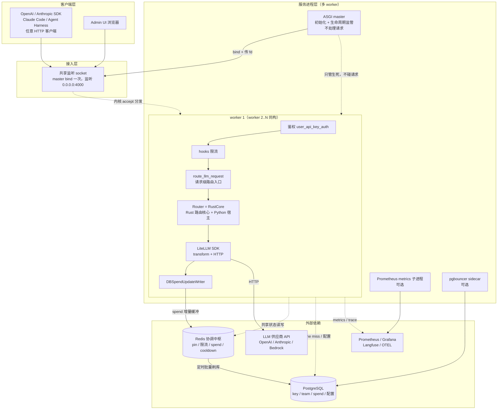

读图要点：

- **客户端只认 IP:port**，直连 master 创建的共享监听 socket。多 pod 部署时入口前面还有 K8s Service 做第一层负载均衡，这是部署拓扑而非 LiteLLM 组件，见 1.6。
- **master 在控制面**。它创建 socket 并传给 worker，只做初始化和生命周期监管，不碰任何 HTTP 请求数据（见 1.6）。
- **worker 处理全部请求**。worker 内部串联鉴权、限流、路由、SDK 调用、成本入队。Gateway 层负责治理，provider 格式转换在 SDK 层完成（`ARCHITECTURE.md:11-20`）。
- **Router 的核心已是 Rust**。`litellm/router.py` 是一个不可继承的 facade，背后是 RustCore（`litellm/router_rust/core.py`，通过 PyO3 句柄调 `litellm-rust/crates/router-core`），Python 只保留宿主步骤，见 2.2。
- **worker 无状态，Redis 是共享中枢**。多个 worker 通过 Redis 共享 session pin、限流计数、spend 缓冲和 cooldown（见 2.8、2.4）。没有 Redis 时这些退化为进程本地。
- **数据持久化在 PostgreSQL**。API key、团队、spend log、配置存库；spend 先经 Redis 缓冲再定时刷入（见 2.7、6.1）。
- **可观测是旁路**。metrics 子进程和 callback 把指标、trace 送到 Prometheus/Grafana/Langfuse（见第 4 章）。

图中细节的放大视图分别在 1.6（socket 共享原理）、2.1（请求时序）、2.3（路由决策）、2.4（pin 读写）。

### 1.3 运行时形态与双栈边界

| 形态 | 进程边界 | 载体 | 是否默认 |
|---|---|---|---|
| Python 代理 | Python 进程 + ASGI 服务器 | `litellm/proxy/proxy_server.py` 的 FastAPI `app` | 是，`litellm --config` 走这条 |
| Rust 路由核心（进程内） | 同一 CPython 进程 | PyO3 `RouterCoreHandle`，Python 包装层 `litellm/router_rust/core.py` 的 `RustCore` | 是，Router 的默认核心（`router_core.py:51-55`） |
| Rust 数据面（进程内） | 同一 CPython 进程 | PyO3 `cdylib` -> `litellm.rust_bridge._native`，按路由 rollout 目录决定 | OCR、Bedrock transcription 强制；Anthropic messages opt-in；其余路由 Python |
| Rust 独立网关 | 独立 OS 进程 / 容器 | 二进制 `litellm-gateway`（axum） | 否，功能不完整 |
| 控制面/数据面分离部署 | 两个 Python 进程 | 仓库根 `gateway/`（只裁出 LLM 数据面，:4000）与 `backend/`（只裁出管理面，:4001），复用同一个 FastAPI app 裁剪路由表 | 否，可选 |

默认命令 `litellm --config` 的调用链是 `pyproject.toml:202` -> `litellm_cli/main.py:201-202` -> `proxy_cli.py:1229 run_server` -> `uvicorn.run(app="litellm.proxy.proxy_server:app")`（`proxy_cli.py:1829`）。`--run_gunicorn`、`--run_hypercorn`、`--run_granian` 只是换 ASGI 服务器外壳（`proxy_cli.py:1833/1845/1854`），服务的仍是同一个 Python FastAPI app。

`LITELLM_RUST` 环境变量不是启动 Rust 网关的开关，而是**数据面**路由的 opt-in/opt-out 开关（`litellm/rust_bridge/configuration.py:11`），对路由核心不生效，路由核心就是 Rust。

### 1.4 Rust 三层版图

`litellm-rust/` 是 75 个 crate 的 Cargo workspace。1.110 的 Rust 分三层，边界要分清：

| 层 | 位置 | 默认状态 | 职责 |
|---|---|---|---|
| 路由控制面 | `litellm-rust/crates/router-core` + Python 包装 `litellm/router_rust/core.py` | **默认启用** | registry、selection、retries、fallbacks、cooldowns |
| 数据面 | `litellm-rust/crates/inference-*` + `litellm/rust_bridge/` | 按路由 rollout 目录决定 | 请求/响应转换、流式、tokenizer |
| 独立网关 | `litellm-rust/crates/gateway*`（axum） | 不默认 | 完全独立的 Rust 进程，auth、端点路由、MCP、请求日志有，但 spend accounting、guardrails、local Python tools 未实现（README:43），不能替代生产 Python 代理 |

路由控制面与数据面通过 PyO3 桥接：`litellm.rust_bridge._native` 暴露 `RouterCoreHandle`、token counter 等；Rust 核心通过 Python 宿主（`PythonHost.invoke(op)`）反向调用 `litellm.<op>` 完成真正的供应商调用。Rust 返回未启动的执行句柄，由 Python 在调用方 asyncio task 内推进；Rust 通过 PyO3 反向回调把执行事实翻译回 `Logging` 契约（`callbacks-legacy-python/` crate）。

**数据面 rollout 目录**

数据面哪些路由下沉 Rust 由 `litellm/rust_bridge/catalog.py` 的规则表决定（`:212-229`）：

| 路由 | Rollout |
|---|---|
| CHAT_COMPLETIONS、EMBEDDINGS、TOKEN_COUNTER、TOKENIZER | PYTHON_ONLY |
| MESSAGES | PYTHON_ONLY（转 chat/responses 的除外）；Anthropic provider 为 RUST_OPT_IN |
| RESPONSES | PYTHON_ONLY |
| OCR | **RUST_REQUIRED** |
| TRANSCRIPTION（Bedrock） | **RUST_REQUIRED** |

`LITELLM_RUST` 环境变量只影响 OPT_IN/OPT_OUT 档（`configuration.py`），PYTHON_ONLY 和 RUST_REQUIRED 档不受它控制，显式设置的环境值优先级最高。Rust 侧缺失能力时（`RustBridgeDeclined`）回退 Python（`Decision.RUST_WITH_FALLBACK`），RUST_REQUIRED 档不可回退。

**crate 分层**

crates 依赖只向下，大致六层：

1. 服务层：gateway、gateway-inference、gateway-auth、gateway-forward、gateway-management、gateway-mcp、gateway-ui
2. 宿主驱动层：host（中立协议）、host-http、host-native、host-python（CPython 适配器），让同一套可恢复执行机能被 HTTP 和 Python 两种运行时解释
3. 编排层：inference-chat/messages/responses/ocr/transcription，共享基座 inference
4. provider/数据层：llms（镜像 `litellm/llms/` 的 transformation）、llms-types、cost + model-catalog（含 refresh）、db（静态 SQLx 查询不建表）、router + router-core + router-types
5. 基础设施层：cache 系列（memory/disk/s3/gcs/azure-blob/qdrant-semantic/response）、redis 系列（client/connect/resolve/store/types）、secrets 系列（aws/azure/gcp/hashicorp/cyberark）、auth 系列、token-counter 系列（tiktoken/fast/huggingface）、tracing、circuit-breaker
6. Python 互操作层：python-bridge、host-python、callbacks-legacy-python、python-compat

架构决策记录：Python 侧 `docs/adrs/adr_001_provider_usage_fields_ride_as_usage_extras.md`（usage 字段以 usage extras 形式传递）；Rust 侧 `litellm-rust/docs/adrs/adr_001_only_type_inference_inside_rust.md`（不在 Python 侧做浅层 typed shim，而是把原始对象传给 Rust，在边界做翻译）。

### 1.5 启动与服务入口

**CLI 启动链路**

```text
pyproject.toml:202  litellm = "litellm_cli.main:proxy_server"
  -> litellm_cli/main.py:201  proxy_server()
  -> litellm/proxy/proxy_cli.py:1229  run_server()   （Click command，选项定义在 894-1228）
  -> save_worker_config()  把 CLI 参数写入环境变量 WORKER_CONFIG（proxy_server.py:9995）
  -> Prisma 迁移 / pgbouncer / metrics 子进程
  -> uvicorn.run(..., workers=N) 或 gunicorn / hypercorn / granian
```

`litellm_cli/main.py` 顶部注释说明了一个重要设计：CLI 在 Click 解析 argv 之前不导入 SDK，避免多 worker 场景每个 worker 都 import 整个 SDK 而错过 uvicorn 的健康探测。

**五种启动方式**

1. 最快路径，无需配置文件和数据库
   ```shell
   uv tool install 'litellm[proxy]'
   export OPENAI_API_KEY=...
   litellm --model gpt-4o
   ```
2. 交互式向导。`litellm --setup`（`litellm/setup_wizard.py`）依次询问供应商、API Key、端口，自动生成 master key 和 `config.yaml`，最后询问是否直接启动。
3. 用配置文件启动。`litellm --config config.yaml`，配置结构参考仓库根 `proxy_server_config.yaml`，分 `model_list`、`litellm_settings`、`router_settings`、`general_settings` 四块。
4. Docker Compose。`docker-compose.yml` 同时拉起 litellm、postgres、prometheus，`.env` 自动加载。另有 `docker-compose.hardened.yml` 和 `docker-compose.liteadmin.yml` 两个变体。
5. 开发模式（README:651-662）。`docker-compose up db prometheus` 起依赖，`make bootstrap`，`uv run python litellm/proxy/proxy_cli.py` 起后端，`ui/litellm-dashboard` 下 `npm run dev` 起前端。

另有一个不常被注意的形态：`lambda.py` 用 Mangum 把整个 FastAPI app 包成 AWS Lambda handler，serverless 部署走这里。

**需要准备的信息**

按必需程度分三档：

| 档位 | 信息 | 说明 |
|---|---|---|
| 基础必需 | 供应商 API Key | `OPENAI_API_KEY`、`ANTHROPIC_API_KEY`、`AZURE_API_KEY` + `AZURE_API_BASE`/`AZURE_API_VERSION` 等，配置里用 `os.environ/XXX` 引用，见 `.env.example` |
| 生产管理 | `LITELLM_MASTER_KEY` | 管理员密钥，用于虚拟 key、管理 API、Admin UI。不设置则所有请求按无管理员权限处理，Admin UI 报错 |
| 生产管理 | `DATABASE_URL` | PostgreSQL 连接串，虚拟 key、spend、DB 存模型、用户团队管理都依赖它；启动时自动跑 prisma migration。可用分散的 `DATABASE_*` 环境变量拼出（`gateway/main.py` 顶部注释即此场景） |
| 多 worker | Redis | `REDIS_HOST/PORT/PASSWORD`，多 worker/多 pod 共享路由状态、限流、spend、缓存 |
| 可选 | `STORE_MODEL_IN_DB=True` | 允许通过 UI 添加模型 |
| 可选 | 回调 | Prometheus、Langfuse 等 |
| 可选 | SSL 证书 | HTTPS 需要 `--ssl_keyfile_path`/`--ssl_certfile_path` |

**CLI 参数全景**

常用参数（`proxy_cli.py:894-1228`）：`--host`（默认 0.0.0.0）、`--port`（4000）、`--config/-c`、`--model/-m`、`--num_workers`、`--detailed_debug`、`--reload`、`--run_gunicorn/--run_hypercorn/--run_granian`、`--ssl_keyfile_path/--ssl_certfile_path`、`--setup`、`--validate_config`、`--prometheus_metrics_port`、`--max_requests_before_restart`（worker 按请求数回收，多 worker 才有意义，`proxy_cli.py:491-508`）。多数参数支持同名环境变量（HOST、PORT、NUM_WORKERS）。

迁移相关参数值得单独记：`--use_prisma_db_push`（用 `db push` 代替 `migrate`，`proxy_cli.py:1084`）、`--skip_server_startup`（只跑迁移不起服务，`proxy_cli.py:1094`）、`--check_migrations_against_existing_data`（在真实库上干跑本版本待执行迁移的 SQL，评估锁与耗时，失败退出码 2，`proxy_cli.py:287-301, 1103-1110`）。`--use_v2_migration_resolver` 已废弃，v2 解析器成为默认，回退用 `--use_legacy_migration_resolver`（`proxy_cli.py:1188-1207`）。

验证手段：`curl http://localhost:4000/health/liveliness`，或 `litellm --test`、`litellm --validate_config --config config.yaml`。

### 1.6 进程与运行时架构

**进程组件清单**

一次典型多 worker 部署包含：

| 组件 | 谁创建 | 职责 |
|---|---|---|
| master / supervisor | `litellm` 控制台脚本 | 读配置、DB URL 解析、Prisma 迁移、启动 pgbouncer 和 metrics 子进程，最后交给 ASGI supervisor |
| ASGI server | master 选择 | uvicorn / gunicorn / hypercorn / granian，管理 worker 生命周期 |
| worker 进程 | uvicorn `Multiprocess` 或 gunicorn fork | 各自加载 FastAPI app，处理推理请求，各持一个 Prisma query-engine |
| reloader（`--reload`） | uvicorn `ChangeReload` | 监听 `*.py`、`.env`、config YAML 变化并重启 worker（`dev_reload.py` 定制了 reload 选项） |

可选独立进程或短命子进程：

| 组件 | 触发条件 | 解决的问题与职责 |
|---|---|---|
| Prometheus metrics 进程 | `--prometheus_metrics_port` | 把指标聚合 scrape 从推理 worker 的事件循环挪到独立进程，独立端口暴露 `/metrics` |
| in-container pgbouncer | `LITELLM_PGBOUNCER_*` 开启 | 在 worker 与 Postgres 之间做事务级连接池，避免每 worker 直连导致连接数膨胀 |
| Prisma CLI 子进程 | 每次启动 | `prisma migrate deploy` 或 `db push`，fork worker 之前同步结束 |
| `ollama serve` | `--model` 含 ollama 且无 api_base | 本地拉起 ollama |

进程内守护线程（非进程）：master 的 query-engine reaper 回收被强杀 worker 遗留的孤儿数据库引擎进程（`proxy/db/query_engine_reaper.py`，`proxy_cli.py:804` 拉起）；pgbouncer 有崩溃监督和 token 刷新线程。

**Prometheus metrics 子进程**

多 worker 时每个 worker 把指标样本写进共享目录 `PROMETHEUS_MULTIPROC_DIR`。如果直接在推理 worker 的 `/metrics` 端点做聚合，Prometheus 来抓取时会占用推理 worker 的事件循环。这个子进程专门承担聚合与暴露：master 用 `subprocess.Popen` 拉起独立的 Python 进程（`prometheus_metrics_server.py:139-141`），里面跑 uvicorn + FastAPI app，用 `prometheus_client.multiprocess.MultiProcessCollector` 读共享目录聚合样本（`:76-78`），从独立端口暴露 `/metrics` 和 `/health`。就绪探测通过校验响应头 `x-litellm-metrics-pid`（`:35, 55-66`）确认是自己的子进程在应答（`:111-136`）。

生命周期上有个 watchdog 守护线程每秒检查 `os.getppid()`，父进程退出后子进程立刻自杀（`:89-95`）。CLI 强制该端口不同于主端口。注意这个独立端口无虚拟 key 鉴权，不能暴露公网 ingress，只在内部网络抓取。

**in-container pgbouncer sidecar**

每个 worker 进程持有自己的 Prisma query-engine，都会直连 PostgreSQL。worker 一多，尤其多 pod 部署，Postgres 连接数会线性膨胀。pgbouncer 在中间做事务级连接池，用少量真实连接服务大量 worker 连接。

master 启动 pgbouncer 进程（`proxy_cli.py:1706` -> `proxy/db/pgbouncer.py`，共 743 行），监听 `127.0.0.1:6432`，生成 `pgbouncer.ini` 配置 `pool_mode=transaction`、`max_db_connections` 和 auth 文件，然后把 `DATABASE_URL` 改写成指向 loopback 的 pooled URL（环境变量 `LITELLM_PGBOUNCER_POOLED_DATABASE_URL`，`pgbouncer.py:68-69`）。worker 只拿到这个 loopback 地址和随机 pool 密码，不知道上游 Postgres 的真实凭据。

顺序是关键：数据库迁移和 schema diff 在 pgbouncer 启动**之前**由 master 直连 Postgres 完成，之后 worker 才用 pooled URL 连库。崩溃时守护线程自动重启；IAM token 或 Azure Entra 认证场景下，另有守护线程定期重写 auth 文件并发 SIGHUP 让 pgbouncer 重新加载。没配置 `LITELLM_PGBOUNCER_*` 时 worker 直连 Postgres。

两个进程都做了"只由启动它的 master 执行退出清理"的保护：pgbouncer 用进程标记确保 atexit 清理只在 master 跑，因为 gunicorn fork 的 worker 继承了 atexit 表；metrics 子进程靠父进程死亡 watchdog 实现生命周期绑定。

**master 与 worker 的分工**

master 在 fork worker 之前完成所有一次性初始化，顺序为（`proxy_cli.py` run_server 主流程）：

1. `apply_process_defaults()` 处理 DEV 模式与 `.env` 加载。
2. `save_worker_config()` 把 CLI 参数序列化为 JSON 写入环境变量 `WORKER_CONFIG`（调用点 `proxy_cli.py:1337`，定义 `proxy_server.py:9995`）。
3. DB token auth（IAM / Azure Entra）、AWS KMS 解密。
4. 读 config YAML，组装 `DATABASE_URL`、`DIRECT_URL`、连接池参数。
5. Prisma 迁移在 master 中同步执行，失败即退出（`PrismaManager.setup_database`，`proxy_cli.py:1666`）；迁移成功后还会检查并启动 spend log 的大索引构建（`:1671-1674`）。
6. 启动 pgbouncer sidecar，把 `DATABASE_URL` 改写为 loopback pooled URL（`:1706`）。
7. 准备 metrics 多进程目录，必要时拉起独立 metrics 子进程（`:1741`）。
8. 交给 ASGI server fork/spawn worker，master 启动 query-engine reaper（`:804`）。

worker 通过环境变量继承配置：`WORKER_CONFIG` 和 `CONFIG_FILE_PATH` 在 worker 启动事件里读回（`proxy_server.py:1670`），日志配置走 `LITELLM_WORKER_LOG_CONFIG`。worker app factory `proxy_worker_app()`（`litellm_cli/main.py:217-223`）在加载期 `gc.disable()`、加载完 `gc.freeze()`（`:209, 213`），避免完整 GC 占用 GIL 导致错过 uvicorn 健康 ping。

一句话：**master 只做初始化和生命周期监管，不碰业务请求；鉴权发生在每个 worker 的 FastAPI 路由依赖里**（`proxy_server.py` 大量 `Depends(user_api_key_auth)`）。

**启动时序（master 初始化 + worker 引导）**

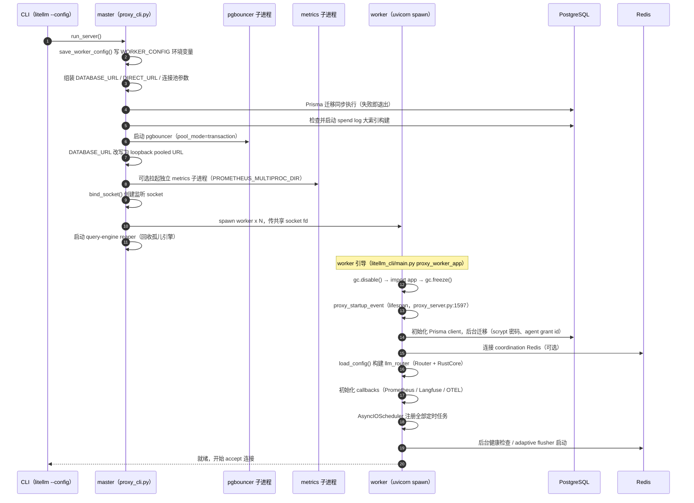

**ASGI 服务器与 worker 分发**

ASGI（Asynchronous Server Gateway Interface）是 Python Web 服务器与应用之间的标准协议。ASGI 服务器（uvicorn/gunicorn/granian/hypercorn）负责监听端口、管理多 worker，把请求喂给 FastAPI app，不认识"大模型"概念。

一个容易误解的点：客户端既不直连某个 worker，也不存在"master 转发请求"这一层。真实机制是**共享监听 socket + 内核 accept 分发**。

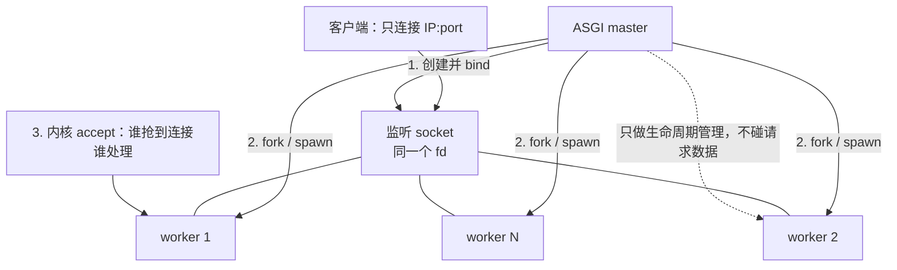

过程分解：

1. master 调用 `bind_socket()` 创建监听 socket（`litellm/proxy/dev_reload.py:164`）。
2. master 通过 `sockets=[shared_socket]` 把它传给 worker pool（`dev_reload.py:169`）。uvicorn 的 `Multiprocess.init_processes()` 把同一个 sockets 列表传给每一个 worker 进程；litellm 在这里用的是自己的 `ReloadWorkerPool` 子类（`dev_reload.py:116, 135-144`）。
3. 每个 worker 在自己的 asyncio 事件循环里对这个共享 fd 调用 accept。
4. 客户端三次握手完成后，内核把连接放进该 socket 的 accept 队列并唤醒某个 worker 取走，由它完成 HTTP 解析和业务处理。

三句话概括：客户端只认 IP:port，看不到 worker；master 只管 worker 生死，不转发 HTTP 请求；分发发生在内核 accept 层，worker 共享 socket 竞争接单。gunicorn、granian 也是同类模式。

底层原理：两个进程为什么能共享一个 socket。关键在于 Unix「一切皆文件」的语义。socket 在 Linux/Unix 里就是一个文件描述符（fd）。理解共享必须先区分三层对象：

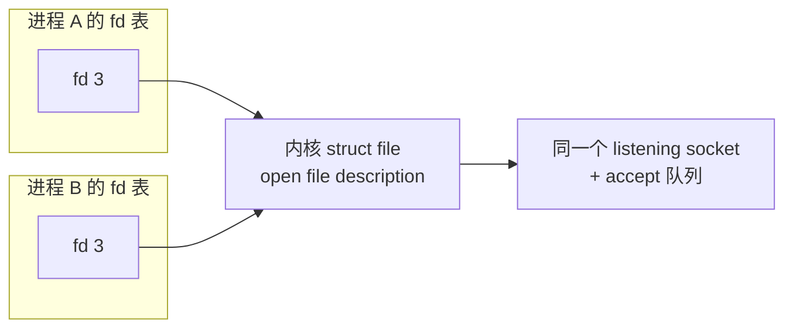

两个进程的 fd 表里数字可能都是 3，但它们指向内核中**同一个** `struct file`，进而指向同一个 listening socket 和同一个 accept 队列。所以共享的不是 fd 数字，而是 fd 背后的内核对象。

master 建好 socket 后，要让 worker 拿到指向同一内核对象的 fd，有两条路：

| 方式 | 做法 | 谁负责 |
|---|---|---|
| fork | `fork()` 时内核复制子进程的 fd 表，每一项指向与父进程相同的内核 `struct file`，子进程天然继承所有已打开 fd | 内核自动 |
| spawn | 重新启动干净的 Python 解释器，没有 fd 自动继承。socket 被 pickle 时经 `multiprocessing.reduction` 转成 `DupFd`，通过 resource sharer 用 `SCM_RIGHTS` 控制消息把 fd 复制进目标进程 | Python multiprocessing |

uvicorn 实际走的是 spawn：每个 Process 用 `Pipe()` 建立父子通信通道，子进程 `subprocess_started()` 拿到的 `sockets` 已是有效的 socket 对象，直接 `target(sockets=sockets)` 即 `Server.run(sockets=sockets)`。一句话概括：**父进程 bind 一次，通过 IPC 把 fd 复制给每个子进程**。

为什么多进程 accept 不会乱。accept 队列在内核里是共享的，内核保证一次 accept 只把一个连接交给一个进程，不会重复分发。所以不需要 master 做调度，内核天然把进来的连接分给被唤醒的 worker。现代内核还处理了惊群问题（thundering herd），避免唤醒所有等待的 worker 造成资源浪费。

共享 fd 不等于 SO_REUSEPORT：

| 机制 | 做法 | 谁分发 |
|---|---|---|
| 共享同一个 fd | master bind 一次，fd 传给所有 worker，大家 accept 同一个 socket | 内核在共享 accept 队列上分发 |
| SO_REUSEPORT | 每个 worker 各自 bind 同一个端口，内核在多个独立 socket 间做负载均衡 | 内核按哈希在 socket 间分发 |

uvicorn 走第一种（共享 fd），所以 worker 必须在 master 之后启动、且在同一主机上，这正是它跨不了容器边界的原因。K8s 里多个 pod 各自 bind 端口，是另一种形态，与这里的共享 fd 无关。

master 与 worker 必须在同一容器（同一 pod）内，拆不到两个 pod，因为它依赖 fork/spawn、共享 socket fd、进程信号、环境变量继承这些跨不了容器边界的操作系统原语。

**K8s 部署的两级扩展**

K8s 下"worker"对应两个层次，不要混为一谈。

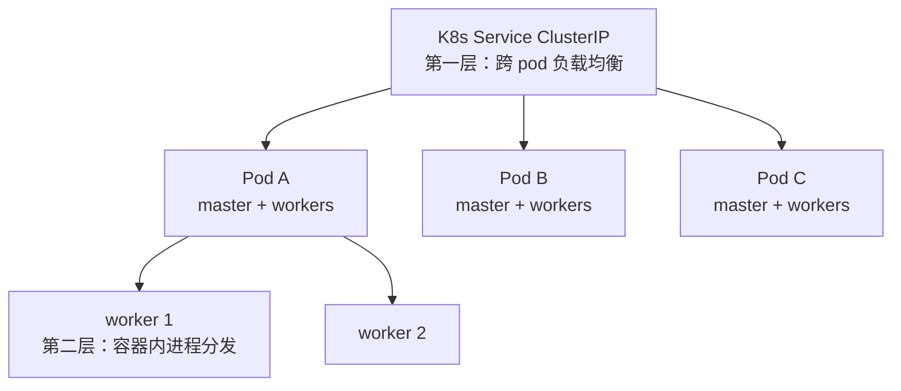

`gateway.replicaCount` 控制 pod 副本数，`gateway.numWorkers`（默认 1，通过 `NUM_WORKERS` 环境变量传入，`helm/litellm/values.yaml`）控制每个 pod 内 worker 数。跨 pod 状态一致性全靠 Redis，Helm chart 注释明确 Redis 是 "coordination store"，负责跨 pod tpm/rpm、spend 和 pod lock manager。

---

## 2. 请求主链路与路由

### 2.1 chat completions 全链路

端点处理函数 `chat_completion()` 在 `proxy_server.py:13193`。鉴权在同一 worker 内完成，不存在"master 鉴权后转发给 worker"。多 worker 时请求既可能被 K8s Service 分发到不同 pod，进入 pod 后又可能被分到不同 worker，所以会话亲和的 pin 必须存在 Redis 里跨 worker 共享。

代理层的路由请求组装步骤 `proxy/route_llm_request.py`：它负责把 FastAPI 请求翻译成 Router 的调用（含请求级 router 参数覆盖、gated mock 参数拦截如 `mock_testing_rate_limit_error`，以及总超时 scope `enforce_total_timeout_scope`），再交给 Router。

**worker 内组件交互图**。请求路径上每个组件与外部依赖的连接都在这一张图里，后续时序图是它的动态视图：

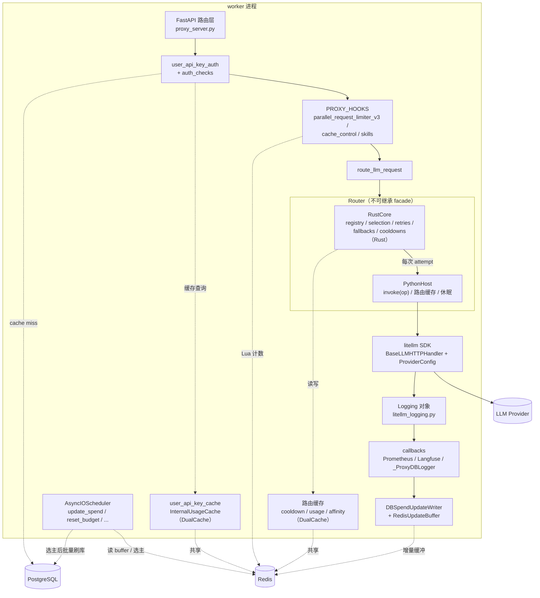

**全链路时序图（详细版）**。编号即真实执行顺序，鉴权内部的检查顺序按 `validate_resolved_virtual_key`（`user_api_key_auth.py:3195`）的实际代码排列：

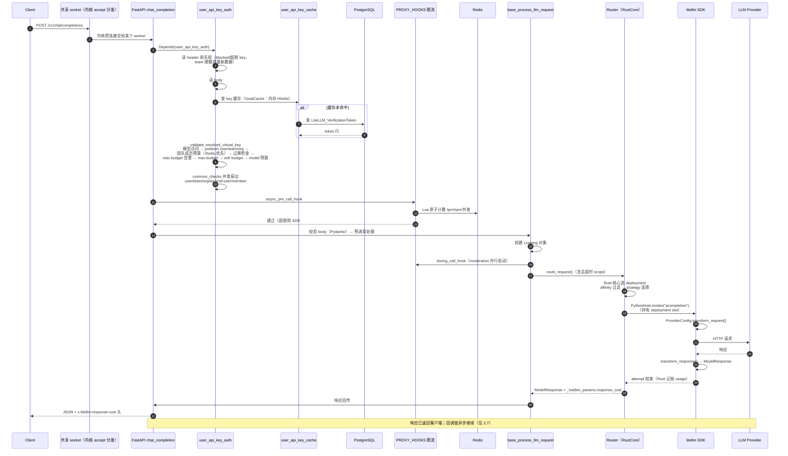

### 2.2 Router：RustCore 架构与 model group

**RustCore + PythonHost 的新架构**

1.110 的 Router 完成了架构分层。入口文件 `litellm/router.py`（463 行）是一个**不可继承的 facade**（`__init_subclass__` 直接抛 TypeError，`router.py:368-373`），自己没有任何路由逻辑；`__init__` 把构造参数绑定成 `RouterConfig`（`router_config.py`，168 行），交给 `make_core()` 建出核心（`router_core.py:51-55`）。

核心只有一个实现：`RustCore`（`litellm/router_rust/core.py`，5669 行 Python 包装），它通过 PyO3 句柄（`litellm.rust_bridge._native.RouterCoreHandle`）驱动 `litellm-rust/crates/router-core` 的 Rust 实现。**Rust 核心拥有 registry、selection、retries、fallbacks、cooldowns**（`router_rust/core.py` 模块 docstring）；它不直接 import 任何代理模块，所有"出核心"的操作都走宿主：

- 每次尝试由宿主执行：`router_attempt.py`（230 行）为 Rust 选中的那一个 deployment 构建请求，`PythonHost.invoke(op)` 调 `litellm.<op>` 真正发请求（`router_python_host.py`，227 行）。
- 路由事实（cooldown、allowed-fails 计数、usage）由 Rust 核心自己记录在路由缓存里，缓存实体由宿主建并持有（`PythonHost.routing_cache`）。
- 休眠、fallback 访问/预算检查、缓存读写都是宿主步骤（`router_host.py` 的 `RouterHost` 协议）。

`router_host.py`（108 行）定义了路由对宿主的提问接口：vertex 透传凭据、member auto-router 的团队鉴权、auto-router 的 prompt 压缩策略。代理启动时用 `install_router_host()` 装上 `ProxyRouterHost`（`proxy/_router_host.py`）；纯 SDK 场景用默认宿主（拒绝 member auto-router）。这个设计切断了 router 与 proxy 的循环 import。

Python 侧其余文件是核心的外围接口层：

| 文件 | 行数 | 职责 |
|---|---|---|
| `router_api.py` | 1736 | `ChangeSet` / `ApplyResult` / `RouterRegistry` / `RouterSettings` / `RouterHealth` / `RoutingContext` / `RoutingObservers`，以及没有 `model_info.id` 的 deployment 的稳定 id 生成（sha256，`:197-209`） |
| `router_attempt.py` | 230 | 单次尝试（RoutedAttempt）的构建与结算（attempt settlement） |
| `router_host.py` / `router_python_host.py` | 108 / 227 | 宿主协议与 SDK 默认宿主 |
| `router_deprecated.py` | — | `DeprecatedRouterMembers`：旧成员方法过渡层 |
| `router_rust/invoke/endpoints.py` | 2509 | 端点层：routed 端点（Rust 选 deployment、宿主执行尝试）与 direct 端点（不路由直接调 litellm 函数） |
| `router_rust/steps/` | prerouting 1159 / precall 630 / selection 445 / callbacks 742 / plugins 87 / access 85 | 路由各阶段的宿主侧步骤 |
| `router_rust/surface/` | registry 2364 / model_info 915 / health 601 / settings 236 / retries 295 / fallbacks 129 / indexes 514 / legacy_members 524 / model_list 408 等 | registry、健康、设置等只读视图与维护面 |

端点覆盖面也明显扩张：`endpoint_names()`（`router_rust/invoke/endpoints.py:675-690`）除了 chat/embeddings/responses/messages/batches/files，还包含 `asearch`、`aguardrail`、interactions（`acreate_interaction` 等）、containers、vector stores（`avector_store_*`、`avector_store_file_*`）。direct 端点（不路由直调）清单在 `:655-669`。

**model group 与 deployment**

`model_name` 是 agent 请求里传的别名，也就是 model group。config 里所有 `model_name` 相同的条目下标被塞进同一个 list，这就是一个组。每条条目是一个 deployment，有唯一 `model_id`（`model_info.id`，没配就按 group + litellm_params 做 sha256 生成，`router_api.py:197-209`）。厂商信息绑定在 deployment 的 `litellm_params` 里，包括带厂商前缀的 `model`、`api_base`、`api_key`。

选中 deployment 后厂商就确定了：`update_kwargs_with_deployment`（`router_rust/invoke/shaping.py`）把那条 deployment 的 `litellm_params` 展开进请求，`model` 的厂商前缀、`api_base`、`api_key` 一起交给 litellm 核心按前缀分派。Router 本身不做"厂商决策"。要显式点名某厂商，可直接把 `model` 传成该 deployment 的 `model_id`，此时 strategy 被跳过。

### 2.3 路由策略与决策顺序

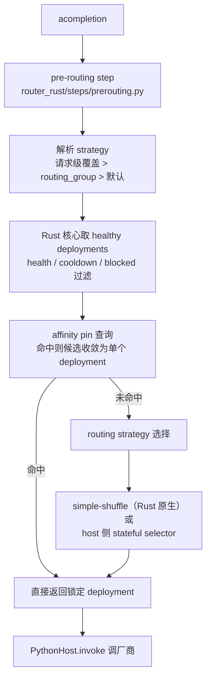

**读 pin 在策略之前**。affinity 的读作为 filter 嵌在健康候选解析里（`router_utils/pre_call_checks/deployment_affinity_check.py`），命中就只返回那一个 deployment，让后面的 strategy 必然选中它。

默认 `simple-shuffle`（`router.py:105`），由 Rust 核心原生实现；带状态的策略由 Rust 请求宿主执行（`router_rust/steps/selection.py` 头注释说明分工：Rust 决定"谁选、读谁的状态"，宿主跑有状态 selector）。这些 selector 就是 `router_strategy/` 下独立的 logger 类，它们同时是 `CustomLogger` 回调，把流量记录进宿主的路由缓存。

内置策略（`router_rust/steps/selection.py:41-52` 注册表）：

| strategy | 实现 | 依据 |
|---|---|---|
| simple-shuffle（默认） | Rust 原生 | 权重加权（请求级 weights > deployment weight > rpm > tpm）或均匀随机 |
| least-busy | `router_strategy/least_busy.py` | 在途请求数最少 |
| latency-based-routing | `router_strategy/lowest_latency.py` | 每 token 延迟或 TTFT 最低 |
| cost-based-routing | `router_strategy/lowest_cost.py` | input+output 单价最低 |
| usage-based-routing(-v2) | `router_strategy/lowest_tpm_rpm*.py` | Redis 实时 tpm/rpm 准入 |

1.110 还内置了一批更聪明的"auto router"，以 strategy 形式存在（`router_strategy/`）：

| 策略 | 机制 |
|---|---|
| adaptive_router（v0） | 请求分类到 7 种 RequestType，按 (request_type, model) 格做 Thompson Beta bandit 采样，质量估计与归一化成本加权求和；post-call 用轻量 regex + tool-call 检测器给模型 credit/blame，内存攒批约 10s 刷 Postgres（`adaptive_router/README.md`） |
| auto_router | embedding 语义匹配路由（`auto_router/litellm_encoder.py`） |
| complexity_router | 本地规则打分（零外部调用，亚毫秒），按复杂度分级路由（`complexity_router/README.md`） |
| quality_router | 复用 complexity 分类，映射到管理员配置的质量档位，再从候选的 `model_info.litellm_routing_preferences` 解析目标模型（`quality_router/quality_router.py`） |
| switchyard_router / lar1_routing / tag_based_routing / budget_limiter / savings_baseline | 其余专项策略（LAR1 是带 repin 的失败切换策略，tag_based 按 tag 路由，budget_limiter 按预算状态路由） |

### 2.4 会话亲和的三种 pin

affinity 不止 session 一种。`deployment_affinity_check.py` 支持三种粘滞维度，按 model group 逐组开关（`model_group_affinity_config`，`:109-142`）：

| 模式 | pin 的 key | 用途 |
|---|---|---|
| session_id affinity | `deployment_affinity:v1:session:{model_group}:{hashed_user_key}:{session_id}`（`:269-274`） | 同会话固定 deployment；user key hash 隔离防串用 |
| api key (user) affinity | `deployment_affinity:v1:{model_group}:{hashed_user_key}`（`:264-266`） | 同调用方固定 deployment |
| responses API affinity | 按 responses 前链 id | Responses API 多轮固定 deployment |

TTL 默认 3600 秒（`router.py:112` `deployment_affinity_ttl_seconds`），是滑动 TTL，读 pin 的 Lua 脚本每次读都 `EXPIRE` 刷新。LiteLLM 不感知"session 关闭"，只看有没有请求带 session_id 进来。只要空闲间隔小于 TTL 就一直有效；空闲超过 TTL 后 key 被淘汰，下次请求重新走策略。

pin 存 DualCache（内存 + Redis）。配了 Redis 用 Lua 脚本原子抢占，所有 worker 共享；没配就退化为进程内 pod-local。Redis 故障时读写都回退本地。pin 指向的 deployment 变不健康或在失败列表里，filter 会跳过并退回完整候选集重新选。失败切换后还可以配 `session_affinity_repin_on_failover`（`router.py:124`）：替换响应成功后把旧 pin 迁到新 deployment。

**读在策略前，写在策略后**。pre-call 阶段（deployment 选定后、请求发出前）记住本次选中的 deployment，用原子 set-if-empty 先到先得，后到的不覆盖。

**pin 读写时序图**。第 1 轮未命中走 strategy 并抢先写 pin，第 N 轮命中直接锁定：

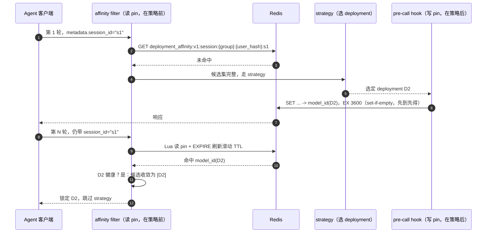

要区分三套独立的"粘滞"：

| 机制 | 粘的目标 | 跨 worker |
|---|---|---|
| Router deployment affinity | deployment / model_id | 配 Redis 就共享 |
| code interpreter sandbox | sandbox 容器 | 否，纯进程内 dict |
| guardrail `sticky_session_routing` | 敏感数据路由到的 model | 配 Redis 就共享 |

`qa_sticky_session.sh` 测的是第二套，靠 `metadata.session_id` 复用代码沙箱容器。它是真正进程内状态，多 worker 下若同 session 落到不同 worker 就会失败，需要外部负载均衡粘滞或单 worker 部署。

### 2.5 自定义路由插件

自定义策略靠代码显式调用 `router.register_plugin()` 注入，facade 把它转发给 Rust 核心（`router_core.py:46`）。`proxy_server.py` 里没有任何 `register_plugin` 调用，config.yaml 和 DB 都启不了外部自定义策略。

风险点依旧：切换 `routing_strategy` 会先重置已注入的自定义策略，通过管理 API 改 `routing_strategy` 会把已注册插件清掉且不会自动恢复（LAR1 类自带 repin 的策略会在切换路径里重新挂载）。complexity router 的插件通过 `litellm_params.complexity_router_config.plugins` 点分路径配置，只在启动时解析一次。另外 Router 禁止子类化（见 2.2），扩展一律走 `register_plugin()` / `apply()` / `observe()`（`router.py:369-372` 的错误信息明确给出这三个入口）。

### 2.6 失败、重试与 cooldown

一次 attempt 失败后发生什么。决策（重试、fallback、cooldown）全部由 Rust 核心做，Python 只执行尝试和回调：

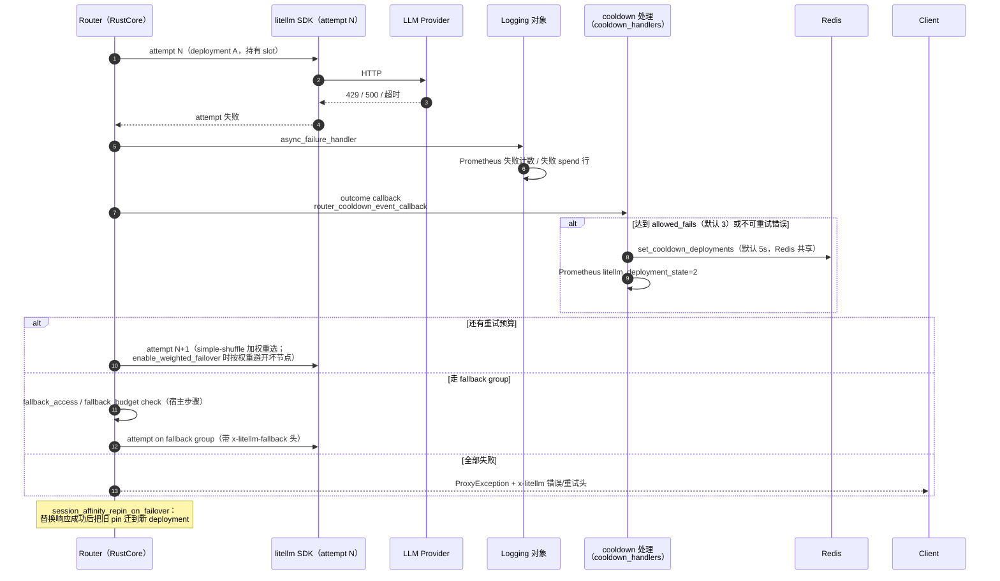

错误分类决定冷却与否：429 立即冷却，401/402/408/404 冷却，其余 4xx 不冷却（`router_utils/cooldown_handlers.py:305-309`）。deployment 的 `max_parallel_requests` slot 在 attempt 期间被持有，流式响应持有到流结束；slot 耗尽时新请求得到 429，Rust 核心把它记为该 attempt 的失败（`router_rust/invoke/slots.py`）。

### 2.7 成本归属链路

成本计算完全异步且归 Python。回调算出 cost 后写入 `response._hidden_params["response_cost"]`，`common_request_processing.py` 提取出来加到响应头（`:2071-2076`）：除了 `x-litellm-response-cost`，还有 `x-litellm-response-cost-original`、`-discount-amount`、`-margin-amount`、`-margin-percent`、`-input` 等细分头，成本明细（discount/margin）直接暴露给调用方。随后 `logging_obj.async_success_handler()` 触发 `_ProxyDBLogger.async_log_success_event()`（`proxy/hooks/proxy_track_cost_callback.py:417`），调用 `DBSpendUpdateWriter.update_database()`（`proxy/db/db_spend_update_writer.py:704`）把增量写入内存队列（+ Redis 缓冲），后台 job `update_spend`（10-15s，`proxy/utils.py:8875`）经 `PodLockManager` 选主后批量刷入 Postgres。记账路径上 1.110 有一个默认行为变化：`use_spend_logs_ledger`（`general_settings`，`proxy/_types.py:2509-2513`）默认 True，spend 累计以 SpendLogs 台账为准，而不是单独的 counter 表。

**成本归属与刷库时序图**。上半段随请求异步发生，下半段由定时 job 驱动，两者只通过 Redis buffer 与内存队列耦合：

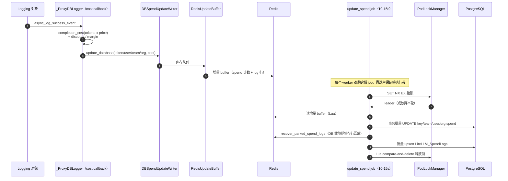

一条关键不变式：即便请求曾下沉到 Rust，计费和回调的所有权始终在 Python。Rust 路由核心自己记录 cooldown、allowed-fails、usage 等路由事实，但响应成本、spend log、callback 链全部由 Python 宿主步骤执行。

### 2.8 进程间共享与协调

配置走环境变量继承，动态运行时状态走 Redis，这是两条不同通道。

Redis 承载的共享状态：API key 缓存、限流计数器、TPM/RPM 追踪、部署 cooldown、LLM 响应缓存、spend 增量缓冲、分布式锁。1.110 把这些 Redis 访问面重构成了独立的 store 包 `litellm/redis/stores/`（`auth_cache`、`rate_limits`、`router_cooldowns`、`router_usage`、`sensitive_route_pins`、`spend_counters`），Router 的 cooldown 与 usage 直接走 `RouterCooldownStore` / `RouterUsage`（`router_rust/core.py` 顶部 import）。代理侧注入点在 `proxy/utils.py:1975-2040`：`internal_usage_cache`（限流）、`file_usage_cache`、`max_parallel_request_limiter`、`db_spend_update_writer`（含其 `pod_lock_manager`）。Router 通过 `apply(ChangeSet(redis_cache=...))` 共享健康状态。

原子性与选主：限流用 Redis Lua 脚本保证多 worker 并发计数不漂移（`proxy/hooks/parallel_request_limiter_v3.py`，5348 行，含 `fail_closed_rate_limit_enforcement_enabled` 的 fail-closed 模式）；`PodLockManager`（`proxy/db/db_transaction_queue/pod_lock_manager.py:24`）用 `SET NX EX` 做 cron job 的 leader election，释放用 Lua compare-and-delete 防止 TOCTOU（`:128-187`）。

无 Redis 时各 worker 的缓存、spend 计数、限流计数都是进程本地，不共享，代码里有多处警告。所以多 worker 部署 Redis 实际是必需项。

### 2.9 后台任务与守护组件

每个 uvicorn/gunicorn worker 各自持有一个 `AsyncIOScheduler`（`proxy_server.py:11625` 初始化，任务注册在 `:11659-12075`），所以**每个 worker 都跑一份定时任务**，靠 `PodLockManager` 保证跨 pod 只一个执行者。

主要任务（间隔取自代码常量）：

| 任务 | 间隔 | 位置 |
|---|---|---|
| worker 心跳 | 60s（`proxy/db/proxy_worker_heartbeat.py:29`） | `proxy_server.py:11659` |
| 预算重置 reset_budget | 597s + 随机抖动（`PROXY_BUDGET_RESCHEDULER_MIN_TIME`，`constants.py:1951`），约 10min | `:11677` |
| update_spend 批量刷库 | 10-15s（`PROXY_BATCH_WRITE_AT=10` + rand(0,5)，`constants.py:1991`、`proxy_server.py:11654`） | `:11688` |
| 工具发现提交 commit_tool_discoveries | 同批量刷库间隔 | `:11702` |
| daily tag spend | 批量刷库间隔 × 倍数 | `:11717-11735` |
| 网关请求/错误计数 flush_gateway_requests / flush_request_errors | 同批量刷库间隔 | `:11743-11760` |
| config 周期重载 | 默认 30s（`proxy_config_reload_interval_seconds` 非法时回退 30s，`:11785-11791`） | `:11794` |
| 从 DB 同步模型部署 add_deployment_job | 30s（注释明确从 10s 提到 30s 修内存泄漏，`:11810-11824`） | `:11812` |
| batch / Responses 成本核算 | `proxy_batch_polling_interval` + rand(0,30) | `:11936-11961` |
| key rotation | 默认 24h（`LITELLM_KEY_ROTATION_CHECK_INTERVAL_SECONDS=86400`，`constants.py:1846`），需开关 | `:11979` |
| 过期 UI session key 清理 | 24h（`constants.py:1857`） | `:12203-12242` |
| Slack 周报月报、spend 捕获率检查 | 按 Slack 配置 | `:12322-12426` |

另有一类非 APScheduler 的 `asyncio.create_task` 无限循环，同进程内运行，例如后台健康检查（`proxy_server.py` 启动事件里创建）、spend 队列监控、adaptive router flusher（约 10s 把 bandit 更新批量刷 Postgres，`router_strategy/adaptive_router/README.md`）。

仓库根 `ARCHITECTURE.md:219-232` 的任务清单仍然过时：它把 `update_spend` 写成 60s（实际 10-15s）、`add_deployment` 写成 10s（实际 30s）、`process_rotations` 写成 1h（实际默认 24h 且需开关），还把后台健康检查归进 APScheduler。分析以代码为准。

---

## 3. 治理平面：配额、计费、审计与脱敏

### 3.1 配额粒度与功能维度

配额体系围绕共享预算表 `LiteLLM_BudgetTable`（`schema.prisma:13-39`）展开，各实体通过 `budget_id` 关联，部分实体也有直写字段。

| 粒度 | 直写字段 | 能力来源 |
|---|---|---|
| Virtual key | 最全：max_budget、soft_budget、budget_duration、budget_limits、model_max_budget、budget_fallbacks、tpm/rpm/tpd、并发、model_spend | 两者兼备 |
| Team | max_budget、soft_budget、budget_duration、budget_limits、model_max_budget、tpm/rpm/tpd、并发、model_spend | 两者兼备 |
| User | max_budget、budget_duration、model_max_budget、tpm/rpm、model_spend | 以直写为主 |
| Organization / Project / Tag / End-user / Model access group | 仅 spend、model_spend | 靠 budget_id 拿到完整能力 |
| Team member / Org member | spend、total_spend | 靠 budget_id |
| 全局代理 | 无表，用 `litellm.max_budget` | — |

BudgetTable 自身的能力字段（`schema.prisma:13-39`）：`tpd_limit`、`allowed_models`（按成员收敛模型范围）、`temp_budget_increase` + `temp_budget_expiry`（临时提额）。多窗口预算 `budget_limits`（如同时 7d + 30d）挂在 key 与 team 上（`:550, :210`），窗口累计 spend 由专门的 `LiteLLM_BudgetWindowSpend` 表（entity_type + entity_id + window_duration 三元组主键，`:765` 起）持久化，写入走 `proxy/db/budget_window_spend_writer.py`。

覆盖的功能维度：金额上限与周期重置、软预算告警与 80% 预警、多预算窗口、模型级预算与超预算回退（`budget_fallbacks`）、临时提额、TPM/RPM/TPD 与并发限制、模型白名单（`allowed_models`）、每日汇总与历史归档。

执行点：key 级预算在 `validate_resolved_virtual_key`（`proxy/auth/user_api_key_auth.py:3195`，依次做 alert、max budget、soft budget、model_max_budget，`:3404-3426`；函数本体抽在 `auth_checks.py:6723-6800`），其余通过 `common_checks`（`auth_checks.py:1137`）的 `asyncio.gather` 并发扇出（`:1472-1530`），token/team/project/org/tag/end-user/member 各有独立检查函数。累计 spend 从 Redis 计数器读，超限抛 `BudgetExceededError`（默认 HTTP 422，`litellm/__init__.py:392` `budget_exceeded_status_code`，可设 429），请求在鉴权阶段被拒。1.110 还把拒绝前移：被 block 或已超限的 key 在读请求 body 之前就被拒掉（`user_api_key_auth.py:2260-2347` -> limiter 的 `raise_if_over_limit_before_body`，`parallel_request_limiter_v3.py:3748`），且 team 级限额用比 key 缓存更新的 team 数据判定（HEAD 合入的修复）。TPM/RPM/并发是独立限流机制，由 pre-call hook 执行，超限返回 429。

### 3.2 费用计算

按 token 计费，核心在 `litellm/cost_calculator.py:490` 的 `cost_per_token()`（文件 4213 行，`completion_cost` 在 `:1783`），支持 cache read/creation、按秒计费、audio 时长、service tier、区域溢价（`region_name` / `vertex_location` / `data_residency`）等。默认价格来自 `model_prices_and_context_window.json`（默认从 GitHub 拉取，可用 `LITELLM_LOCAL_MODEL_COST_MAP` 切换到打包副本 `litellm/model_prices_and_context_window_backup.json`），支持 `litellm.register_model()` 自定义价格（跨 cost map 刷新持久重放），还有 batch/image/transcription/OCR/rerank/vector store search 等专门计费函数和 discount/margin（经 `litellm.cost_discount_config` 配置，对应 2.7 的响应头明细）。

### 3.3 审计日志与字段

Spend log 表 `LiteLLM_SpendLogs`（`schema.prisma:720-762`）字段：request_id、call_type、**哈希后的 api_key**、spend、token 数、起止时间、`completionStartTime`、`request_duration_ms`、model/model_id/model_group/provider（`custom_llm_provider`）、api_base、user/team_id/org_id/end_user、session_id、status、requester_ip_address、cache_hit/cache_key、request_tags、`litellm_call_id`，以及 `metadata`/`messages`/`response`/`proxy_server_request` 几个 JSON 列。1.110 新增了 agent 归因字段：`mcp_namespaced_tool_name`、`agent_id`、`billing_agent_id`。索引含 `(api_key, startTime)`、`session_id`、`litellm_call_id`、`end_user`。写入链路是 `_ProxyDBLogger` -> `DBSpendUpdateWriter` -> 后台批量刷库。

请求体和响应体默认不落库。开关 `general_settings.store_prompts_in_spend_logs` 或 `STORE_PROMPTS_IN_SPEND_LOGS`（`proxy/spend_tracking/spend_tracking_utils.py:2218-2239`），默认 False，关闭时三列都写 `"{}"`。粒度上还能再收：`latest_turn` 模式对无状态请求只存当前轮（`:1280-1307`），且可以按 key/team 元数据单独关闭提示词存储（`_TENANT_PROMPT_STORAGE_FIELDS`，`:118, 2222-2225`），这两处覆盖全局开关。

管理 API 审计日志用 `LiteLLM_AuditLog` 表（`schema.prisma:852`），记录 `changed_by`、`changed_by_api_key`（哈希）、`action`、`table_name`、`object_id`、`before_value`/`updated_values`，覆盖 key 创建/更新/轮换、user 创建/更新、配置修改。开关 `litellm.store_audit_logs` 默认回退到 `premium_user`，且写库要求付费用户（`proxy/management_helpers/audit_logs.py`），可用 `LITELLM_STORE_AUDIT_LOGS` 显式开启。

### 3.4 敏感信息脱敏

三套机制，**默认策略是"凭据脱敏开、消息内容脱敏关"**。

| 机制 | 默认 | 实现 |
|---|---|---|
| 凭据按形状脱敏 | 开 | `litellm/litellm_core_utils/secret_redaction.py:18-85` 正则覆盖 PEM 私钥、AWS AKIA/ASIA、Bearer/Basic、sk- key、裸 JWT、Azure SAS、DB 连接串等（`redact_string` 优先走 Rust diagnostics）；`SecretRedactionFilter`（`litellm/_logging.py:189-197`）自动应用到所有日志和 access log。仅 `LITELLM_DISABLE_REDACT_SECRETS=true` 关闭 |
| 结构化 payload 按键名脱敏 | 开 | `litellm/litellm_core_utils/sensitive_data_masker.py:11-30` 敏感键片段 password/secret/key/token/auth/cookie 等，保留首尾各 4 字符中间打星号；审计配置落库前强制执行（`proxy/_types.py:3516-3527` 的 `mask_api_keys` validator），spend logs 的请求体凭据同样掩码 |
| 消息内容脱敏 | **关** | `turn_off_message_logging=False`、`redact_messages_in_exceptions=False`、`redact_user_api_key_info=False`（`litellm/__init__.py:188, 196, 197`），默认会记录 prompt/response 且不明文脱敏 |

消息内容脱敏的判定链（`redact_messages.py:712-756`）按优先级走：`litellm-disable-message-redaction` 头可一票关闭，然后依次是请求级 dynamic param（开启来源里最高）、`litellm-enable-message-redaction` 头、全局 `litellm.turn_off_message_logging=True`；另有 custom logger 的 `message_logging=False`、`litellm.standard_logging_payload_excluded_fields` 剔除字段。开启后 `perform_redaction()`（`:616-709`）把 messages 替换为 `REDACTED_BY_LITELM`。

还有一个 `expose_router_debug_in_errors=True`（`__init__.py:206`）默认把内部 model 名、fallback 配置塞进错误信息返回客户端，注释说计划未来主版本翻转为默认脱敏。

---

## 4. 可观测、稳定性与评估

### 4.1 可观测集成生态

`AllCallbacks`（`proxy/_types.py:3609`）定义 UI 可选的 17 个 callback：langfuse、otel、s3、azure_sentinel、openmeter、custom_callback_api、generic_api、datadog、braintrust、langsmith、lago、traceloop、galileo、newrelic、pointfive、signoz、zerobus。请求级详细内容通过 `StandardLoggingPayload`（含 routing_decision、mcp_tool_call_metadata、vector_store_request_metadata、agent 归因字段）分发给这些 callback。

### 4.2 Prometheus 指标

`PrometheusLogger`（`litellm/integrations/prometheus.py:493`）定义 46 个 `litellm_*` 指标族，label 集合集中在 `litellm/types/integrations/prometheus.py`（`PrometheusMetricLabels`，`:425`）：

| 类别 | 代表指标 |
|---|---|
| 请求与错误 | `litellm_proxy_total_requests_metric`、`litellm_proxy_failed_requests_metric`、`litellm_requests_metric`、`litellm_zero_cost_requests_total` |
| 延迟直方图 | `litellm_request_total_latency_metric`、`litellm_llm_api_latency_metric`、`litellm_llm_api_time_to_first_token_metric`、`litellm_overhead_latency_metric`（网关开销）、`litellm_request_queue_time_seconds`、`litellm_deployment_latency_per_output_token` |
| 花费与 token | input/output token、cache read/creation、cached tokens 细分 |
| 部署健康 | `litellm_deployment_state`（0 健康、1 部分故障、2 完全故障）、`litellm_deployment_success_responses` / `failure_responses` / `total_requests`、tpm/rpm limit |
| 预算限流 | `litellm_remaining_*_budget_metric`（key/user/team/org/customer）、`litellm_*_max_budget_metric`、`*_budget_remaining_hours_metric`、`litellm_remaining_requests/tokens_metric` |
| 其它 | 缓存命中/未命中、MCP tool 调用数与 spend、managed file/batch 计数、callback 失败计数、team members |

label 维度很细：model、model_id、api_provider、model_group、api_base、team、user、hashed_api_key、status_code、exception_status 等。运行时开关（如 `prometheus_emit_stream_label`）改变 label 集需要重启才生效，logger 初始化时对 label 集做了快照（`prometheus.py:520-535`）。多 worker 通过 `PROMETHEUS_MULTIPROC_DIR` 聚合，`--prometheus_metrics_port` 可起独立进程。

### 4.3 健康检查与熔断

后台健康检查 `_run_background_health_check()` 用极小 prompt 探测每个 deployment，默认间隔 300 秒（`DEFAULT_HEALTH_CHECK_INTERVAL`，`constants.py:2017`），可配并发、Redis 跨 pod 共享状态、结果落库。开启 `enable_health_check_routing` 后路由过滤不健康部署（`router_rust/surface/health_routing.py`）。

熔断/cooldown 在 `router_utils/cooldown_handlers.py`：429 立即冷却，401/402/408/404 会冷却（`:305-309`），其它 4xx 不冷却，支持 `allowed_fails`（默认 3，`constants.py:158`）、按异常类型策略和失败率阈值。状态通过 DualCache + Redis 跨副本共享（`redis/stores/router_cooldowns`），默认冷却 5 秒（`DEFAULT_COOLDOWN_TIME_SECONDS`，`constants.py:160`），联动 Prometheus 的 `litellm_deployment_state=2`。

health endpoints：`/health`、`/health/latest`、`/health/history`、`/health/shared-status`（`proxy/health_endpoints/_health_endpoints.py:1557, 1797, 1757, 1829`），以及 `/health/readiness`、`/health/liveliness`，适合 K8s 探针。

### 4.4 UI 看板与 Grafana

生产环境 UI 是打包进 Python 的 Next.js 静态文件，由主 app 挂在 `/ui`（`proxy_server.py:2898`）。OBSERVABILITY 导航分组（`ui/litellm-dashboard/src/components/leftnav.tsx:297`）含：Usage（用量/花费/token/平均延迟/错误）、Alerts、Model Leaderboard（Beta）、Cost Optimization、Logs、Lens（Beta，内嵌追踪，代理侧实现 `proxy/lens/`）、Guardrails Monitor。

**p50/p95/p99 不在 LiteLLM 服务端计算**，靠 Prometheus Histogram bucket 加 Grafana 的 `histogram_quantile()`。仓库自带三套可导入模板（`cookbook/litellm_proxy_server/grafana_dashboard/`）：`dashboard_all_metrics`、`dashboard_v2`（prod）、`dashboard_genai_otel`。Helm 里有 ServiceMonitor 和独立 metrics Service。

一句话边界：原生覆盖指标生产、健康检查/冷却、请求日志、Slack 告警和一个可用内置看板；分位数、成功率趋势、长期存储可视化依赖 Prometheus + Grafana 或 Langfuse/OTEL。

### 4.5 模型效果评估

**原生评估能力**

LiteLLM 提供评估的管线和钩子，没有开箱即用的"回答是否解决用户问题"语义判定。

- **LLM-as-a-judge guardrail**（`proxy/guardrails/guardrail_hooks/llm_as_a_judge/__init__.py`）：用 LLM 对请求或回复按加权标准打 0-100 分，criteria 由运维自定义，低于阈值（默认 80，`:206`）时 block 或 log，结果写入 `metadata["eval_information"]`。要判断"是否解决"需自己写一条 criterion 并配 judge 模型。
- **Shadow eval 盲评 A/B**（`integrations/shadow_eval_logger.py`）：采样真实请求复制到 shadow arm，用 judge 对比两个回复，每个 arm 追加一行 `LiteLLM_ShadowEvalAttempt`（verdict 或 error，`:5`）。能回答"哪个更好"，不是"是否解决了问题"。
- **Adaptive router 信号**（`router_strategy/adaptive_router/signals.py`）：post-call 用轻量 regex 和工具调用检测给模型 credit/blame，更新 Beta-bandit 质量估计，结合成本路由。7 个信号都是弱代理指标，README 自述检测器是 "lightweight regex + tool-call detectors"。
- **quality_router / complexity_router 分类器**：评估输入 prompt 的复杂度/所需能力，不是回答质量，也不回流训练。

**与外部系统的边界**

`/v1/evals` 端点是 OpenAI Evals API 的透传，默认目标 `https://api.openai.com`（`litellm/evals/main.py:41`），本地不做打分。Langfuse、Braintrust、DeepEval、Athina、Opik 等是 observability 导出通道，把 trace 送外部评估。

给外部系统用的构建块：结构化的 `eval_information`、session/trace ID、路由决策记录（`StandardLoggingPayload.routing_decision`）、guardrail 结果、shadow eval attempt 表、OpenAI Evals 透传端点。

---

## 5. 网关能力全景：Agent 与数据面扩张

这一章覆盖路由、计费、可观测之外的用户可见能力。1.110 的主旋律是"Agent 网关"：网关不只代理模型调用，还开始代理 agent 本身（A2A）、代理 agent 的周边数据面（memory/search/skills/RAG）以及 agent 的宿主（harness）。

### 5.1 Agent 与 A2A

| 能力 | 入口 | 说明 |
|---|---|---|
| A2A 代理 | `proxy/agent_endpoints/a2a_endpoints.py`：`/a2a/{agent_id}/.well-known/agent-card.json`、`/a2a/{agent_id}/message/stream`、`/v1/a2a/{agent_id}/message/stream` | 把上游 A2A agent 注册成可路由、可计费、可限流的资源，JSON-RPC 流式转发（`a2a_routing.py`） |
| A2A 发现与注册 | `proxy/a2a/endpoints.py:67` `POST /v1/a2a/discover`；`discovery.py` 拉上游 well-known card | UI 展示 agent 的 skills/capabilities 供管理员挑选 |
| Managed agents | `proxy/agent_endpoints/endpoints.py`：`/v1/agents/identity/*`、`/v1/agents/{agent_id}/identity`（增删改查） | agent 身份、managed identity、kill switch（`kill_switch.py`）、agent search |
| A2A 作为调用方 | `litellm/a2a_protocol/` | SDK 侧封装官方 `a2a` SDK，带 LiteLLM 日志装饰的 httpx client 调 A2A agent |
| Router 层 | `router_rust/invoke/endpoints.py` 的 `_MANAGED_AGENTS` 计划 | A2A agent 调用走统一路由与 spend 归因（spend logs 的 `agent_id`/`billing_agent_id`） |

### 5.2 Harness：把 coding agent 接到网关上

`litellm/harness/`（入口 `litellm.agent(...)`）让 Claude Code、Codex、OpenCode、pi、Deep Agents 或内置 Tool Loop 跑在任何 LiteLLM 模型上，配套 `litellm/sandbox/` 提供执行沙箱：

```python
import litellm
from litellm import Harness, sandbox
result = litellm.agent(
    Harness.CLAUDE_CODE,
    "fix the failing test",
    sandbox=sandbox.local("."),
    model="litellm_proxy/claude-sonnet-4-5",  # 网关上的 model group
)
```

返回统一的事件流、Result、State、错误类型（`HarnessError`、`CapabilityUnsupported`）。网关运维视角：harness 流量与普通 chat 一样过鉴权、限流、计费。`litellm/tool_loop.py` 是纯客户端的 tool-calling 循环助手（不依赖沙箱）。`litellm/proxy/native_compaction.py` 服务 Responses API 的上下文压缩（`acompact_responses` 端点），长会话 agent 场景配套。

### 5.3 Agent 周边数据面

| 能力 | 入口 | 说明 |
|---|---|---|
| Memory | `proxy/memory/memory_endpoints.py`：`/v1/memory` CRUD（key 级五方法） | user/team 作用域的记忆条目存储 |
| Search | `proxy/search_endpoints/endpoints.py`：`/v1/search`、`/v1/search/tools`、`/v1/search/{search_tool_name}`；SDK `litellm/search.asearch` | 搜索供应商统一接口 + search tool 注册表；Router 有 `asearch` 端点 |
| Skills | `proxy/anthropic_endpoints/skills_endpoints.py`：`/v1/skills`；Claude Code 插件市场 `anthropic_endpoints/claude_code_endpoints/`；skill hub `proxy/discovery_endpoints/`（提交/扫描/导入） | Anthropic Skills API 兼容，含 Claude Code marketplace 集成 |
| RAG | `proxy/rag_endpoints/endpoints.py`：`/v1/rag/ingest`、`/v1/rag/query`；SDK `litellm/rag/` | 一条管线 Upload -> OCR -> Chunk -> Embed -> Vector Store |
| Vector stores | `proxy/vector_store_endpoints/` + Router 的 `avector_store_*` 端点 | OpenAI Vector Stores API 兼容 |
| Interactions | `litellm/interactions/`（Google Interactions API SDK）；Router 端点 `acreate_interaction` 等 | 统一的长时 agent 交互资源，后台成本轮询 `interactions/background_cost_polling.py` |

### 5.4 治理与运维

| 能力 | 入口 | 说明 |
|---|---|---|
| Policy engine | `proxy/policy_engine/`（`init_policies.py`、`pipeline_executor.py`、`condition_evaluator.py`） | 管理员把 guardrails 组合成 policy，按 team/key/model 圈定作用域 |
| MCP 网关 | `proxy/mcp_server/server.py`：`/mcp`（Streamable HTTP）与 `/mcp/sse`（legacy SSE）；`/toolset/{name}/mcp` | MCP server 代理、tool registry、allowlist、BYOK OAuth、订阅、tool outcome 记录；管理端 `admin_mcp.py` |
| Workflows | `proxy/workflows/`：`/v1/workflows/runs` 等三表 API（WorkflowRun/WorkflowEvent/WorkflowMessage） | agent 流水线的持久化状态追踪，WorkflowEvent 是 source of truth 可重放 |
| Decisions | `proxy/decisions_endpoints/` | guardrail/policy 决策的查询面（`litellm/systemone/` 是其数据 SDK） |
| 成本细分 | `x-litellm-response-cost-*` 头、`litellm/accounting/`（projection/metrics/snapshot）、`proxy/roi_calculator/`、`enterprise_billing/` | discount/margin 拆解、ROI 与账务投影 |
| 部署形态 | `lambda.py`（Mangum/AWS Lambda）、`gateway/` 与 `backend/`（数据面/管理面分进程）、`proxy/shutdown/`（graceful shutdown manager + 优雅 uvicorn worker） | 拆分部署与优雅停机 |

### 5.5 SDK 分包速查

1.110 把 SDK 按 API 面拆成了清晰的子包，每个对应一种供应商 API 形态（`litellm/endpoints/speech` 等）：`chat_completions`、`messages`（Anthropic 形态）、`responses`、`embeddings`、`images`、`videos`、`rerank_api`、`ocr`、`search`、`rag`、`interactions`、`a2a_protocol`、`harness`、`memory`（proxy 端）、`skills`、`mcp_client`（`experimental_mcp_client` 是它的废弃别名包）、`anthropic_interface`（Anthropic 原生接口层）、`google_genai`。这些都挂到 Router 的 endpoint 计划里，统一走路由、限流、计费。

---

## 6. 配置管理与数据库模型

### 6.1 模型配置的 DB 持久化与热更新

模型组配置存 DB（`store_model_in_db=True`）时新增/修改/删除都无需重启。管理 API 写 DB 后本地 pod 立即更新内存 router：

- 修改 `patch_model`（`model_management_endpoints.py:1682`）加 `clear_cache`，靠 reconcile 的 upsert 收敛。
- 删除 `delete_model`（`:2940`）删 DB 后直接 `apply(ChangeSet(delete=[model_info.id]))`。
- 新增 `add_new_model`（`:3120`）写 DB 后立刻 `add_deployment`（`proxy_server.py:8919`），内部 `llm_router.apply(ChangeSet(...))`。

跨 pod 靠两条路径收敛：Redis pub/sub 的 config sync 订阅者（`start_config_sync_subscriber`，`proxy_server.py:9015`，启动挂载 `:11826`），1 秒 debounce（`CONFIG_SYNC_DEBOUNCE_SECONDS`，`config_sync_pubsub.py:45`）；以及 `add_deployment_job` 30 秒轮询兜底（`:11812`）。`router_settings` 等配置段经 `POST /config/update`（`proxy_server.py:20464`）写 DB 后也立即应用。代码里没有字面上的 `/config/reload` 端点，config reload job 重载的是 cost map、Anthropic beta headers 这类元数据，不是模型路由本身。

**配置热更新跨 pod 收敛时序图**。写侧"先本地生效、再广播"，读侧"pub/sub 快路径 + 轮询兜底"：

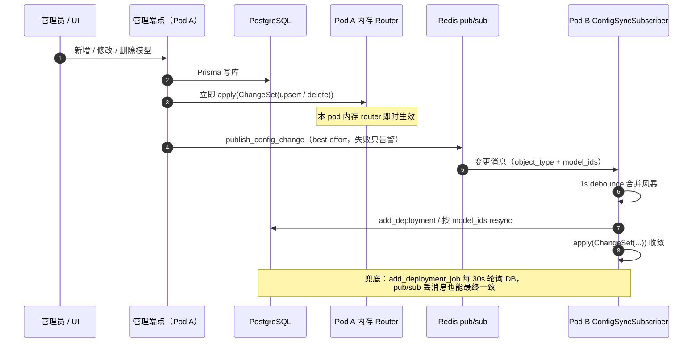

### 6.2 插件扩展与重启边界

内置路由策略可在线切换；自定义策略插件没有配置化热加载，只能代码注入，且改 `routing_strategy` 会清掉已注册插件（见 2.5），实际运维中基本等同于改了就要重启并重新注册。

仓库根 `router_plugins.json` 里只有 language-detector 这类路由信号检测插件，不是 routing strategy 注册表，代码里也没有读取它做策略注册的逻辑。`general_settings.plugins` 是 UI iframe 代理插件，同样与路由无关。

### 6.3 全表目录（按域分组）

数据面唯一的持久化存储是 PostgreSQL，schema 定义在仓库根 `schema.prisma`（2170 行，107 张表；`litellm/proxy/schema.prisma` 与 `litellm-proxy-extras` 里的副本内容一致）。运行时由 Prisma Client 访问；实体类型定义在 `litellm/models/`，数据访问层在 `litellm/repositories/`（`BaseRepository[T]` + 各实体 repository，见 `ARCHITECTURE.md` 的 Data Access Layer 一节）。迁移只在启动时同步执行，不做行级改写。

| 域 | 表 | 一句话用途 |
|---|---|---|
| 治理核心 | `LiteLLM_OrganizationTable`（16 字段） | 组织，budget_id 关联预算 |
| | `LiteLLM_ProjectTable`（18） | 项目，介于 team 与 key 之间的用例管理单元 |
| | `LiteLLM_TeamTable`（32） | 团队，生产 key 按组分配的主载体 |
| | `LiteLLM_UserTable`（32） | 内部用户（SDK/UI 登录主体） |
| | `LiteLLM_VerificationToken`（49） | 虚拟 key，网关鉴权的第一实体 |
| | `LiteLLM_TeamMembership`（5）/ `LiteLLM_OrganizationMembership`（9） | 用户在 team/org 内的成员身份与角色，各自可挂 budget |
| | `LiteLLM_InvitationLink`（12） | 邀请链接 |
| | `LiteLLM_EndUserTable`（9） | 终端用户（customer），可限区域、挂预算 |
| | `LiteLLM_TagTable`（9） | 请求 tag 的预算与 spend |
| 预算 | `LiteLLM_BudgetTable`（25） | 共享预算表，各实体经 budget_id 复用 |
| | `LiteLLM_ModelAccessGroupBudgetTable`（7） | 模型访问组的共享预算（组本身是 model_info 里的自由字符串） |
| | `LiteLLM_BudgetWindowSpend`（7） | 多窗口预算（7d+30d 等）的窗口累计 spend |
| 权限与资源 | `LiteLLM_ObjectPermissionTable`（20） | 统一资源授权行，key/team/user/org/agent 都可挂一条 |
| | `LiteLLM_MCPServerTable`（56）/ `MCPToolsetTable`（8）/ `MCPUserCredentials`（6）/ `MCPUserEnvVars`（6）/ `MCPServerOAuthClient`（4）/ `UserProviderCredentials`（7） | MCP 网关的服务器注册、toolset、BYOK 凭据、用户环境变量、OAuth client |
| | `LiteLLM_AgentsTable`（23）/ `AgentIdentity`（12）/ `RetiredAgent*`（2+7）/ `VerifiedSubject`（9） | A2A agent 注册、身份与退役 |
| | `LiteLLM_AccessGroupTable`（14）/ `LiteLLM_ToolTable`（16） | 工具策略：全局注册表 + 按 (tool, team/key) 的覆盖 |
| | `LiteLLM_VectorStore 相关`（ManagedVectorStore*） | 托管 vector store 注册 |
| 模型与凭据 | `LiteLLM_ProxyModelTable`（8） | DB 存模型（`store_model_in_db=True` 的 model_list 条目） |
| | `LiteLLM_CredentialsTable`（9） | 供应商凭据（按 credential_name 唯一） |
| | `LiteLLM_ModelTable`（7） | team 级模型别名（TeamTable.model_id 外键） |
| 请求日志 | `LiteLLM_SpendLogs`（35） | 每请求一行：spend、token、模型、归属（第 3.3 节有字段清单） |
| | `LiteLLM_ErrorLogs`（10） | 错误日志 |
| | `LiteLLM_DailyUserSpend`（26）等 7 张 `Daily*` | 日粒度 rollup（见 6.4） |
| | `LiteLLM_DailyGatewayRequests`（7）/ `DailyGatewayFailedRequests`（7）/ `DailyRequestErrors`（9） | ASGI 边缘计的网关请求/失败计数 |
| | `LiteLLM_SpendLogGuardrailIndex`（4）/ `SpendLogToolIndex`（3） | SpendLogs 的辅助索引行，加速"某 guardrail/tool 最近 N 条"查询 |
| 运维 | `LiteLLM_ProxyWorkerHeartbeat`（4）/ `LiteLLM_CronJob`（5） | worker 存活表与 cron 选主租约（6.4） |
| | `LiteLLM_HealthCheckTable`（13） | 后台健康检查结果历史 |
| | `LiteLLM_Config`（4）/ `ConfigOverrides`（4）/ `UISettings`（4）/ `CacheConfig`（4）/ `SSOConfig`（4） | config.yaml 各段与 UI/缓存/SSO 设置的持久化 |
| | `LiteLLM_PromptTable`（8）/ `SearchToolsTable`（5）/ `UserNotifications`（5） | prompt 注册、搜索工具注册、成员申请模型访问的通知 |
| 审计 | `LiteLLM_AuditLog`（9） | 管理 API 审计（3.3） |
| | `LiteLLM_DeletedTeamTable`（33）/ `DeletedVerificationToken`（51） | 删除前归档（archive-then-delete 事务模式） |
| | `LiteLLM_DeprecatedVerificationToken`（5） | key 轮换宽限期内允许旧 key 继续用 |
| | `LiteLLM_SSOIdentityAssertion`（4） | SSO 登录时的 IdP 身份断言（加密存储） |
| Router 状态 | `LiteLLM_AdaptiveRouterState`（7）/ `AdaptiveRouterSession`（20） | adaptive router 的 Beta 后验与信号计数 |
| | `LiteLLM_AutoRouter*`（5 张） | auto router 的基线对比、观察、会话与日 spend |
| 评估 | `LiteLLM_ShadowEvalJob`（18）/ `ShadowEvalAttempt`（17）/ `ShadowEvalFunnel`（5） | 盲评 A/B 的任务、每次采样判定、漏斗计数 |
| Agent 工作流 | `LiteLLM_WorkflowRun`（12）/ `WorkflowEvent`（8）/ `WorkflowMessage`（8） | 工作流状态机：run + 追加事件（source of truth）+ 消息收发箱 |
| | `LiteLLM_BackgroundInteractionSettlement`（8） | 后台 interaction 的待结算账单 |
| | `LiteLLM_MemoryTable`（10） | `/v1/memory` 的用户/团队作用域记忆条目 |
| Guardrail / Policy | `LiteLLM_GuardrailsTable`（9） | guardrail 配置 |
| | `LiteLLM_DailyGuardrailMetrics`（10）/ `DailyGuardrailUsageUnits`（10）/ `DailyPolicyMetrics`（10） | 日粒度 guardrail/policy 用量 |
| | `LiteLLM_PolicyTable`（18）/ `PolicyAttachmentTable`（13） | policy 定义（带版本）与作用域挂载 |
| Skills / Claude Code | `LiteLLM_SkillsTable`（14）/ `SkillSubmission`（14）/ `ClaudeCodePluginTable`（14）/ `PluginVersion`（10）/ `PluginDownload`（12）/ `PluginUpload`（3） | skill 注册与下载、Claude Code 插件市场 |
| Lens | `LiteLLM_Lens`（5）等 8 张 | 内嵌追踪的 run/review/dataset/信号配置 |
| 账务外发 | `LiteLLM_TelemetryReport`（5）/ `SpendLogDelivery`（10）/ `SubscriptionAccountTable`（11） | 遥测上报、spend log 外投（delivery 投影）、订阅账户 |
| 托管资源 | `LiteLLM_ManagedFileTable`（12）/ `ManagedObjectTable`（16）/ `ManagedFileContentTable`（3）/ `ManagedVectorStoreTable`（12）/ `ManagedVectorStoresTable`（9）/ `ManagedVectorStoreIndexTable`（7） | files/batches/vector stores 的托管资源注册 |

### 6.4 核心表字段解释

**LiteLLM_VerificationToken（虚拟 key，49 字段）**——鉴权与配额的第一实体，`token`（主键）存的是**哈希后的 key**，与 SpendLogs.api_key 同值：

| 字段组 | 字段 | 含义 |
|---|---|---|
| 身份 | `token` @id / `key_name` / `key_alias` | 哈希后的 key / 展示名 / 别名 |
| 归属 | `user_id` / `team_id` / `organization_id` / `project_id` / `agent_id` | 五级归属，A2A agent 调用也可持 key |
| 花费 | `spend`（预算窗口内）/ `total_spend`（生命周期累计）/ `model_spend` Json | spend 随 `budget_duration` 重置，total 不重置；model_spend 按模型细分 |
| 限流 | `tpm_limit` / `rpm_limit` / `tpd_limit` / `max_parallel_requests` | token 与并发限制，limiter 直接读 |
| 预算 | `max_budget` / `budget_duration` / `budget_reset_at` / `budget_limits` Json / `budget_fallbacks` Json / `budget_id` / `model_max_budget` Json / `soft_budget_cooldown` | 直写预算一套 + 经 budget_id 挂共享预算一套；budget_limits 是多窗口（如 7d+30d）；budget_fallbacks 是超预算后回退到的模型组；soft_budget_cooldown 是 80% 告警的冷却状态位 |
| 访问控制 | `models` / `aliases` / `config` / `permissions` Json / `allowed_cache_controls` / `allowed_routes` / `access_group_ids` / `policies` / `key_type` / `blocked` | 可调模型与路由、请求级参数门控、policy engine 挂载；blocked 是禁用开关 |
| 资源授权 | `object_permission_id` → `LiteLLM_ObjectPermissionTable` | MCP/vector store/agent/search/skills 的细粒度授权都挂在这一条上 |
| 轮换 | `auto_rotate` / `rotation_interval` / `rotation_count` / `last_rotation_at` / `key_rotation_at` | 自动轮换配置与进度，`process_rotations` job 消费 |
| 审计 | `created_at/by`、`updated_at/by`、`last_active`、`settings_updated_at` | last_active 供 UI 展示；settings_updated_at 用于 key 配置缓存失效 |
| 元数据 | `metadata` Json | 任意 k/v（如 spendlogs 的 project_id） |

**LiteLLM_TeamTable（32 字段）**——`admins` / `members` / `members_with_roles`（JSON，含 role）、`team_member_permissions`（团队级权限位）、`default_team_member_models`（新成员默认 allowed_models）、`model_id` → `LiteLLM_ModelTable`（team 级模型别名）、`allow_team_guardrail_config`（团队管理员可否自配 guardrail）；预算/限流/模型字段与 key 同名同义（`budget_limits` 多窗口在此直写），`blocked` 默认 false。

**LiteLLM_UserTable（32 字段）**——`user_id` @id、`sso_user_id` @unique（SSO 映射）、`teams`（旧式 ID 数组，实际成员关系以 `TeamMembership` 行为准）、`user_role`、`password`（scrypt）+ `password_reset_required` + `last_breach_check_at`（口令泄露检查）、`policies`、预算/限流字段与 key 同名同义（无 tpd）。

**LiteLLM_ObjectPermissionTable（20 字段）**——统一资源授权行，key/team/user/org/agent 都可挂一条（`object_permission_id` 外键回指）：`mcp_servers`（可访问的 server_id 列表）、`mcp_tool_permissions` Json（`{"server_id": ["tool1", ...]}` 的工具级白名单）、`mcp_toolsets`（授予的 toolset）、`blocked_tools`、`mcp_tool_search_enabled`、`vector_stores`、`agents` + `agent_access_groups`、`search_tools`（可调用的 search tool 名）、`skills`（超出公开集的 Claude Code 插件）、`models`。网关新数据面（MCP/vector store/agent/search/skills）的授权全部收敛在这张表。

**LiteLLM_BudgetTable（25 字段）**——`max_budget`、`soft_budget`、`max_parallel_requests`、`tpm/rpm/tpd_limit`、`model_max_budget` Json、`budget_duration` + `budget_reset_at`、`allowed_models`（per-member 模型范围，空 = 继承 team）、`temp_budget_increase` + `temp_budget_expiry`（临时提额）、`created_by/updated_by`。各实体通过 budget_id 共享一套完整预算能力。

**LiteLLM_SpendLogs（35 字段）**——字段清单见 3.3。语义要点：`api_key` 是哈希 key（等价 VerificationToken.token）；`spend` 是该请求的成本；`metadata` 里放 project_id 等；`request_tags` 是请求时打的标签；`agent_id` / `billing_agent_id` / `mcp_namespaced_tool_name` 支撑 agent 与 MCP 的账务归因；`litellm_call_id` 是链路追踪锚点。索引按 `(api_key, startTime)`、`session_id`、`litellm_call_id`、`end_user` 建。

**`LiteLLM_Daily*` 家族（7 张，以 DailyUserSpend 26 字段为代表）**——日粒度 rollup，UI 用量页直接读，避免扫 SpendLogs。唯一键 `(user_id, date, api_key, model, custom_llm_provider, mcp_namespaced_tool_name, endpoint)`；token 细分含 `cache_read/creation_input_tokens`、`compression_saved_tokens`；四类"节省"金额列（`prompt_caching_savings_spend`、`gateway_injected_caching_savings_spend`、`autorouter_savings_spend`、`compression_savings_spend`）支撑 Cost Optimization 页；`total_response_time_ms` / `timed_requests` 用于算平均延迟；`api_requests` / `successful_requests` / `failed_requests` 是计数。家族成员按归属维度换主键：user / global（无 key 维度）/ organization / end_user / agent / team / tag。

**LiteLLM_CronJob（5 字段）与 LiteLLM_ProxyWorkerHeartbeat（4 字段）**——跨 pod 运维的两张小表。CronJob：`cronjob_id`、`pod_id`（leader）、`status`（JobStatus）、`ttl`（租约到期），部分 cron job 用它做 DB 层选主（与 Redis `PodLockManager` 并存的另一机制）；Heartbeat：每 worker 一行，60s upsert（`proxy/db/proxy_worker_heartbeat.py:29`），存活窗口 3 倍间隔。

**LiteLLM_Config（4 字段）**——`param_name` @id（如 `general_settings`、`router_settings`）、`param_value` Json、`last_run_at`、`reload_revision`（配置行版本号，消费 job 对比它决定是否重新应用，如 cost map 调度器记录 `model_cost_map_applied_revision`，`proxy_server.py:9471`）。

**LiteLLM_TeamMembership（5）与 LiteLLM_OrganizationMembership（9）**——联合主键（user_id + team_id / organization_id）的成员关系行：spend、total_spend、budget_id（用户在该 team/org 内的独立预算）、user_role（org 内角色）。成员预算检查（`_check_team_member_budget`）读的就是这里。

**核心实体关系图**：

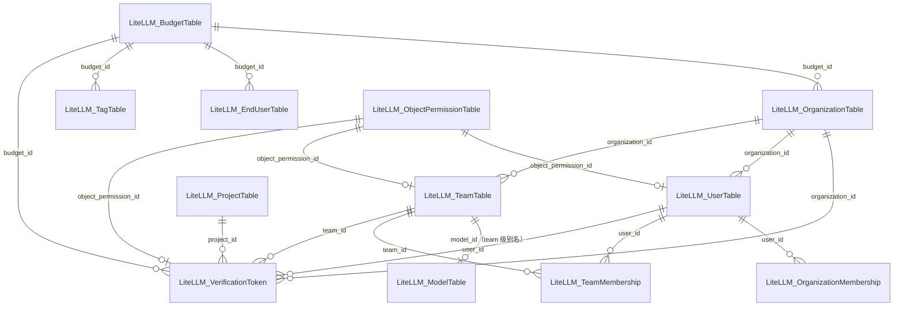

读模型的三个要点：**多窗口与模型级预算走 JSON 列**（`budget_limits`、`model_max_budget`、`model_spend`），而不是行级展开，查询时由 `auth_checks.py` 解析；**删除是归档制**（team/key 先复制进 `LiteLLM_Deleted*` 表再删原行，单事务完成）；**迁移只动 schema**（`tests/code_coverage_tests/check_migrations_no_data_rewrites.py` 强制），行级汇总全部由应用层 job 完成（如 `Daily*` 由 scheduler 算、`BudgetWindowSpend` 由 `budget_window_spend_writer.py` 写）。

---

## 7. 总结与设计评价

LiteLLM 的本质是"LLM 调用的标准网关层"。站在软件架构视角，几个值得记住的设计决策：

1. **分层清晰，但分层的实现语言变了**：Gateway 做治理（鉴权、配额、路由、审计），SDK 做执行（provider 转换、流式）。1.110 把"路由"从 SDK 层上移成独立的 Rust 核心：Router 是不可继承的 facade，registry/selection/retries/fallbacks/cooldowns 归 Rust，Python 退为宿主步骤（缓存、休眠、回调、真正发请求），宿主协议 `RouterHost` 切断了 router 与 proxy 的循环依赖。
2. **进程模型是单机垂直扩展**：master 只初始化和监管，worker 处理请求，鉴权在 worker 内完成。跨机器扩展靠多 pod + Service，不靠把 master 拆开。需要控制面/数据面拆分时，用 `gateway/` + `backend/` 两个裁剪过的入口。
3. **Redis 是跨 worker 一致性的命脉**：session pin、限流计数、spend、cooldown、健康状态全依赖它。无 Redis 时这些退化为进程本地，多 worker 部署实际不可用。1.110 把 Redis 访问面整理成 `litellm/redis/stores/` 独立包。
4. **会话亲和固定的是 deployment 而非 worker**：这是常见误解。pin 的值是 `model_id`，固定到某厂商端点是副作用；worker 对 LLM 路由而言无状态。亲和有三个维度（session/key/responses id），按 model group 开关。
5. **计费与回调所有权始终在 Python**：即便路由决策和 cooldown 记账在 Rust，语义判定、成本计算、spend log、callback 链仍由 Python 宿主步骤完成。
6. **默认安全边界要主动加固**：消息内容脱敏默认关闭，`store_prompts_in_spend_logs` 默认 False，凭据脱敏默认开启。有敏感数据的部署需显式开启消息脱敏。
7. **评估能力是管线而非成品**：提供 judge guardrail、盲评、反馈信号和 trace 导出，但"是否解决用户问题"的语义判定要自己配 criteria 或交给外部平台。
8. **Agent 网关是 1.110 的主旋律**：A2A 代理、agent 身份与 kill switch、harness、memory/search/skills/RAG/interactions 数据面、MCP 网关、workflow 状态追踪，全部接入统一的鉴权限流计费管道。网关正在从"模型代理"扩张成"agent 的完整基础设施"。

与同库其它页面的关联见 `wiki/index.md` 交叉主题：部署视角对照 `tech/cloud-native/kubernetes.md`；作为被治理的 LLM 调用网关，与 `tech/agent-harness/` 下的 harness 形成"调用方 ↔ 网关"的对照。
