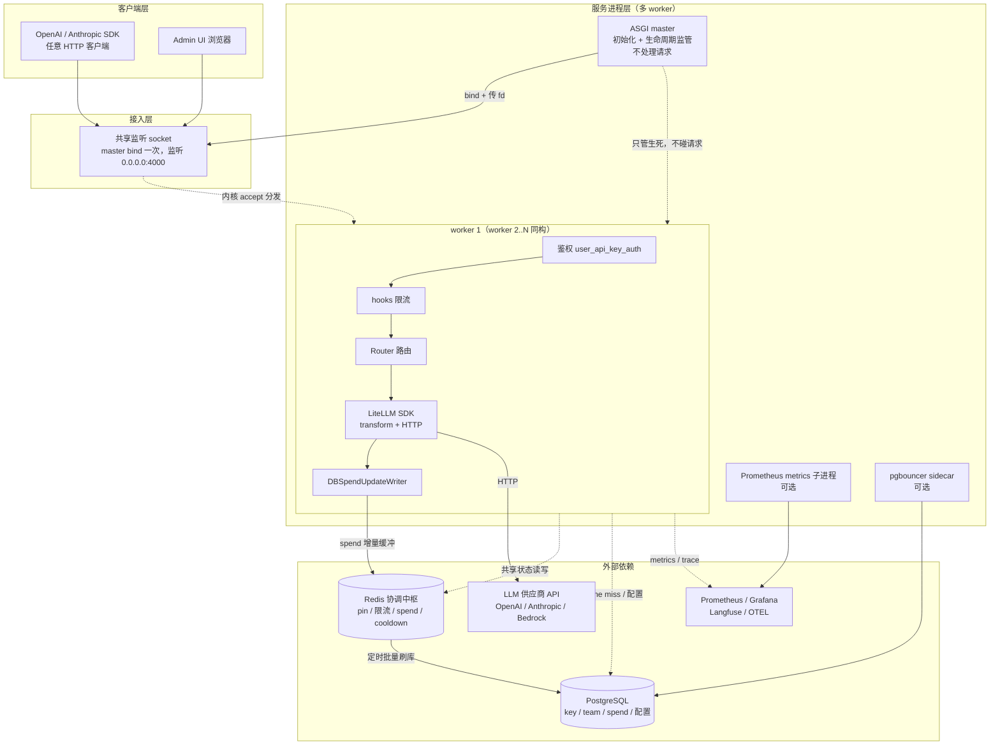
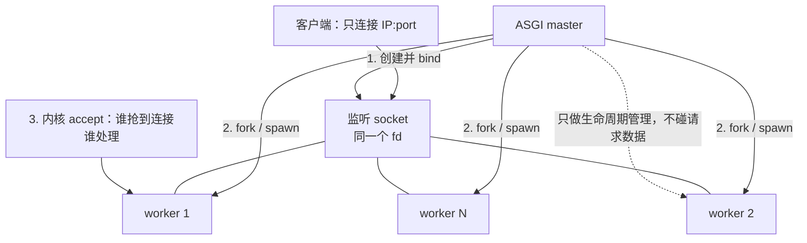
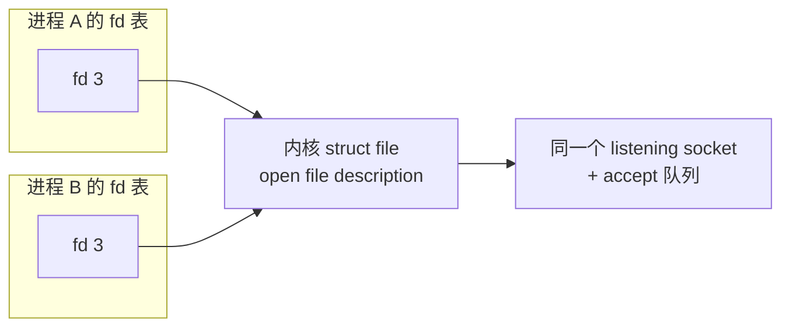
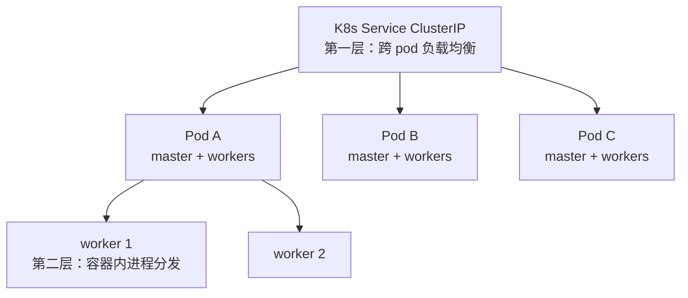
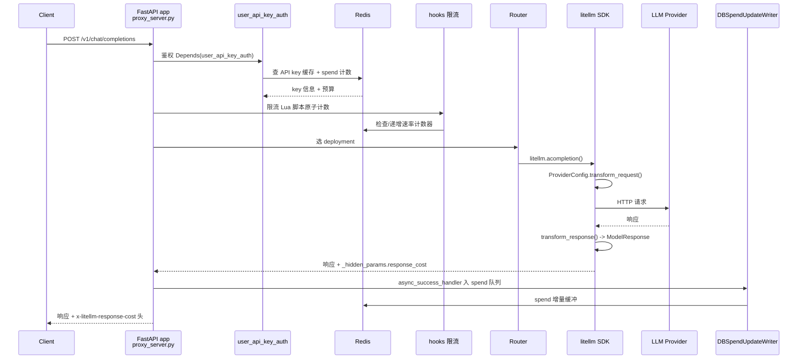
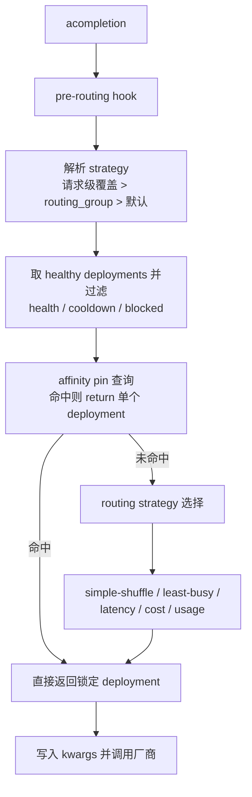
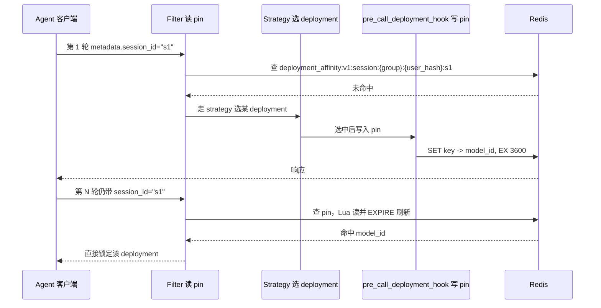

# LiteLLM AI Gateway 技术架构深度解析

> 基于 BerriAI/litellm release-1.109.1 源码分析
> 整理日期：2026-11-18
> 来源仓库：`BerriAI/litellm`（release-1.109.1 tag）
> 阅读方式：先按目录建立全局框架，再按章节深入；文中路径均为仓库相对路径，行号对应 release-1.109.1。

---

## 目录

- [1. 定位与服务本质](#1-定位与服务本质)
  - [1.1 一句话定位](#11-一句话定位)
  - [1.2 总体架构全景](#12-总体架构全景)
  - [1.3 两套运行时形态](#13-两套运行时形态)
- [2. 启动与服务入口](#2-启动与服务入口)
  - [2.1 CLI 启动链路](#21-cli-启动链路)
  - [2.2 四种启动方式](#22-四种启动方式)
  - [2.3 需要准备的信息](#23-需要准备的信息)
  - [2.4 CLI 参数全景](#24-cli-参数全景)
- [3. 进程与运行时架构](#3-进程与运行时架构)
  - [3.1 进程组件清单](#31-进程组件清单)
  - [3.2 master 与 worker 的分工](#32-master-与-worker-的分工)
  - [3.3 ASGI 服务器与 worker 分发](#33-asgi-服务器与-worker-分发)
  - [3.4 K8s 部署的两级扩展](#34-k8s-部署的两级扩展)
- [4. 请求主链路与协作](#4-请求主链路与协作)
  - [4.1 chat completions 全链路](#41-chat-completions-全链路)
  - [4.2 成本归属链路](#42-成本归属链路)
  - [4.3 进程间共享与协调](#43-进程间共享与协调)
  - [4.4 后台任务与守护组件](#44-后台任务与守护组件)
- [5. 多 deployment 路由与会话亲和](#5-多-deployment-路由与会话亲和)
  - [5.1 model group 与 deployment](#51-model-group-与-deployment)
  - [5.2 路由策略与决策顺序](#52-路由策略与决策顺序)
  - [5.3 session affinity 的 pin 机制](#53-session-affinity-的-pin-机制)
  - [5.4 自定义路由插件](#54-自定义路由插件)
- [6. 配置热更新](#6-配置热更新)
  - [6.1 模型配置的 DB 持久化与热更新](#61-模型配置的-db-持久化与热更新)
  - [6.2 插件扩展与重启边界](#62-插件扩展与重启边界)
- [7. 配额与计费](#7-配额与计费)
  - [7.1 配额粒度与功能维度](#71-配额粒度与功能维度)
  - [7.2 费用计算](#72-费用计算)
- [8. 可观测性 日志 审计 脱敏](#8-可观测性-日志-审计-脱敏)
  - [8.1 审计日志与字段](#81-审计日志与字段)
  - [8.2 敏感信息脱敏](#82-敏感信息脱敏)
  - [8.3 可观测集成生态](#83-可观测集成生态)
- [9. 稳定性 性能监控与分析看板](#9-稳定性-性能监控与分析看板)
  - [9.1 Prometheus 指标](#91-prometheus-指标)
  - [9.2 健康检查与熔断](#92-健康检查与熔断)
  - [9.3 UI 看板与 Grafana](#93-ui-看板与-grafana)
- [10. 模型效果评估](#10-模型效果评估)
  - [10.1 原生评估能力](#101-原生评估能力)
  - [10.2 与外部系统的边界](#102-与外部系统的边界)
- [11. Rust 核心](#11-rust-核心)
  - [11.1 两套集成形态](#111-两套集成形态)
  - [11.2 分层结构](#112-分层结构)
- [12. 总结与设计评价](#12-总结与设计评价)

---

## 1. 定位与服务本质

### 1.1 一句话定位

LiteLLM 是一个开源 AI 网关，提供 100 多个大模型供应商的统一 OpenAI 格式接口。既可以当 Python SDK 直接集成，也可以部署成集中式的 Gateway（Proxy Server）。Gateway 在 SDK 之上叠加鉴权、虚拟 key、预算、限流、路由和可观测，SDK 负责真正的供应商调用、请求响应转换和流式处理。

整个仓库是 Python 与 Rust 双栈：默认服务是 Python FastAPI，Rust 是并行演进的重写工程。

### 1.2 总体架构全景

这张图把 LiteLLM 的静态组件和关键连接放在同一视图，作为全篇的地图。它按五个平面组织：客户端、接入、服务进程、worker 内部、外部依赖。



读图要点：

- **客户端只认 IP:port**，直连 master 创建的共享监听 socket。多 pod 部署时入口前面还有 K8s Service 做第一层负载均衡，这是部署拓扑而非 LiteLLM 组件，见 3.4。
- **master 在控制面**。它创建 socket 并传给 worker，只做初始化和生命周期监管，不碰任何 HTTP 请求数据（见 3.2、3.3）。
- **worker 处理全部请求**。worker 内部串联鉴权、限流、路由、SDK 调用、成本入队，Gateway 层负责治理，provider 格式转换在 SDK 层完成（`ARCHITECTURE.md:11-20`）。
- **worker 无状态，Redis 是共享中枢**。多个 worker 通过 Redis 共享 session pin、限流计数、spend 缓冲和 cooldown（见 4.3、5.3）。没有 Redis 时这些退化为进程本地。
- **数据持久化在 PostgreSQL**。API key、团队、spend log、配置存库；spend 先经 Redis 缓冲再定时刷入（见 4.2、6.1）。
- **可观测是旁路**。metrics 子进程和 callback 把指标、trace 送到 Prometheus/Grafana/Langfuse（见第 9 章）。

图中细节的放大视图分别在 3.3（socket 共享原理）、4.1（请求时序）、5.2（路由决策）、5.3（pin 读写）。

### 1.3 两套运行时形态

| 形态 | 进程边界 | 载体 | 是否默认 |
|---|---|---|---|
| Python 代理 | Python 进程 + ASGI 服务器 | `litellm/proxy/proxy_server.py` 的 FastAPI `app` | 是，`litellm --config` 走这条 |
| Rust 进程内扩展 | 同一 CPython 进程 | PyO3 `cdylib` -> `litellm.rust_bridge._native` | 部分路由强制，多数 opt-in |
| Rust 独立网关 | 独立 OS 进程 / 容器 | 二进制 `litellm-gateway`（axum） | 否，功能不完整 |

默认命令 `litellm --config` 的调用链是 `pyproject.toml:199` -> `litellm_cli/main.py:201-204` -> `proxy_cli.py:1211 run_server` -> `uvicorn.run(app="litellm.proxy.proxy_server:app")`（`proxy_cli.py:424-425, 1810-1813`）。`--run_gunicorn`、`--run_hypercorn`、`--run_granian` 只是换 ASGI 服务器外壳，服务的仍是同一个 Python FastAPI app。

`LITELLM_RUST` 环境变量不是启动 Rust 网关的开关，而是进程内路由的 opt-in/opt-out 开关（`litellm/rust_bridge/configuration.py:11`）。

---

## 2. 启动与服务入口

### 2.1 CLI 启动链路

```text
pyproject.toml:199  litellm = "litellm_cli.main:proxy_server"
  -> litellm_cli/main.py:201  proxy_server()
  -> litellm/proxy/proxy_cli.py:1211  run_server()   （Click command，选项定义在 886-1210）
  -> save_worker_config()  把 CLI 参数写入环境变量 WORKER_CONFIG
  -> Prisma 迁移 / pgbouncer / metrics 子进程
  -> uvicorn.run(..., workers=N) 或 gunicorn / hypercorn / granian
```

`litellm_cli/main.py` 顶部注释说明了一个重要设计：CLI 在 Click 解析 argv 之前不导入 SDK，避免多 worker 场景每个 worker 都 import 整个 SDK 而错过 uvicorn 的健康探测。

### 2.2 四种启动方式

1. 最快路径，无需配置文件和数据库
   ```shell
   uv tool install 'litellm[proxy]'
   export OPENAI_API_KEY=...
   litellm --model gpt-4o
   ```
2. 交互式向导。`litellm --setup`（`litellm/setup_wizard.py:243-254, 488-489`）依次询问供应商、API Key、端口，自动生成 master key 和 `config.yaml`，最后询问是否直接启动。
3. 用配置文件启动。`litellm --config config.yaml`，配置结构参考仓库根 `proxy_server_config.yaml`，分 `model_list`、`litellm_settings`、`router_settings`、`general_settings` 四块。
4. Docker Compose。`docker-compose.yml` 同时拉起 litellm、postgres、prometheus，`.env` 自动加载。
5. 开发模式（README:651-662）。`docker-compose up db prometheus` 起依赖，`make bootstrap`，`uv run python litellm/proxy/proxy_cli.py` 起后端，`ui/litellm-dashboard` 下 `npm run dev` 起前端。

### 2.3 需要准备的信息

按必需程度分三档：

| 档位 | 信息 | 说明 |
|---|---|---|
| 基础必需 | 供应商 API Key | `OPENAI_API_KEY`、`ANTHROPIC_API_KEY`、`AZURE_API_KEY` + `AZURE_API_BASE`/`AZURE_API_VERSION` 等，配置里用 `os.environ/XXX` 引用，见 `.env.example` |
| 生产管理 | `LITELLM_MASTER_KEY` | 管理员密钥，用于虚拟 key、管理 API、Admin UI。不设置则所有请求按无管理员权限处理，Admin UI 报错（`proxy_server.py:7131, 19060`） |
| 生产管理 | `DATABASE_URL` | PostgreSQL 连接串，虚拟 key、spend、DB 存模型、用户团队管理都依赖它；启动时自动跑 prisma migration。可用 `construct_database_url_from_env_vars()` 由分散环境变量拼出 |
| 多 worker | Redis | `REDIS_HOST/PORT/PASSWORD`，多 worker/多 pod 共享路由状态、限流、spend、缓存 |
| 可选 | `STORE_MODEL_IN_DB=True` | 允许通过 UI 添加模型 |
| 可选 | 回调 | Prometheus、Langfuse 等 |
| 可选 | SSL 证书 | HTTPS 需要 `--ssl_keyfile_path`/`--ssl_certfile_path` |

### 2.4 CLI 参数全景

常用参数（`proxy_cli.py:886-1210`）：`--host`（默认 0.0.0.0）、`--port`（4000）、`--config/-c`、`--model/-m`、`--num_workers`、`--detailed_debug`、`--reload`、`--run_gunicorn/--run_hypercorn/--run_granian`、`--ssl_keyfile_path/--ssl_certfile_path`、`--setup`、`--validate_config`、`--prometheus_metrics_port`。多数参数支持同名环境变量（HOST、PORT、NUM_WORKERS）。

验证手段：`curl http://localhost:4000/health/liveliness`，或 `litellm --test`、`litellm --validate_config --config config.yaml`。

---

## 3. 进程与运行时架构

### 3.1 进程组件清单

一次典型多 worker 部署包含：

| 组件 | 谁创建 | 职责 |
|---|---|---|
| master / supervisor | `litellm` 控制台脚本 | 读配置、DB URL 解析、Prisma 迁移、启动 pgbouncer 和 metrics 子进程，最后交给 ASGI supervisor |
| ASGI server | master 选择 | uvicorn / gunicorn / hypercorn / granian，管理 worker 生命周期 |
| worker 进程 | uvicorn `Multiprocess` 或 gunicorn fork | 各自加载 FastAPI app，处理推理请求，各持一个 Prisma query-engine |
| reloader（`--reload`） | uvicorn `ChangeReload` | 监听 `*.py`、`.env`、config YAML 变化并重启 worker |

可选独立进程或短命子进程：

| 组件 | 触发条件 | 解决的问题与职责 |
|---|---|---|
| Prometheus metrics 进程 | `--prometheus_metrics_port` | 把指标聚合 scrape 从推理 worker 的事件循环挪到独立进程，独立端口暴露 `/metrics` |
| in-container pgbouncer | `LITELLM_PGBOUNCER_*` 开启 | 在 worker 与 Postgres 之间做事务级连接池，避免每 worker 直连导致连接数膨胀 |
| Prisma CLI 子进程 | 每次启动 | `prisma migrate deploy` 或 `db push`，fork worker 之前同步结束 |
| `ollama serve` | `--model` 含 ollama 且无 api_base | 本地拉起 ollama |

进程内守护线程（非进程）：master 的 query-engine reaper 回收被强杀 worker 遗留的孤儿数据库引擎进程；pgbouncer 有崩溃监督和 token 刷新线程。

**Prometheus metrics 子进程**

多 worker 时每个 worker 把指标样本写进共享目录 `PROMETHEUS_MULTIPROC_DIR`。如果直接在推理 worker 的 `/metrics` 端点做聚合，Prometheus 来抓取时会占用推理 worker 的事件循环。这个子进程专门承担聚合与暴露：master 用 `subprocess.Popen` 拉起独立的 Python 进程（`prometheus_metrics_server.py:139-156`），里面跑 uvicorn + FastAPI app，用 `prometheus_client.multiprocess.MultiProcessCollector` 读共享目录聚合样本，从独立端口暴露 `/metrics` 和 `/health`（`:76-86, 98-102`）。就绪探测通过校验响应头 `x-litellm-metrics-pid` 确认是自己的子进程在应答（`:120-136`）。

生命周期上有个 watchdog 守护线程每秒检查 `os.getppid()`，父进程退出后子进程立刻自杀（`:89-95`）。CLI 强制该端口不同于主端口（`proxy_cli.py:1704-1705`）。注意这个独立端口无虚拟 key 鉴权，不能暴露公网 ingress，只在内部网络抓取。

**in-container pgbouncer sidecar**

每个 worker 进程持有自己的 Prisma query-engine，都会直连 PostgreSQL。worker 一多，尤其多 pod 部署，Postgres 连接数会线性膨胀。pgbouncer 在中间做事务级连接池，用少量真实连接服务大量 worker 连接。

master 启动 pgbouncer 进程（`proxy_cli.py:1685-1701` -> `pgbouncer.py:686-743`），监听 `127.0.0.1:6432`，生成 `pgbouncer.ini` 配置 `pool_mode=transaction`、`max_db_connections` 和 auth 文件（`pgbouncer.py:190-280`），然后把 `DATABASE_URL` 改写成指向 loopback 的 pooled URL。worker 只拿到这个 loopback 地址和随机 pool 密码，不知道上游 Postgres 的真实凭据（`pgbouncer.py:336-342`）。

顺序是关键：数据库迁移和 schema diff 在 pgbouncer 启动**之前**由 master 直连 Postgres 完成（`pgbouncer.py:1-31` 文件头明确说明），之后 worker 才用 pooled URL 连库。崩溃时守护线程自动重启（`:589-627`）；IAM token 或 Azure Entra 认证场景下，另有守护线程定期重写 auth 文件并发 SIGHUP 让 pgbouncer 重新加载（`:362-446`）。没配置 `LITELLM_PGBOUNCER_*` 时 worker 直连 Postgres。

两个进程都做了"只由启动它的 master 执行退出清理"的保护：pgbouncer 用 `_only_in_this_process`（`pgbouncer.py:675-683`）确保 atexit 清理只在 master 跑，因为 gunicorn fork 的 worker 继承了 atexit 表；metrics 子进程靠父进程死亡 watchdog 实现生命周期绑定。

### 3.2 master 与 worker 的分工

master 在 fork worker 之前完成所有一次性初始化，顺序为（`proxy_cli.py:1363-1701`）：

1. `apply_process_defaults()` 处理 DEV 模式与 `.env` 加载。
2. `save_worker_config()` 把 CLI 参数序列化为 JSON 写入环境变量 `WORKER_CONFIG`（`proxy_server.py:9785-9788`）。
3. DB token auth（IAM / Azure Entra）、AWS KMS 解密。
4. 读 config YAML，组装 `DATABASE_URL`、`DIRECT_URL`、连接池参数。
5. Prisma 迁移在 master 中同步执行，失败即 `sys.exit`（`proxy_cli.py:1614-1684`）。
6. 启动 pgbouncer sidecar，把 `DATABASE_URL` 改写为 loopback pooled URL。
7. 准备 metrics 多进程目录，必要时拉起独立 metrics 子进程。
8. 交给 ASGI server fork/spawn worker，master 启动 query-engine reaper。

worker 通过环境变量继承配置：`WORKER_CONFIG` 和 `CONFIG_FILE_PATH` 在 worker 启动事件里读回（`proxy_server.py:1584-1616`），日志配置走 `LITELLM_WORKER_LOG_CONFIG`。worker app factory `proxy_worker_app()`（`litellm_cli/main.py:217-223`）在加载期 `gc.disable()`、加载完 `gc.freeze()`，避免完整 GC 占用 GIL 导致错过 uvicorn 健康 ping。

一句话：**master 只做初始化和生命周期监管，不碰业务请求；鉴权发生在每个 worker 的 FastAPI 路由依赖里**（`proxy_server.py:12397` 等大量 `Depends(user_api_key_auth)`）。

### 3.3 ASGI 服务器与 worker 分发

ASGI（Asynchronous Server Gateway Interface）是 Python Web 服务器与应用之间的标准协议。ASGI 服务器（uvicorn/gunicorn/granian/hypercorn）负责监听端口、管理多 worker，把请求喂给 FastAPI app，不认识"大模型"概念。

一个容易误解的点：客户端既不直连某个 worker，也不存在"master 转发请求"这一层。真实机制是**共享监听 socket + 内核 accept 分发**。



过程分解：

1. master 调用 `bind_socket()` 创建监听 socket（`litellm/proxy/dev_reload.py:164`）。
2. master 通过 `sockets=[shared_socket]` 把它传给 worker pool（`dev_reload.py:169`）。uvicorn 的 `Multiprocess.init_processes()` 把同一个 sockets 列表传给每一个 worker 进程（`uvicorn/supervisors/multiprocess.py` 的 `Process(self.config, self.target, self.sockets)`）。
3. 每个 worker 在自己的 asyncio 事件循环里对这个共享 fd 调用 accept。
4. 客户端三次握手完成后，内核把连接放进该 socket 的 accept 队列并唤醒某个 worker 取走，由它完成 HTTP 解析和业务处理。

三句话概括：客户端只认 IP:port，看不到 worker；master 只管 worker 生死，不转发 HTTP 请求；分发发生在内核 accept 层，worker 共享 socket 竞争接单。gunicorn、granian 也是同类模式。

**底层原理：两个进程为什么能共享一个 socket**

关键在于 Unix「一切皆文件」的语义。socket 在 Linux/Unix 里就是一个文件描述符（fd）。理解共享必须先区分三层对象：



两个进程的 fd 表里数字可能都是 3，但它们指向内核中**同一个** `struct file`，进而指向同一个 listening socket 和同一个 accept 队列。所以共享的不是 fd 数字，而是 fd 背后的内核对象。

**两种传递方式**

master 建好 socket 后，要让 worker 拿到指向同一内核对象的 fd，有两条路：

| 方式 | 做法 | 谁负责 |
|---|---|---|
| fork | `fork()` 时内核复制子进程的 fd 表，每一项指向与父进程相同的内核 `struct file`，子进程天然继承所有已打开 fd | 内核自动 |
| spawn | 重新启动干净的 Python 解释器，没有 fd 自动继承。socket 被 pickle 时经 `multiprocessing.reduction` 转成 `DupFd`，通过 resource sharer 用 `SCM_RIGHTS` 控制消息把 fd 复制进目标进程 | Python multiprocessing |

uvicorn 实际走的是 spawn：`uvicorn/_subprocess.py` 里 `spawn = multiprocessing.get_context("spawn")`，每个 Process 用 `Pipe()` 建立父子通信通道（`multiprocess.py` 的 `self.parent_conn, self.child_conn = Pipe()`）。子进程 `subprocess_started()` 拿到的 `sockets` 已是有效的 socket 对象，直接 `target(sockets=sockets)` 即 `Server.run(sockets=sockets)`。一句话概括：**父进程 bind 一次，通过 IPC 把 fd 复制给每个子进程**。

**为什么多进程 accept 不会乱**

accept 队列在内核里是共享的，内核保证一次 accept 只把一个连接交给一个进程，不会重复分发。所以不需要 master 做调度，内核天然把进来的连接分给被唤醒的 worker。现代内核还处理了惊群问题（thundering herd），避免唤醒所有等待的 worker 造成资源浪费。

**共享 fd 不等于 SO_REUSEPORT**

| 机制 | 做法 | 谁分发 |
|---|---|---|
| 共享同一个 fd | master bind 一次，fd 传给所有 worker，大家 accept 同一个 socket | 内核在共享 accept 队列上分发 |
| SO_REUSEPORT | 每个 worker 各自 bind 同一个端口，内核在多个独立 socket 间做负载均衡 | 内核按哈希在 socket 间分发 |

uvicorn 走第一种（共享 fd），所以 worker 必须在 master 之后启动、且在同一主机上，这正是它跨不了容器边界的原因。K8s 里多个 pod 各自 bind 端口，是另一种形态，与这里的共享 fd 无关。

master 与 worker 必须在同一容器（同一 pod）内，拆不到两个 pod，因为它依赖 fork/spawn、共享 socket fd、进程信号、环境变量继承这些跨不了容器边界的操作系统原语。

### 3.4 K8s 部署的两级扩展

K8s 下"worker"对应两个层次，不要混为一谈。



`gateway.replicaCount` 控制 pod 副本数，`gateway.numWorkers`（默认 1，通过 `NUM_WORKERS` 环境变量传入，`helm/litellm/values.yaml:303-305, 425`）控制每个 pod 内 worker 数。跨 pod 状态一致性全靠 Redis，Helm chart 注释明确 Redis 是 "coordination store"，负责跨 pod tpm/rpm、spend 和 pod lock manager（`values.yaml:261-267`）。

---

## 4. 请求主链路与协作

### 4.1 chat completions 全链路



鉴权在同一 worker 内完成，不存在"master 鉴权后转发给 worker"。多 worker 时请求既可能被 K8s Service 分发到不同 pod，进入 pod 后又可能被分到不同 worker，所以会话亲和的 pin 必须存在 Redis 里跨 worker 共享。

### 4.2 成本归属链路

成本计算完全异步且归 Python。回调算出 cost 后写入 `response._hidden_params["response_cost"]`，`common_request_processing.py` 提取出来加到响应头 `x-litellm-response-cost`。随后 `logging_obj.async_success_handler()` 触发 `_ProxyDBLogger.async_log_success_event()`，调用 `DBSpendUpdateWriter.update_database()` 把增量写入内存队列（+ Redis 缓冲），后台 job `update_spend`（10-15s）经 `PodLockManager` 选主后批量刷入 Postgres。

一条关键不变式：即便请求曾下沉到 Rust，计费和回调的所有权始终在 Python（`litellm-rust/crates/inference/AGENTS.md:77-79`）。

### 4.3 进程间共享与协调

配置走环境变量继承，动态运行时状态走 Redis，这是两条不同通道。

Redis 承载的共享状态（`proxy_server.py:3074, 6263-6354`）：API key 缓存、限流计数器、TPM/RPM 追踪、部署 cooldown、LLM 响应缓存、spend 增量缓冲、分布式锁。注入点 `proxy/utils.py:2041-2045` 把 Redis 挂到四个消费者：`internal_usage_cache`（限流）、`file_usage_cache`、`db_spend_update_writer.redis_update_buffer`、`pod_lock_manager`。Router 则通过 `apply(ChangeSet(redis_cache=...))` 共享健康状态（`proxy_server.py:7447-7448`）。

原子性与选主：限流用 Redis Lua 脚本（`parallel_request_limiter_v3.py:261-445`）保证多 worker 并发计数不漂移；`PodLockManager`（`pod_lock_manager.py:24-197`）用 `SET NX EX` 做 cron job 的 leader election，释放用 Lua compare-and-delete。

无 Redis 时各 worker 的缓存、spend 计数、限流计数都是进程本地，不共享，代码里有多处警告（`proxy_server.py:7085-7086, 10913-10927`）。所以多 worker 部署 Redis 实际是必需项。

### 4.4 后台任务与守护组件

每个 uvicorn/gunicorn worker 各自持有一个 `AsyncIOScheduler`（`proxy_server.py:3165`，在 11336-11805 初始化），所以**每个 worker 都跑一份定时任务**，靠 `PodLockManager` 保证跨 pod 只一个执行者。

主要任务：worker 心跳（60s）、预算重置（约 10min）、spend 批量刷库（10-15s）、工具发现提交、daily tag spend、网关请求/错误计数、config 周期重载、从 DB 同步模型部署、spend log 清理、批量成本与 Responses 成本核算、key rotation（默认 24h）、Slack 周报月报、spend 捕获率检查。

另有一类非 APScheduler 的 `asyncio.create_task` 无限循环，同进程内运行，例如后台健康检查（`proxy_server.py:1830-1832, 4817-4994`）、spend 队列监控、adaptive router flusher。

注意仓库根 `ARCHITECTURE.md:219-232` 的任务清单已过时：它把 `update_spend` 写成 60s（实际 10-15s）、`add_deployment` 写成 10s（实际约 30s）、`process_rotations` 写成 1h（实际默认 24h 且需开关），还误把后台健康检查归进 APScheduler。分析以代码为准。

---

## 5. 多 deployment 路由与会话亲和

### 5.1 model group 与 deployment

`model_name` 是 agent 请求里传的别名，也就是 model group。config 里所有 `model_name` 相同的条目下标被塞进同一个 list（`router_python_core.py:11981-11986`），这就是一个组。每条条目是一个 deployment，有唯一 `model_id`（`model_info.id`，没配就按 group + litellm_params 做 sha256 生成，`router_api.py:186-200`）。厂商信息绑定在 deployment 的 `litellm_params` 里，包括带厂商前缀的 `model`、`api_base`、`api_key`。

注意 `router.py`（330 行）已不含路由逻辑，只是 facade，全部委托给 `router_python_core.py` 的 `PythonCore`（`router.py:4-8, 214-215`）。

### 5.2 路由策略与决策顺序



**读 pin 在策略之前**。affinity 的读作为 filter 嵌在 `_core_async_get_healthy_deployments` 里（`router_python_core.py:15752` -> `deployment_affinity_check.py:379`），命中就 `return [session_deployment]`（`:465-476`），让后面的 strategy 只看到一个候选，必然选中它。默认 `simple-shuffle`（`router_python_core.py:1576`），算法是按权重加权随机：依次尝试请求级 `_router_weights`、deployment 的 `weight`、`rpm`、`tpm`，全都没有就均匀随机（`simple_shuffle.py:43-67`），对厂商没有天然偏好。

内置策略可运行时切换（`routing_strategy_init`，`router_python_core.py:2346`）：

| strategy | 实现 | 依据 |
|---|---|---|
| simple-shuffle（默认） | `simple_shuffle.py` | 权重加权或均匀随机 |
| least-busy | `least_busy.py` | 在途请求数最少 |
| latency-based-routing | `lowest_latency.py` | 每 token 延迟或 TTFT 最低 |
| cost-based-routing | `lowest_cost.py` | input+output 单价最低 |
| usage-based-routing(-v2) | `lowest_tpm_rpm*.py` | Redis 实时 tpm/rpm 准入 |

选中 deployment 后厂商就确定了：`_update_kwargs_with_deployment`（`router_python_core.py:5269`）把那条 deployment 的 `litellm_params` 展开进请求，`model` 的厂商前缀、`api_base`、`api_key` 一起交给 litellm 核心按前缀分派。Router 本身不做"厂商决策"。要显式点名某厂商，可直接把 `model` 传成该 deployment 的 `model_id`（`:15410-15428`），此时 strategy 被跳过。

### 5.3 session affinity 的 pin 机制



pin 的 key 是 `deployment_affinity:v1:session:{model_group}:{hashed_user_key}:{session_id}`（`deployment_affinity_check.py:269-275`），按 model group 和调用方 api key hash 隔离。value 是 `DeploymentAffinityCacheValue(model_id=...)`，是 LiteLLM 内部的 deployment id，不是厂商的 model 名。session_id 从 `metadata`/`litellm_metadata` 提取（`:285-296`），代理层会把 `x-litellm-session-id` 等 header 转成该字段。

默认 TTL 3600 秒（`router_python_core.py:1583`），是滑动 TTL，`_READ_PIN_SCRIPT` 每次读都 `EXPIRE` 刷新（`affinity_cache.py:20-26`）。LiteLLM 不感知"session 关闭"，只看有没有请求带 session_id 进来。只要空闲间隔小于 TTL 就一直有效；空闲超过 TTL 后 key 被淘汰，下次请求重新走策略，厂商可能变。

pin 存 DualCache（内存 + Redis）。配了 Redis 用 Lua 脚本原子抢占（`affinity_cache.py:146-192`），所有 worker 共享；没配就退化为进程内 pod-local。Redis 故障时读写都回退本地（`:134-135, 183-184`）。pin 指向的 deployment 变不健康或在失败列表里，filter 会跳过并退回完整候选集重新选（`:477-481, 500-512`）。

**读在策略前，写在策略后**。`async_pre_call_deployment_hook`（`utils.py:1772-1777` docstring 明说在 deployment 选定后、请求发出前）记住本次选中的 deployment，用原子 set-if-empty 先到先得，后到的不覆盖。

要区分三套独立的"粘滞"：

| 机制 | 粘的目标 | 跨 worker |
|---|---|---|
| Router `session_affinity` | deployment / model_id | 配 Redis 就共享 |
| code interpreter sandbox | sandbox 容器 | 否，纯进程内 dict（`code_interpreter_interception/handler.py:237, 710-726`） |
| guardrail `sticky_session_routing` | 敏感数据路由到的 model | 配 Redis 就共享 |

`qa_sticky_session.sh` 测的是第二套，靠 `metadata.session_id` 复用代码沙箱容器。它是真正进程内状态，多 worker 下若同 session 落到不同 worker 就会失败，需要外部负载均衡粘滞或单 worker 部署。

### 5.4 自定义路由插件

自定义策略靠代码显式调用 `router.register_plugin()` 注入（`router_python_core.py:1502`），通过 `setattr` 把方法挂到 Router 实例上（`_core_set_custom_routing_strategy`，`:17608-17634`）。`proxy_server.py` 里没有任何 `register_plugin` 调用，config.yaml 和 DB 都启不了外部自定义策略。

风险点：`routing_strategy_init` 会先 `_reset_custom_routing_strategy()`（`:2349`）把注入的方法 `delattr` 掉。通过管理 API 改 `routing_strategy` 会触发重新初始化，**已注册的自定义策略被清掉且不会自动恢复**。LAR1 是例外，因为 `_switch_routing_strategy` 会重新 `apply_lar1_routing_strategy` 再挂一次。complexity router 的 `RoutingPlugin` 通过 `litellm_params.complexity_router_config.plugins` 点分路径配置（`proxy_server.py:7349-7355`），只在启动时解析一次。

---

## 6. 配置热更新

### 6.1 模型配置的 DB 持久化与热更新

模型组配置存 DB（`store_model_in_db=True`）时新增/修改/删除都无需重启。管理 API 写 DB 后本地 pod 立即更新内存 router：

- 新增 `add_new_model`（`model_management_endpoints.py:3026`）写 DB 后立刻 `add_deployment`，内部 `llm_router.apply(ChangeSet(upsert=...))`（`proxy_server.py:7819-7863`）。
- 修改 `patch_model`（`:1606`）加 `clear_cache`，靠 reconcile 的 upsert 收敛。
- 删除 `delete_model`（`:2846`）删 DB 后直接 `apply(ChangeSet(delete=[model_info.id]))`（`:2928-2931`）。

跨 pod 靠两条路径收敛：Redis pub/sub 的 config sync 订阅者（`start_config_sync_subscriber`，`proxy_server.py:8808`），约 1 秒 debounce；以及 `add_deployment_job` 约 30 秒轮询兜底。`router_settings` 等配置段经 `POST /config/update`（`proxy_server.py:19797-19996`）写 DB 后也立即应用。代码里没有字面上的 `/config/reload` 端点，`check_periodic_reloads` 重载的是 cost map、Anthropic beta headers 这类元数据，不是模型路由本身。

### 6.2 插件扩展与重启边界

内置路由策略可在线切换；自定义策略插件没有配置化热加载，只能代码注入，且改 `routing_strategy` 会清掉已注册插件（见 5.4），实际运维中基本等同于改了就要重启并重新注册。

仓库根 `router_plugins.json` 里只有 language-detector 这类路由信号检测插件，不是 routing strategy 注册表，代码里也没有读取它做策略注册的逻辑。`general_settings.plugins` 是 UI iframe 代理插件，同样与路由无关。

---

## 7. 配额与计费

### 7.1 配额粒度与功能维度

配额体系围绕共享预算表 `LiteLLM_BudgetTable`（`schema.prisma:13-39`）展开，各实体通过 `budget_id` 关联，部分实体也有直写字段。

| 粒度 | 直写字段 | 能力来源 |
|---|---|---|
| Virtual key | 最全：max_budget、soft_budget、budget_duration、budget_limits、model_max_budget、budget_fallbacks、tpm/rpm/tpd、并发、model_spend | 两者兼备 |
| Team | max_budget、soft_budget、budget_duration、budget_limits、model_max_budget、tpm/rpm/tpd、并发、model_spend | 两者兼备 |
| User | max_budget、budget_duration、model_max_budget、tpm/rpm、model_spend | 以直写为主 |
| Organization / Project / Tag / End-user / Model access group | 仅 spend、model_spend | 靠 budget_id 拿到完整能力 |
| Team member / Org member | spend、total_spend | 靠 budget_id |
| 全局代理 | 无表，用 `litellm.max_budget` | — |

覆盖的功能维度：金额上限与周期重置、软预算告警与 80% 预警、多预算窗口（`budget_limits`，如同时 7d + 30d）、模型级预算与超预算回退（`budget_fallbacks`）、临时提额（`temp_budget_increase` + `temp_budget_expiry`）、TPM/RPM/TPD 与并发限制、模型白名单（`allowed_models`）、每日汇总与历史归档。

执行点：key 级在 `user_api_key_auth.py:3111-3188`，其余通过 `common_checks`（`auth_checks.py:1116-1150, 1408-1509`）并发检查。累计 spend 从 Redis 计数器读，超限抛 `BudgetExceededError`（默认 HTTP 422，可配 429），请求在鉴权阶段被拒。TPM/RPM 是独立限流机制，由 pre-call hook 用分钟窗口计数器执行，超限返回 429。

### 7.2 费用计算

按 token 计费，核心在 `litellm/cost_calculator.py:416-469` 的 `cost_per_token()`，支持 cache read/creation、按秒计费、audio 时长、service tier、区域溢价等。默认价格来自根目录 `model_prices_and_context_window.json`，支持 `litellm.register_model()` 自定义价格，还有 batch/image/transcription/OCR/rerank 等专门计费函数和 discount/margin。

---

## 8. 可观测性 日志 审计 脱敏

### 8.1 审计日志与字段

Spend log 表 `LiteLLM_SpendLogs`（`schema.prisma:720-763`）字段：request_id、call_type、**哈希后的 api_key**、spend、token 数、起止时间和耗时、model/model_id/model_group/provider、user/team_id/org_id/end_user、session_id、status、requester_ip_address，以及 `metadata`/`messages`/`response`/`proxy_server_request` 几个 JSON 列。写入链路是 `_ProxyDBLogger` -> `DBSpendUpdateWriter` -> 后台批量刷库。

请求体和响应体默认不落库。开关 `general_settings.store_prompts_in_spend_logs` 或 `STORE_PROMPTS_IN_SPEND_LOGS`（`spend_tracking_utils.py:2050-2066`），默认 False，关闭时三列都写 `"{}"`。

管理 API 审计日志用 `LiteLLM_AuditLog` 表（`schema.prisma:852-862`），记录 `changed_by`、`changed_by_api_key`（哈希）、`action`、`table_name`、`object_id`、`before_value`/`updated_values`，覆盖 key 创建/更新/轮换、user 创建/更新、配置修改。开关 `litellm.store_audit_logs` 默认回退到 `premium_user`，且写库要求付费用户（`audit_logs.py:28-41, 286-287`），可用 `LITELLM_STORE_AUDIT_LOGS` 显式开启。

### 8.2 敏感信息脱敏

三套机制，**默认策略是"凭据脱敏开、消息内容脱敏关"**。

| 机制 | 默认 | 实现 |
|---|---|---|
| 凭据按形状脱敏 | 开 | `secret_redaction.py:18-85` 正则覆盖 PEM、AWS AKIA、Bearer/Basic、sk- key、JWT、Azure SAS 等；`SecretRedactionFilter`（`_logging.py:189-197`）自动应用到所有日志和 access log。仅 `LITELLM_DISABLE_REDACT_SECRETS=true` 关闭 |
| 结构化 payload 按键名脱敏 | 开 | `sensitive_data_masker.py:11-30` 敏感键片段 password/secret/key/token/auth/cookie 等，保留首尾各 4 字符中间打星号，用于审计配置（`proxy_server.py:20286-20302`） |
| 消息内容脱敏 | **关** | `turn_off_message_logging=False`、`redact_messages_in_exceptions=False`、`redact_user_api_key_info=False`（`litellm/__init__.py:190-199`），默认会记录 prompt/response 且不明文脱敏 |

消息内容脱敏的开启方式：全局 `litellm.turn_off_message_logging=True`、请求级 dynamic param（优先级最高，`redact_messages.py:657-674`）、HTTP header `litellm-enable-message-redaction`、custom logger 的 `message_logging=False`、`litellm.standard_logging_payload_excluded_fields` 剔除字段。开启后 `perform_redaction()`（`redact_messages.py:504-597`）把 messages 替换为 `REDACTED_BY_LITELM`。

还有一个 `expose_router_debug_in_errors=True`（`__init__.py:208`）默认把内部 model 名、fallback 配置塞进错误信息返回客户端，注释说计划未来主版本翻转为默认脱敏（`:205-207`）。

### 8.3 可观测集成生态

`AllCallbacks`（`proxy/_types.py:3572-3728`）列出 Langfuse、OpenTelemetry、S3、Azure Sentinel、Datadog、Langsmith、Braintrust、Galileo、New Relic、SigNoz、Databricks Zerobus 等。请求级详细内容通过 `StandardLoggingPayload` 分发给这些 callback。

---

## 9. 稳定性 性能监控与分析看板

### 9.1 Prometheus 指标

`PrometheusLogger`（`prometheus.py:492`）定义约 90+ 个 `litellm_*` 指标族：

| 类别 | 代表指标 |
|---|---|
| 请求与错误 | `litellm_proxy_total_requests_metric`、`litellm_proxy_failed_requests_metric` |
| 延迟直方图 | `litellm_request_total_latency_metric`、`litellm_llm_api_latency_metric`、`litellm_llm_api_time_to_first_token_metric`、开销/排队延迟 |
| 花费与 token | `litellm_spend_metric`、input/output token、cache read、reasoning、audio 细分 |
| 部署健康 | `litellm_deployment_state`（0 健康、1 部分故障、2 完全故障）、`litellm_deployment_cooled_down`、成功/失败/总请求、fallback |
| 预算限流 | 剩余预算、rate limit allowed/used 等 gauge |
| 其它 | 缓存命中、guardrail、MCP、batch、用户团队数 |

label 维度很细（`types/integrations/prometheus.py:198-233`）：model、model_id、api_provider、model_group、api_base、team、user、hashed_api_key、status_code、exception_status 等。多 worker 通过 `PROMETHEUS_MULTIPROC_DIR` 聚合，`--prometheus_metrics_port` 可起独立进程。

### 9.2 健康检查与熔断

后台健康检查 `_run_background_health_check()`（`proxy_server.py:4817-4994`）用极小 prompt 探测每个 deployment，默认间隔 300 秒，可配并发、Redis 跨 pod 共享状态、结果落库。开启 `enable_health_check_routing` 后路由过滤不健康部署。

熔断/cooldown 在 `cooldown_handlers.py`：429/401/402/408/404、5xx 会冷却，其它 4xx 不冷却，支持 `allowed_fails`、按异常类型策略和失败率阈值（`:257-561`）。状态通过 DualCache + Redis 跨副本共享，默认冷却 5 秒（`constants.py:159`），联动 Prometheus 的 `litellm_deployment_state=2`。

有整套 health endpoints：`/health`、`/health/latest`、`/health/history`、`/health/readiness`、`/health/liveliness` 等，适合 K8s 探针。

### 9.3 UI 看板与 Grafana

生产环境 UI 是打包进 Python 的 Next.js 静态文件，由主 app 挂在 `/ui`（`proxy_server.py:2562, 2786-2802`）。OBSERVABILITY 导航分组（`leftnav.tsx:289-337`）含：Usage（用量/花费/token/平均延迟/错误）、Model Leaderboard、Cost Optimization、Logs、Guardrails Monitor、Lens（内嵌追踪）。Usage 顶部直接展示 Spend、Total Requests、Total Tokens、Avg cost/request、Avg latency（`UsageStatStrip.tsx:20-108`）。

**p50/p95/p99 不在 LiteLLM 服务端计算**，靠 Prometheus Histogram bucket 加 Grafana 的 `histogram_quantile()`。仓库自带三套可导入模板（`cookbook/litellm_proxy_server/grafana_dashboard/`）：all metrics（116 面板）、prod v2、GenAI OTEL。Helm 里有 ServiceMonitor 和独立 metrics Service（`helm/litellm-helm/templates/servicemonitor.yaml`、`values.yaml:652-662`）。

一句话边界：原生覆盖指标生产、健康检查/冷却、请求日志、Slack 告警和一个可用内置看板；分位数、成功率趋势、长期存储可视化依赖 Prometheus + Grafana 或 Langfuse/OTEL。

---

## 10. 模型效果评估

### 10.1 原生评估能力

LiteLLM 提供评估的管线和钩子，没有开箱即用的"回答是否解决用户问题"语义判定。

- **LLM-as-a-judge guardrail**（`proxy/guardrails/guardrail_hooks/llm_as_a_judge/__init__.py`）：用 LLM 对请求或回复按加权标准打 0-100 分，criteria 由运维自定义，低于阈值（默认 80）时 block（HTTP 422）或 log，结果写入 `metadata["eval_information"]`。要判断"是否解决"需自己写一条 criterion 并配 judge 模型。
- **Shadow eval 盲评 A/B**（`integrations/shadow_eval_logger.py`）：采样真实请求复制到 shadow arm，用 judge 对比两个回复，写 `LiteLLM_ShadowEvalAttempt` 表。能回答"哪个更好"，不是"是否解决了问题"。
- **Adaptive router 信号**（`router_strategy/adaptive_router/signals.py`）：post-call 用正则和工具调用检测给模型 credit/blame，更新 Beta-bandit 质量估计，结合成本路由。7 个信号 satisfaction/misalignment/disengagement/stagnation/failure/loop/exhaustion 都是弱代理指标，README 自认 "regex + tool-call only... best-effort and biased toward English"。
- **complexity_router 分类器**：评估输入 prompt 的复杂度/所需能力，不是回答质量，也不回流训练。

### 10.2 与外部系统的边界

`/v1/evals` 端点是 OpenAI Evals API 的纯透传，转发到 `https://api.openai.com/v1/evals/...`（`openai/evals/transformation.py:60-73`），没有任何本地打分逻辑。Langfuse、Braintrust、DeepEval、Athina、Opik 等是 observability 导出通道，把 trace 送外部评估。

给外部系统用的构建块：结构化的 `eval_information`、session/trace ID、路由决策记录、guardrail 结果、shadow eval attempt 表、OpenAI Evals 透传端点。

---

## 11. Rust 核心

### 11.1 两套集成形态

`litellm-rust/` 是约 74 个 crate 的 Cargo workspace，目标是用 Rust 逐步重写 Python 代理数据面，当前是并行演进、非默认。

进程内形态通过 maturin 构建 PyO3 扩展（`pyproject.toml:317-328`），产物 `litellm.rust_bridge._native`。默认 OCR、Bedrock transcription 是 `RUST_REQUIRED`（`rust_bridge/catalog.py:215, 224`），Anthropic messages 在 `LITELLM_RUST=1` 时 opt-in，其余 chat/responses/embeddings 留 Python。Rust 返回未启动的 `Execution`，由 Python 在调用方 asyncio task 内推进（`execution.py:88-105`），Rust 通过 PyO3 反向调用 Python 钩子，把执行事实翻译回 `Logging` 契约（`callbacks-legacy-python/`）。

独立网关 `litellm-gateway`（axum，入口 `gateway/src/main.rs:42-115`）需显式启动，有 auth、端点路由、MCP、请求日志，但 README:43 明确 spend accounting、guardrails、local Python tools 未实现，也不调用 Python，目前不能替代生产 Python 代理。

### 11.2 分层结构

crates 依赖只向下，大致五层：

1. 服务层：gateway、gateway-inference、gateway-auth、gateway-management、gateway-mcp、gateway-ui
2. 宿主驱动层：host（中立协议）、host-http、host-native、host-python（CPython 适配器），让同一套可恢复执行机能被 HTTP 和 Python 两种运行时解释（`host/AGENTS.md:1-9`）
3. 编排层：inference-chat/messages/responses/ocr/transcription，共享基座 inference
4. provider/数据层：llms（镜像 `litellm/llms/` 的 transformation）、llms-types、cost + model-catalog、db（静态 SQLx 查询不建表）、router、cache 系列
5. Python 互操作层：python-bridge、host-python、callbacks-legacy-python、python-compat

架构决策记录在 `litellm-rust/docs/adrs/`，目前只有 adr_001：不在 Python 侧做浅层 typed shim，而是把原始对象传给 Rust，在边界做翻译。

---

## 12. 总结与设计评价

LiteLLM 的本质是"LLM 调用的标准网关层"。站在软件架构视角，几个值得记住的设计决策：

1. **分层清晰**：Gateway 做治理（鉴权、配额、路由、审计），SDK 做执行（provider 转换、流式），Rust 做计算密集下沉，职责边界明确。
2. **进程模型是单机垂直扩展**：master 只初始化和监管，worker 处理请求，鉴权在 worker 内完成。跨机器扩展靠多 pod + Service，不靠把 master 拆开。
3. **Redis 是跨 worker 一致性的命脉**：session pin、限流计数、spend、cooldown、健康状态全依赖它。无 Redis 时这些退化为进程本地，多 worker 部署实际不可用。
4. **会话亲和固定的是 deployment 而非 worker**：这是常见误解。pin 的值是 `model_id`，固定到某厂商端点是副作用；worker 对 LLM 路由而言无状态。
5. **计费与回调所有权始终在 Python**：即便下沉到 Rust 执行，语义判定和计费仍由 Python 回调链完成。
6. **默认安全边界要主动加固**：消息内容脱敏默认关闭，`store_prompts_in_spend_logs` 默认 False，凭据脱敏默认开启。有敏感数据的部署需显式开启消息脱敏。
7. **评估能力是管线而非成品**：提供 judge guardrail、盲评、反馈信号和 trace 导出，但"是否解决用户问题"的语义判定要自己配 criteria 或交给外部平台。

与同库其它页面的关联见 `wiki/index.md` 交叉主题：部署视角对照 `tech/cloud-native/kubernetes.md`；作为被治理的 LLM 调用网关，与 `tech/agent-harness/` 下的 harness 形成"调用方 ↔ 网关"的对照。
