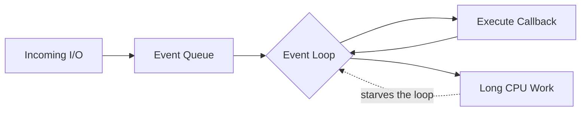
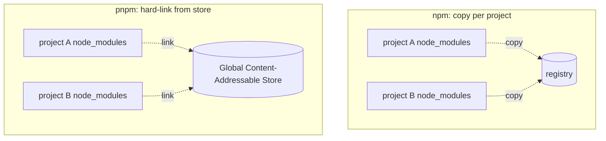
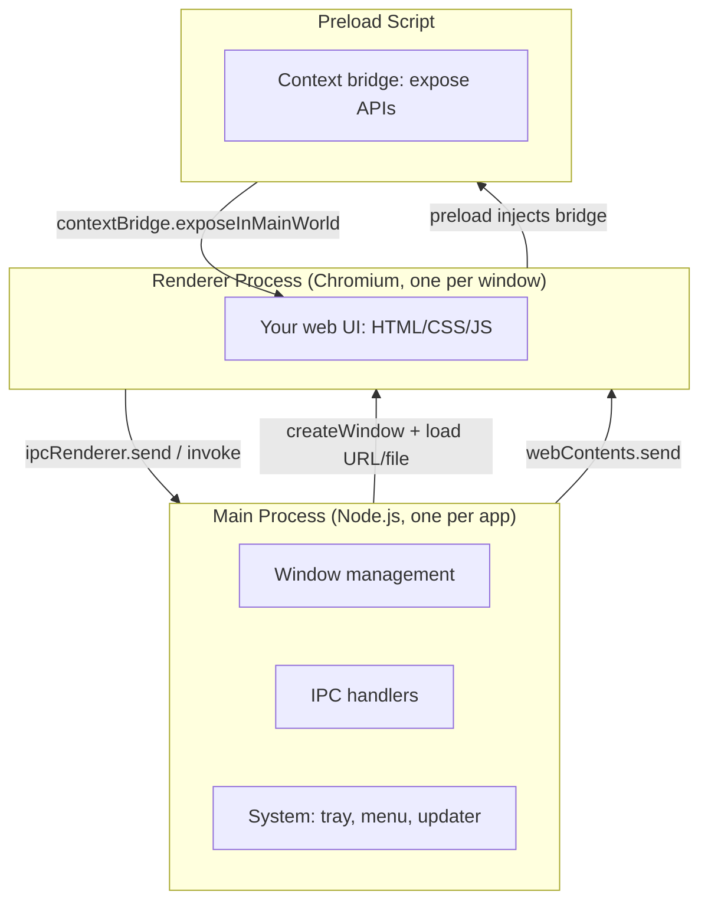

# TypeScript 技术文档

> 通用的 TypeScript / Node.js / 包管理 / Electron 工程技术参考。
> 全文不依赖任何具体项目；示例均为自包含小片段。图表节点使用英文标签以保证渲染对齐。
> 自整理通用工程参考，无外部原文；整理日期 2026-10-16。

---

## 目录

**第一部分　TypeScript 语言**
1. [TypeScript 是什么](#1-typescript-是什么)
2. [核心类型系统](#2-核心类型系统)
3. [面向对象与组合](#3-面向对象与组合)
4. [工程化配置](#4-工程化配置)
5. [编译与打包](#5-编译与打包)

**第二部分　Node.js 运行时**
6. [事件循环与并发模型](#6-事件循环与并发模型)
7. [子进程](#7-子进程)
8. [模块系统](#8-模块系统)

**第三部分　包管理与工程组织**
9. [package.json 全解](#9-packagejson-全解)
10. [npm vs pnpm](#10-npm-vs-pnpm)
11. [Monorepo 与 workspace](#11-monorepo-与-workspace)
12. [.npmrc 与全局路径](#12-npmrc-与全局路径)

**第四部分　桌面应用**
13. [Electron](#13-electron)

**附录**
- [常用命令速查](#附录-a-常用命令速查)
- [术语表](#附录-b-术语表中英对照)

---

# 第一部分　TypeScript 语言

## 1. TypeScript 是什么

### 1.1 定义

TypeScript（TS）是 JavaScript 的**超集**：在 JavaScript 语法之上增加静态类型系统，由微软维护，开源（Apache-2.0）。核心特性是 **类型只存在于编译期**——编译（擦除类型注解）后产出纯 JavaScript，运行时没有任何 TS 类型信息。

```ts
// 源码（.ts）
function add(a: number, b: number): number {
  return a + b
}
add(1, 2)     // OK
add("1", 2)   // 编译期报错：Argument of type 'string' is not assignable to parameter of type 'number'

// 编译产物（.js）——类型注解消失
function add(a, b) {
  return a + b
}
```

### 1.2 多范式定位

TS **不是**纯面向对象语言。它同时支持：

| 范式 | 支持方式 |
|---|---|
| 面向对象 | class、接口、继承、访问修饰符、抽象类 |
| 函数式 | 一等公民函数、高阶函数、闭包、不可变风格 |
| 泛型编程 | 泛型函数/类/约束（`extends`） |
| 结构化类型 | 类型按「形状」匹配，不按名义继承匹配 |

与 Java/C# 的关键区别：TS 没有「一切皆类」的强制约定，类型系统的主体是**结构化类型推断**而非类层级。现代 TS 工程的主流风格是「类做生命周期壳 + 函数/闭包做逻辑 + 类型系统做契约」，深层继承树反而少见。

### 1.3 何时值得引入

- 中大型工程（多人协作，接口契约需要机器校验）；
- 库/SDK 开发（发布 d.ts 提升消费方体验）；
- 重构频繁的代码base（编译器帮你找到所有受影响的调用点）；
- 反例：几十行的脚本、原型验证——TS 的编译配置是净成本。

---

## 2. 核心类型系统

### 2.1 基础类型与结构化类型

```ts
let count: number = 42
let name: string = "dsh"
let done: boolean = false
let anything: unknown = null      // unknown：比 any 安全，使用前必须收窄
let list: string[] = ["a", "b"]
let pair: [string, number] = ["a", 1]

// 结构化类型：形状相同即兼容，与类名无关
interface Point { x: number; y: number }
function draw(p: Point) { /* ... */ }
draw({ x: 1, y: 2 })   // OK——对象字面量形状匹配即可，不需要 "implements"
```

**结构化类型**是 TS 与 Java「名义类型」最大的差异：类型兼容看字段形状，不看继承声明。这鼓励「定义小接口、按需消费」的风格（接口隔离）。

### 2.2 接口 vs 类型别名、联合类型与判别联合

```ts
interface User { id: string; name: string }   // 接口：可声明合并、extends 扩展
type Id = string | number                      // 类型别名：任意类型运算

// 判别联合（discriminated union）——TS 最强大的模式之一
type Result =
  | { kind: "ok"; value: string }
  | { kind: "error"; message: string }

function handle(r: Result): string {
  switch (r.kind) {                 // 按 kind 收窄
    case "ok":    return r.value     // 此分支 r 自动是 ok 形状
    case "error": return r.message
  }
}
```

**判别联合**是建模「有限状态」的标准手法：把「请求成功或失败」「回合进行中或已结束」这类互斥状态编码成带判别字段的联合类型，switch 之后编译器自动收窄字段访问。大型 TS 代码库中大量出现 `assertNever` 兜底未穷尽分支：

```ts
function assertNever(x: never): never {
  throw new Error(`unexpected: ${JSON.stringify(x)}`)
}
// switch 后加 default: return assertNever(x)
// ——新增一种 kind 时，编译期就会报错提醒补分支
```

### 2.3 泛型

```ts
// 泛型函数
function first<T>(arr: T[]): T | undefined {
  return arr[0]
}
first([1, 2, 3])        // T 推断为 number

// 约束
interface HasId { id: string }
function findById<T extends HasId>(list: T[], id: string): T | undefined {
  return list.find(item => item.id === id)
}

// 常用内置工具类型
type PartialUser = Partial<User>        // 所有字段可选
type UserPreview = Pick<User, "id">     // 只取部分字段
type UserInput = Omit<User, "id">       // 去掉部分字段
type Dict = Record<string, number>      // 键值映射
```

原则：**泛型解决「形状复用」，不要用它做运行时逻辑**——泛型全部擦除，不产生任何运行时代码。

### 2.4 类型收窄（Narrowing）

编译器根据控制流自动收窄类型的能力：

```ts
function log(value: string | number | null) {
  if (value === null) return          // 空值收窄
  if (typeof value === "string") {    // typeof 收窄
    value.toUpperCase()
    return
  }
  value.toFixed(2)                    // 此处自动是 number
}

// in 收窄
function size(x: { width: number } | { height: number }) {
  if ("width" in x) return x.width
  return x.height
}

// 自定义类型守卫
function isString(x: unknown): x is string {
  return typeof x === "string"
}
```

### 2.5 类型体操的边界

映射类型、条件类型、模板字面量类型可以做出很强的类型运算（从路由字符串推断参数类型等），但有两条实践边界：

1. **可读性优先**：超过三层的类型嵌套通常意味着该抽一个命名类型；
2. **错误信息友好**：复杂类型报错会展开成天书，公共 API 的类型应「在定义处复杂、在使用处简单」。

---

## 3. 面向对象与组合

### 3.1 class 基础

```ts
abstract class Service {
  protected name: string
  constructor(name: string) { this.name = name }
  abstract start(): void              // 抽象方法
  stop(): void { /* 基类实现 */ }
}

class Server extends Service {
  private port: number
  constructor(name: string, port: number) {
    super(name)
    this.port = port
  }
  override start(): void { /* ... */ }  // override 关键字显式声明覆写（noImplicitOverride 需要）
}
```

访问修饰符：`public`（默认）/ `private` / `protected` / `readonly`。TS 的 `private` 是**编译期**的——运行时仍可访问（与 Java 不同），真正的运行时私有要用 JS 原生 `#field`。

### 3.2 何时用类、何时用函数

| 场景 | 倾向 |
|---|---|
| 有生命周期（创建/启动/销毁）、要被多处引用的状态机 | **类**（做容器） |
| 纯计算、转换、工具逻辑 | **函数**（可测试、可 tree-shake） |
| 需要「可撤销的注册」 | **闭包 + 返回 disposer 函数** |
| 模块级单例 | 导出 const 对象/函数，避免强制实例化 |

现代 TS 生态（React 生态、构建工具、无服务器函数）明显偏向函数式 + 组合。类的合理用法通常是「资源/生命周期容器」，而不是业务逻辑的继承层级。

### 3.3 装饰器

装饰器（Decorator）是「给类/方法/属性附加元数据或行为」的语法。历史上有两套：

- **legacy 装饰器**（TS 5.0 前默认，`experimentalDecorators`）：Angular/NestJS 等大量使用；
- **stage-3 标准装饰器**（TS 5.2+ 支持）：语义与 legacy 不同，新项目应使用标准版或直接用其他元编程手段。

理解概念即可：装饰器本质是**编译期/求值期的函数调用**，用于注册（如 NestJS 的 `@Controller()` 把类注册进路由表）。很多框架正在从装饰器转向「显式注册函数」，因为后者对 tree-shaking 和静态分析更友好。

---

## 4. 工程化配置

### 4.1 tsconfig.json 关键项

```jsonc
{
  "compilerOptions": {
    "target": "ES2022",              // 产出的 JS 语法版本
    "module": "ESNext",              // 模块语法
    "moduleResolution": "bundler",   // 模块解析策略（见 4.3）
    "strict": true,                  // 一组严格检查的总开关（必开）
    "noUncheckedIndexedAccess": true,// 索引访问返回 T | undefined
    "exactOptionalPropertyTypes": true,
    "noImplicitOverride": true,
    "declaration": true,             // 产出 .d.ts
    "sourceMap": true,               // 产出 source map
    "outDir": "lib"                  // 产物目录
  }
}
```

`strict: true` 包含 `noImplicitAny`、`strictNullChecks` 等十余项。**任何严肃项目都应开启**——关掉 strict 的 TS 只是一层会骗人的类型注解。

### 4.2 增量编译与 project references

大型 monorepo 不能用一个巨型 `tsc` 项目编译全部代码（慢、无法增量）。TS 的解法是 **project references**：

```jsonc
// 子包 tsconfig.json
{
  "compilerOptions": { "composite": true, "rootDir": "src", "outDir": "lib/types" },
  "references": [{ "path": "../other-package" }]   // 声明依赖的项目
}
```

```sh
tsc -b          # build 模式：按依赖图拓扑序增量编译所有引用项目
tsc -b --force  # 强制全量
```

`composite: true` 的项目产出 `.tsbuildinfo`，依赖没变就跳过。monorepo 的标准组织是「根 solution 文件只做引用、不做 include；每个子包一个项目」。

### 4.3 ESM vs CJS

Node 有两套并存的模块系统：

| | CommonJS (CJS) | ES Modules (ESM) |
|---|---|---|
| 语法 | `require()` / `module.exports` | `import` / `export` |
| 文件后缀 | `.js`（默认）/ `.cjs` | `.mjs`，或 `package.json` 里 `"type": "module"` 后的 `.js` |
| 解析时机 | 运行时动态解析 | 静态分析（利于 tree-shaking） |
| 顶层 await | 不支持 | 支持 |

实践建议：

- **新项目一律 ESM**（`"type": "module"`），Node ≥ 22 已完全成熟；
- 需要兼容老 CJS 消费者时用条件导出（`exports` 的 `import` / `require` 双入口）；
- TS 侧 `moduleResolution: "bundler"` 适合被打包器消费的库；写 Node 原生库用 `"NodeNext"`（强制你写完整的相对路径扩展名，如 `./utils.js`）。

### 4.4 声明文件与 @types

`.d.ts` 是纯类型文件，不产出 JS。三种来源：

1. 自己的包：`"declaration": true` 编译生成；
2. 第三方库自带（库作者发布时附带）；
3. DefinitelyTyped 社区维护，装成 `@types/<name>`（如 `@types/node`）。

`@types` 只在开发期使用，不进 `dependencies`（应放 `devDependencies`）。

---

## 5. 编译与打包

### 5.1 tsc 的角色

`tsc` 做两件事：**类型检查** + **把 TS 转成 JS（+ d.ts）**。它**不做打包**——每个源文件产出对应的产物文件，import 关系原样保留。所以：

- 写 Node 原生库（消费方自己解析 node_modules）：tsc 产物就够；
- 写浏览器代码或要优化产物：需要打包器。

### 5.2 打包器（Bundler）角色

| 工具 | 定位 | 特点 |
|---|---|---|
| esbuild | 极速打包/转译 | Go 实现，比 tsc 快 10~100 倍，不做深度类型检查 |
| Rollup | 库打包 | tree-shaking 优秀，ESM 输出质量高 |
| Vite | 应用开发/构建 | 开发期靠浏览器原生 ESM + esbuild 转译，生产用 Rollup |
| webpack | 传统应用打包 | 生态最大，配置最复杂 |
| tsdown | 现代库打包 | 基于 Rolldown，TS 友好，逐渐流行 |

典型现代分工：**tsc 负责类型检查与 d.ts 生成，打包器负责运行时产物**。很多项目用 `tsc --noEmit` 只查类型，另用 esbuild/tsdown 出产物。

### 5.3 source map 与调试

source map 是产物 JS ↔ 源码 TS 的位置映射。调试器（Chrome DevTools、VS Code、Playwright）据此在断点时显示 TS 源码。注意事项：

- **链式 source map**：tsc 先产出 JS+map，打包器再打包时要把 tsc 的 map 接续到自己的 map 上（各打包器有对应插件），否则断点只能落到中间 JS；
- 生产环境是否发布 `.map` 是安全与排错的权衡（泄露源码 vs 可远程排错）。

---

# 第二部分　Node.js 运行时

## 6. 事件循环与并发模型

### 6.1 单线程事件循环

Node.js 的并发模型是**单线程 + 事件循环**：



- 所有 JS 代码（包括所有请求处理逻辑）在**一个线程**上交替执行；
- 等待网络/磁盘/定时器时线程不阻塞——I/O 操作被操作系统异步完成后，回调进入事件队列；
- **一段同步 CPU 代码会饿死整个循环**：单个请求算 500ms，所有其他请求都等 500ms。

事件循环分层（简化）：timers（setTimeout/setInterval）→ pending callbacks → poll（I/O）→ check（setImmediate）→ close。微任务（Promise.then、queueMicrotask）在每个宏任务之间清空。

### 6.2 「一请求一线程」对比

| | 传统线程模型（Java Servlet / PHP-FPM 经典配置） | Node 事件循环 |
|---|---|---|
| 并发单元 | 每请求一线程（或进程） | 单线程处理所有请求的回调 |
| 等 I/O 时 | 线程阻塞挂起，占内存（~1MB/线程栈） | 线程去处理别的请求 |
| 内存开销 | 高（线程多） | 低 |
| CPU 密集短板 | 可加线程并行 | 单线程被占满 → 需要外借并行 |
| 典型容量 | 数百~数千并发连接 | 数万并发连接（IO 密集场景） |

结论：**Node 适合 IO 密集（Web API、代理、流处理），不适合单进程内做重 CPU 计算**。

### 6.3 真并行的边界

JS 代码本身无法在主进程内并行。需要真并行时：

1. **worker_threads**：同进程多线程，共享内存（SharedArrayBuffer），适合 CPU 密集小任务（图像处理、压缩）；
2. **子进程**：独立进程，隔离彻底，适合运行不同信任级别的代码、调用原生程序（见第 7 章）；
3. **外部服务**：把重活（推理、转码）交给另一个服务，本进程只做编排。

选择口诀：**共享数据的 CPU 活用 worker；跑外部程序/隔离故障域用子进程；能丢给专用服务的丢给服务**。

## 7. 子进程

### 7.1 child_process 四件套

| API | 形态 | 典型用途 |
|---|---|---|
| `spawn(cmd, args)` | 子进程 + stdio 流 | **首选**：执行外部程序，流式读输出 |
| `exec(cmd)` | `sh -c "cmd"` + 缓冲输出 | 短命令、需要 shell 语法时；有输出大小上限 |
| `execFile(file, args)` | 直启可执行文件 + 缓冲输出 | 不需要 shell 语义的短命令 |
| `fork(module)` | 拉起 Node 子模块 + IPC 通道 | 多进程 Node 应用（如 CPU 池） |

```ts
import { spawn } from "node:child_process"

const child = spawn("git", ["log", "--oneline"], { stdio: ["ignore", "pipe", "pipe"] })
let out = ""
for await (const chunk of child.stdout) out += chunk
const code = await new Promise(r => child.on("close", r))
```

### 7.2 shell true 的代价

`spawn(cmd, { shell: true })` 会把命令拼成字符串交给 `/bin/sh -c` 执行。危险在于：

```ts
// 反例：用户输入拼进 shell 字符串
const filename = getUserInput()          // 假设是 "report.pdf; rm -rf /"
spawn(`convert ${filename} out.png`, { shell: true })
// → sh 实际执行两条命令：convert report.pdf  以及  rm -rf /

// 正解：argv 数组直启，用户输入永远只是一个参数
spawn("convert", [filename, "out.png"])   // filename 里的分号只是参数内容
```

`shell: true` 除了注入风险，还有转义地狱（Windows 与 POSIX 引号规则不同）、无法审计参数边界、每次 spawn 多一个 shell 进程等成本。

### 7.3 实践原则

1. **默认 `spawn` + argv 数组**，永远不要把不可信输入拼进 shell 字符串；
2. 只有当「执行的本来就是用户写的 shell 命令」（终端功能、构建脚本）时才显式过 shell；
3. 沙箱/审计场景记录 argv 原样即可，经 shell 后语义被解释过一层，难以还原；
4. 注意 `windowsHide`、超时 kill（`setTimeout` + `child.kill('SIGKILL')`）、以及 `close` 事件收集退出码。

## 8. 模块系统

### 8.1 import/export 要点

```ts
import defaultExport from "./mod.js"      // 默认导出
import { namedA, namedB as b } from "./mod.js"   // 具名 + 重命名
import * as all from "./mod.js"           // 命名空间
import type { Foo } from "./types.js"    // 纯类型导入（编译期擦除，不产生运行时依赖）
const lazy = await import("./heavy.js")  // 动态 import（按需加载）
```

`import type` 与 `verbatimModuleSyntax`：类型-only 的导入必须显式标记，否则打包器可能错误地保留一个运行时不存在的模块依赖。

### 8.2 解析与幽灵依赖

- **CJS 的 node_modules 提升**：依赖树中出现的包被提升到顶层 `node_modules`，导致「我没声明也能 require 到」的**幽灵依赖**——本地能跑、发布后消费方安装布局不同就崩；
- **严格布局**（pnpm 默认）：每个包的 `node_modules` 只含它**显式声明**的依赖（符号链接指向全局仓库），幽灵依赖在开发机上就暴露。

---

# 第三部分　包管理与工程组织

## 9. package.json 全解

`package.json` 是 Node 包的清单：**你是谁、你要什么、你能跑什么、你发布什么**。

### 9.1 身份字段

```jsonc
{
  "name": "@scope/package-name",   // 包名（scope 可选但推荐）；发布后的唯一标识
  "version": "1.2.3",              // 语义化版本（semver）
  "description": "…",
  "license": "MIT",
  "type": "module"                 // 此目录 .js 按 ESM 还是 CJS 解析
}
```

semver 约定：`1.2.3` = 主版本.次版本.修订号；`^1.2.3` 允许次版本与修订升级；`~1.2.3` 只允许修订升级；`1.x` / `*` 等范围写法。

### 9.2 入口与导出

```jsonc
{
  "main": "./lib/index.js",           // 传统入口（CJS 时代遗留，建议保留兼容）
  "types": "./lib/index.d.ts",        // 类型入口
  "bin": { "mycli": "./bin/cli.js" }, // 安装后暴露的可执行命令
  "files": ["lib", "bin"],            // 发布到 npm 时包含的路径（白名单，没列的不上传）
  "exports": {                        // 现代子路径导出表（优先于 main）
    ".": { "import": "./lib/index.js", "types": "./lib/index.d.ts" },
    "./plugin": "./lib/plugin.js"     // 只有这里声明的子路径才能被 import
  }
}
```

`exports` 是**白名单**：没写进 exports 的内部文件，消费方 `import` 时直接解析失败——这是封装内部实现的关键机制。

### 9.3 依赖分类

| 字段 | 语义 | 什么时候用 |
|---|---|---|
| `dependencies` | 运行时必需，随包发布安装 | 你的代码 `import` 且用户运行时需要 |
| `devDependencies` | 仅开发期 | 测试框架、打包器、类型包 |
| `peerDependencies` | 要求宿主环境提供（不自动安装） | 插件类包声明宿主框架版本 |
| `optionalDependencies` | 装不上也不失败 | 原生 addon 的跨平台可选包 |
| `bundledDependencies` | 随包 tarball 一起发布 | 极少用 |

判断口诀：**发布产物里 import 的 → dependencies；只在开发流程用的 → dev；希望「只有一份实例」的框架 → peer**。

### 9.4 scripts 与生命周期钩子

```jsonc
{
  "scripts": {
    "build": "tsc -b",
    "test": "vitest run",
    "prepublishOnly": "pnpm run build"    // 发布前自动执行
  }
}
```

常用钩子：`preinstall` / `install` / `postinstall`（安装后；供应链安全敏感点，很多仓库限制执行）、`prepack`、`prepublishOnly`。`pnpm run <name>` 执行 scripts；后面传参需 `--`：`pnpm run test -- --watch`。

### 9.5 engines 与 packageManager

```jsonc
{
  "engines": { "node": ">=22" },          // 声明运行环境要求（配合 engine-strict 才强制）
  "packageManager": "pnpm@9.0.0"          // corepack 按此锁定包管理器版本
}
```

`packageManager` 字段 + `corepack enable` 可以保证团队所有人（和 CI）使用完全相同的包管理器版本。

## 10. npm vs pnpm

### 10.1 依赖落盘方式



- **npm（经典）**：每个包目录里物理复制依赖 → 相同依赖在磁盘上存 N 份，安装慢；
- **pnpm**：全局**内容寻址仓库（store）**只存一份文件内容，项目 `node_modules` 里是硬链接 → 省磁盘、安装快（只建链接）、重复安装秒级完成。

### 10.2 结构差异与幽灵依赖

- npm 默认把依赖树**提升**（hoist）到顶层 `node_modules`：能 import 到未声明的间接依赖（幽灵依赖）；
- pnpm 的 `node_modules` 是严格结构：`.pnpm` 虚拟目录 + 每包符号链接，**只能访问显式声明的依赖**。幽灵依赖在开发期就报 `ERR_MODULE_NOT_FOUND`。

### 10.3 lockfile

| 包管理器 | 锁文件 |
|---|---|
| npm | `package-lock.json` |
| pnpm | `pnpm-lock.yaml` |
| yarn | `yarn.lock` |

lockfile 锁定**整个依赖图的精确版本与完整性哈希**，是可重现安装的基础。CI 中配合缓存 store 目录可大幅提速。CI 应使用 `pnpm install --frozen-lockfile`（lockfile 与 manifest 不一致直接失败）。

## 11. Monorepo 与 workspace

### 11.1 概念

Monorepo = 多个包放在一个仓库。包管理器的 **workspace** 功能让这些包互相以本地链接引用，而不需要先发布：

```yaml
# pnpm-workspace.yaml（仓库根）
packages:
  - "packages/*"
  - "apps/*"
```

```jsonc
// packages/ui/package.json
{
  "name": "@myorg/ui",
  "dependencies": {
    "@myorg/utils": "workspace:*"    // 本地链接协议：安装时解析为 workspace 内的包
  }
}
```

`workspace:*` 是 pnpm/yarn 的协议：发布时**自动替换**为真实版本号（如 `"1.2.3"`），开发时用本地源码链接。

### 11.2 过滤与递归执行

```sh
pnpm --filter @myorg/ui run build    # 只构建指定包
pnpm --filter @myorg/ui... run test  # 该包 + 所有依赖它的包
pnpm -r run lint                     # 对所有 workspace 包递归执行
pnpm ls --depth -1                   # 列出所有 workspace 包
```

`--filter` 支持包名、路径 glob（`./packages/*`）、拓扑（`...pkg` 依赖它的、`pkg...` 它依赖的）。

### 11.3 何时用、何时不用

**适合**：多端共享核心逻辑；一仓库原子提交跨包改动；统一工具链与版本。

**不适合**：包之间耦合极深无法独立发布；团队完全没有 workspace 工具经验；只想「代码分层」——那用目录分层 + 单包就够了，不需要多包。

配套设施成本要有预期：project references 的 tsconfig 维护、CI 变更检测（按改动路径选测试）、发布顺序编排（拓扑序发包）。这些是一次性投入，但不是零。

## 12. .npmrc 与全局路径

### 12.1 配置文件

`.npmrc` 是 npm 系工具（含 pnpm）的配置文件，常见项：

```ini
registry=https://registry.npmmirror.com/   # 镜像源
store-dir=/path/to/pnpm-store              # pnpm 全局内容仓库位置
prefix=/path/to/global                      # 全局包安装位置（npm）
fund=false
audit=false
```

### 12.2 优先级

```
CLI flags  >  环境变量 (npm_config_*)  >  项目 .npmrc  >  用户 ~/.npmrc  >  全局 /etc/npmrc  >  内置默认
```

项目级 `.npmrc` 随仓库提交（团队统一 registry/store）；用户级放个人偏好。

### 12.3 全局路径速查

```sh
pnpm store path            # 全局内容仓库位置
pnpm root -g               # 全局安装的包目录
pnpm bin -g                # 全局可执行命令目录（加进 PATH 即可用全局命令）
npm root -g                # npm 的对应位置
```

**注意区分**：`pnpm install`（装当前项目依赖）≠ `pnpm add -g`（装到用户级全局、提供全局命令）。pnpm 的「全局」还常指**所有项目共享的 store 缓存**——它是文件去重仓库，不是运行环境。

### 12.4 CI 缓存实践

```yaml
# 典型 GitHub Actions 片段
- run: corepack enable && pnpm install --frozen-lockfile
- uses: actions/cache@v4
  with:
    path: $(pnpm store path)   # 缓存 store 而不是 node_modules
    key: pnpm-${{ hashFiles('pnpm-lock.yaml') }}
```

缓存 store 比缓存 `node_modules` 更稳（后者含符号链接，跨 runner 恢复易损坏）。

---

# 第四部分　桌面应用

## 13. Electron

### 13.1 是什么

Electron 是用 Web 技术构建桌面应用的运行时/框架（GitHub 发起，现 Microsoft 维护）。核心构成：**Chromium（渲染）+ Node.js（系统能力）**。VS Code、Slack、Discord、Figma 桌面版等都是 Electron 应用。

价值主张：一套 Web 技术栈 → Windows/macOS/Linux 三端原生窗口 + 文件系统/托盘/菜单/通知等系统集成 + 自带 Node 运行时（用户无需安装 Node）。

代价：每个应用自带一份 Chromium（安装包通常 100MB+）、内存占用高于原生或系统 WebView 方案（Tauri）。

### 13.2 三进程模型



| 进程 | 跑什么 | 权限 |
|---|---|---|
| **Main** | Node.js 代码（你的主进程入口） | 完整系统权限：开窗、文件、子进程、托盘、全局快捷键 |
| **Renderer** | 每个窗口一个 Chromium | 默认是浏览器沙箱（无 Node 全局） |
| **Preload** | 页面加载前运行的桥接脚本 | 在隔离世界里同时接触 Node API 与页面上下文 |

IPC（进程间通信）三种形态：`ipcMain`/`ipcRenderer`（消息通道）、`invoke`/`handle`（Promise 式请求-响应）、`contextBridge`（把受控 API 暴露给页面）。

### 13.3 安全基线

Electron 默认不安全配置被攻击的历史很多，现代模板的安全基线：

```js
// 主进程创建窗口时
new BrowserWindow({
  webPreferences: {
    contextIsolation: true,     // 隔离 preload 与页面世界（必须 true）
    nodeIntegration: false,     // 页面里不暴露 require/process（必须 false）
    sandbox: true,              // 渲染进程沙箱
  }
})
```

- **永不**把完整 Node API 暴露给页面；preload 只 `contextBridge.exposeInMainWorld` 受控的最小方法集；
- 所有 IPC 消息在主进程侧校验 **sender**（`event.senderFrame`、URL 匹配），防止被劫持的页面伪造调用；
- 关闭远程内容自由导航（`will-navigate` 拦截）、设置 CSP；
- 自定义协议优先于 `file://`（`protocol.handle` 注册私有 scheme，便于做权限边界）。

### 13.4 与替代方案对比

| 方案 | 渲染层 | 后端 | 体积 | 适用 |
|---|---|---|---|---|
| **Electron** | 自带 Chromium | 自带 Node | 大 | 需要完整 Node 生态、三端一致、离线桌面工具 |
| **Tauri** | 系统 WebView | Rust（可调 Node/侧车） | 小 | 注重安装包体积、安全面小 |
| **PWA** | 用户浏览器 | 无 | 最小 | 纯 Web 能力、无深系统集成 |
| **原生（Swift/C#/…）** | 原生 UI | 原生运行时 | 最小 | 平台专属、极致体验 |

选型核心问题：**你的「后端」逻辑是否必须与 UI 同机、同应用分发？** Electron 的独特优势是「应用 = 前端 + 同分发的 Node 运行时」，适合本体就是 Node 服务、前端已是 SPA 的产品做桌面化——把已有两端装进一个壳。

### 13.5 开发与分发速览

```sh
npm create electron my-app        # 脚手架
npx electron .                    # 开发运行
# 分发：
# electron-builder / electron-forge 把应用 + node_modules + 运行时
# 打成 dmg（macOS）、nsis exe（Windows）、AppImage/deb（Linux）
# macOS 需要代码签名 + 公证（notarization）；Windows 建议代码签名证书
```

主进程代码通常还要经过打包（esbuild/rollup）成单文件——因为 electron-builder 只会把 `dependencies` 拷进 asar，devDependencies 不会随包发布。

---

# 附录 A　常用命令速查

```sh
# —— npm ——
npm init -y
npm install                    # 按 lockfile 安装
npm install <pkg> -S           # → dependencies
npm install <pkg> -D           # → devDependencies
npm install -g <pkg>           # 全局安装
npm run <script>
npm outdated
npm view <pkg>                 # 查 registry 上的信息

# —— pnpm（对应关系：install→install，i→add，npm run→pnpm run）——
pnpm install
pnpm add <pkg> / pnpm add -D <pkg> / pnpm add -g <pkg>
pnpm remove <pkg>
pnpm --filter <pkg> run <script>
pnpm -r run <script>
pnpm exec <bin>                # ≈ npx
pnpm dlx <pkg>                 # 临时运行（不写入项目）
pnpm store path
pnpm why <pkg>                 # 查依赖来源

# —— TypeScript ——
tsc --init                     # 生成 tsconfig
tsc -b                         # 按 project references 增量构建
tsc -b --force
tsc --noEmit                   # 只检查类型不产出

# —— Node ——
node --watch app.ts            # 监听重启（Node ≥ 22 可直接跑 TS：--experimental-strip-types）
node --inspect app.ts          # 打开调试端口
```

# 附录 B　术语表（中英对照）

| 英文 | 中文 | 一句话解释 |
|---|---|---|
| package manager | 包管理器 | npm / pnpm / yarn，安装与分发 Node 包 |
| workspace / monorepo | 工作区 / 单仓多包 | 一个仓库管理多个互相链接的包 |
| lockfile | 锁文件 | 锁定完整依赖图版本，保证可重现安装 |
| hoisting | 提升 | 把依赖上移到顶层 node_modules |
| phantom dependency | 幽灵依赖 | 能 import 但未显式声明的依赖 |
| semantic versioning (semver) | 语义化版本 | 主.次.修 版本约定 |
| peer dependency | 同级依赖 | 要求宿主提供的依赖（插件模式常用） |
| event loop | 事件循环 | Node 单线程调度异步回调的机制 |
| worker threads | 工作线程 | Node 内的多线程并行 |
| child process | 子进程 | 独立进程，用于隔离与外部程序调用 |
| source map | 源码映射 | 产物 JS ↔ 源码位置映射，供调试器使用 |
| ESM / CJS | ES 模块 / CommonJS | Node 两套模块系统 |
| type stripping | 类型剥离 | Node 直接运行 TS 的机制（去类型注解，不检查） |
| bundler | 打包器 | esbuild / Rollup / Vite / webpack |
| project references | 项目引用 | monorepo 增量编译的组织方式 |
| context isolation | 上下文隔离 | Electron 中 preload 与页面世界隔离 |
| IPC | 进程间通信 | Electron 主/渲染进程消息通道 |
| code signing / notarization | 代码签名 / 公证 | macOS/Windows 分发信任链 |

---

*本文档为通用技术参考，示例均可独立运行验证。TypeScript 与 Node 生态迭代快，关键配置项请以官方文档为准。*
